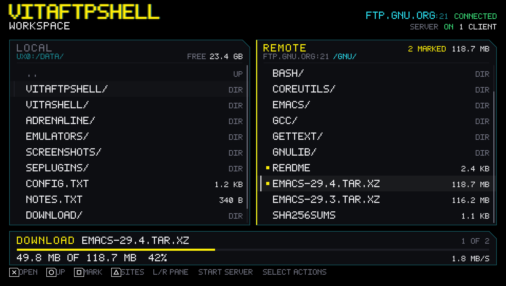

# vitaFTPShell

[](LICENSE)
[](https://github.com/ghostmeson/vitaftpshell/actions/workflows/ci.yml)


A twin-pane FTP workspace for the PS Vita. Browse a saved FTP site and the
console's own storage side by side, then move files between them without leaving
the console. The same app can serve the mounted `ux0:`, `ur0:`, and `uma0:`
volumes as an anonymous read-write FTP server while it is open.

The interface is a 960x544 Cyberpunk HUD built for the controller: two live
ledgers, a transfer dock, and no pointer.



*Design mockup of the settled WORKSPACE screen. This is a design render, not a
hardware screenshot.*

## Status

**Pre-alpha: the app builds and the screens and runtime are linked, but it has
not run on hardware.** Strategy, requirements, screen design, architecture, and
the protocol policy are complete. The FTP client and server engines, the
transfer queue, the local operation planner and executor, the input reducer with
its UI state, the cross-thread handoff, the seven screen surfaces, the six Vita
adapters, the app/worker runtime, the path policy, and the host test harness are
implemented and tested on the host. The first console launch is Phase 6 (U14).

Implemented and covered by host tests today:

- the passive FTP client state machine: resolve, greeting, anonymous or stored
  login, FEAT, MLSD with LIST fallback, browse, RETR, STOR, MKD, RNFR/RNTO,
  DELE, RMD, QUIT, cancel, per-stage deadlines, and the five cause classes;
- the anonymous passive FTP server state machine: control port plus one, one
  client slot, the command table, MLST/SIZE/MDTM, MLSD/LIST/NLST, templed STOR,
  MKD/RMD/DELE/RNFR/RNTO, ABOR, the 450 busy reply, and data peer checking;
- one ordered transfer queue with one active slot, a single busy fact, the R41
  conflict decision recorded once per batch, and a latched terminal outcome;
- the pure local operation planner: recursive copy, move, delete, mkdir and
  rename; parent-before-child order; merge; copy-into-itself refusal; protected
  paths; conflict gate; and per-step risk flags;
- the executor: templed writes, destination sync, aside recovery, rollback,
  per-file cross-volume moves, and `DELETED n OF m` on a partial recursive
  delete;
- the input repeat decoder, the one-writer UI reducer with every settled screen
  transition, and the command vocabulary, including the high-risk confirmation;
- the cross-thread handoff: fixed-record command and event rings, critical
  stop/cancel slots, a coalesced progress latch, three listing generations per
  pane, a bulk lane, and a latched server state;
- canonical path, protected-path, denial, and risk policy; MLSD, Unix, and DOS
  listing parsers; reply and passive-mode parsing; the site book, settings,
  atomic store, and typed session-log events;
- the COCKPIT-derived graphics base and the settled seven-surface layout table;
- the WORKSPACE, SITES, SITE EDITOR, SERVER, ACTIONS, CONFIRM, and TEXT ENTRY
  screens, drawn from `UiState` alone, with the settled geometry and copy;
- the six Vita adapters: NetPort over sceNet and the BSD socket calls, FsPort
  over sceIo, InputPort over SceCtrl, TextInputPort over the system IME, the
  monotonic ClockPort, and the rotating LogPort;
- the app/worker split: the app owns the frame loop and the one writer of
  `UiState`; the worker owns the client, server, queue, local executor, site
  book, settings, and log, and exchanges fixed records across the handoff.

Roadmap and the single next action live in [`PROJECTS.md`](PROJECTS.md). The
behavior contract is
[`docs/plans/2026-11-08-1103-feat-vitaftpshell-v1-plan.md`](docs/plans/2026-11-08-1103-feat-vitaftpshell-v1-plan.md).

## What v1 will do

| Role | Behavior |
|---|---|
| **FTP client** | Saved sites with anonymous or login credentials, passive FTP only, remote browsing, download, upload, create, rename, and delete. MLSD first, LIST fallback, Unix and DOS listings. |
| **File manager** | Browse the mounted `ux0:`, `ur0:`, and `uma0:` volumes, multi-select, recursive folder copy, move, and delete, with protected-path rules and explicit confirmations. |
| **FTP server** | Anonymous read-write FTP on the mounted volumes while the app is open. OFF at launch, one client at a time, with the ON state and client count visible on every screen. |
| **Transfer dock** | One active transfer, the rest queued. Progress, size, speed, retry, and cancel without blocking the workspace. |

Not in v1: SFTP, FTPS, HTTP, WebDAV, SMB, resume, sync, background transfers,
multiple simultaneous transfers, multiple server clients, or a credential vault.

## Build

### Prerequisites

- A PS Vita on 3.65 with Enso. PSTV is out of scope.
- [VitaSDK](https://vitasdk.org/) 2026.08, including `libvita2d`.
- CMake 3.16 or newer.
- For the host tests only: a POSIX shell, a C99 compiler, and zlib.

```sh
export VITASDK=/path/to/vitasdk
export PATH="$VITASDK/bin:$PATH"

./build.sh
```

`build.sh` emits exactly one `vitaftpshell-v01.00-b<build>.vpk` in `build/`, plus
the unstripped ELF. `BUILD_NUMBER` is committed and monotonic: a rebuild with
unchanged packaged inputs reuses the number, and a changed input increments it.
`build/` is pruned to one artifact so "which build is on the Vita?" has one
answer.

### Host checks

The policy and graphics layers run without VitaSDK:

```sh
./tools/test/run.sh        # layering guard + nineteen host suites
./tools/preview/run.sh     # renders 36 settled states to build/preview/
```

The test runner compiles the real core, screens, and runtime against fake
network, filesystem, input, IME, clock, and log ports. The render suites assert
the recorded draw calls and strings at the settled geometry; the integration
suite drives the real reducer and worker through connect, list, mark, download,
cancel, a failed site save, shutdown with an active transfer, and quit with the
server on. The layering guard fails if any file under `src/` outside the seven
documented adapter files includes a `psp2/` or `vita2d.h` header.

### Install

With VitaShell's FTP server running on the console:

```sh
./send.sh <vita-ip>
```

`send.sh` uploads the current VPK and refuses an artifact whose build number does
not match `BUILD_NUMBER`, so a failed build cannot silently send the previous
file. To install manually, copy the VPK from `build/` to `ux0:data/` and open it
in VitaShell.

Installing requires **Enable Unsafe Homebrew**. The server and the local file
manager need unrestricted access to `ur0:` and `uma0:`, which the safe authid
refuses (D32).

> The current VPK only launches and exits. See [Status](#status).

## Safety model

These are product rules, enforced in the policy layer and the screens as they
land:

- The server is **OFF at launch**. Starting it is an explicit action, and its ON
  state and client count stay visible. The warning states that anonymous clients
  can read and write the exposed volumes and that the app data folder is
  excluded.
- The server denies all access to `ur0:tai/boot_config.txt` and to the app's own
  data folder, and denies every write, create, rename, and delete under
  `ur0:tai` and `ux0:tai`.
- The local manager may write inside `ur0:tai` and `ux0:tai` only behind a
  high-risk confirmation. Nothing in the app writes, renames, or deletes
  `boot_config.txt`.
- Volume roots, `ur0:data`, `ux0:data`, and the `tai` folders cannot be renamed,
  moved, or deleted. Every check uses the canonical path, and a rename checks
  both operands.
- Every destructive action confirms and names its items. Cancel changes
  nothing.
- Saved passwords are stored unencrypted on the console and are never written to
  the session log.
- One transfer is active at a time; a server-side transfer uses the same slot.
- No kernel plugin, taiHEN payload, `*KERNEL` entry, or boot-time component.
- Downloads and uploads write a `.vftp.part` file, sync, and rename into place;
  a failed transfer never leaves a partial file looking complete.

## Architecture

Source dependencies point inward, toward policy. The core compiles and runs on
the host without a Vita header.

| Layer | Path | Holds |
|---|---|---|
| Policy | `src/core/` | FTP client/server, listing parsing, path and risk rules, site book, settings, store, log events |
| Platform ports | `src/platform/*.h` | Plain-C contracts for net, filesystem, input, text entry, clock, and log |
| Platform adapters | `src/platform/psp2_*.c` | SceNet, sceIo, SceCtrl, IME, clock, and log (U12) |
| Renderer | `src/gfx/` | Theme, font, and draw primitives |
| Presentation | `src/ui/` | Draws `UiState` and maps input to commands (U10/U11) |
| Runtime | `src/app/` | Frame loop, worker thread, rings, and snapshot handoff (U13) |
| Composition | `src/main.c` | Constructs adapters and starts the runtime |

One worker thread owns every long operation; the main thread owns only the UI.
One writer owns each piece of shared state. See
[`docs/ARCHITECTURE.md`](docs/ARCHITECTURE.md) for the ports, the data phase, the
threading handoff, and the path/denial table.

### Repository map

```text
src/core/        portable policy: protocol engines, parsers, path rules, store
src/gfx/         theme, font, draw, and the settled layout table
src/ui/          the seven screens, the dock, legends, and the renderer
src/app/         frame loop, the one worker, and the handoff consumer
src/platform/    plain-C port contracts and the six psp2_* adapters
src/main.c       composition root; constructs adapters and starts the app
tools/test/      layering guard, host suites, and the app/worker integration test
tools/fake/      controllable NetPort, FsPort, input, IME, clock, log, and FTP peers
tools/preview/   software vita2d shim and the 960x544 preview
docs/            architecture, design, decisions, plan, third-party notices
sce_sys/         placeholder LiveArea art
```

## Documentation

| Document | Contents |
|---|---|
| [`STRATEGY.md`](STRATEGY.md) | Why the product exists, who it serves, boundaries, and metrics |
| [`docs/plans/2026-11-08-1103-feat-vitaftpshell-v1-plan.md`](docs/plans/2026-11-08-1103-feat-vitaftpshell-v1-plan.md) | Requirements, key decisions, implementation units, verification contract |
| [`PROJECTS.md`](PROJECTS.md) | Current phase, last job, next action, and the decision log |
| [`docs/ARCHITECTURE.md`](docs/ARCHITECTURE.md) | Layers, ports, threading, handoff, and module rules |
| [`docs/DESIGN.md`](docs/DESIGN.md) | The settled layout, states, and input |
| [`docs/DECISIONS.md`](docs/DECISIONS.md) | Numbered decisions with context and consequences |
| [`docs/THIRD_PARTY.md`](docs/THIRD_PARTY.md) | Reused code, licenses, and protocol references |
| [`AGENTS.md`](AGENTS.md) | The project contract for agents and contributors |
| [`docs/README.md`](docs/README.md) | The documentation map |

## Contributing

vitaFTPShell is pre-alpha, and the screen layout and protocol behavior are
settled. Read [`AGENTS.md`](AGENTS.md) before changing code, open an issue for a
large change, and run the host checks before sending a pull request:

```sh
./tools/test/run.sh
./tools/preview/run.sh
```

A change that alters behavior must update the plan or add a numbered decision.
Never weaken the path denials or the server's OFF-at-launch rule.

## License

vitaFTPShell is free software under the **GNU General Public License, version
3.0 only**. See [`LICENSE`](LICENSE).

The graphics base under `src/gfx/` is adapted from COCKPIT, Copyright (c) 2026
Upakul Talukdar, and retains its MIT notice in
[`LICENSES/COCKPIT-MIT.txt`](LICENSES/COCKPIT-MIT.txt). VitaShell and
libftpvita are behavioral references only; no code from them is vendored.

## Credits

- [VitaSDK](https://vitasdk.org/) and `libvita2d` for the toolchain and renderer.
- [VitaShell](https://github.com/TheOfficialFloW/VitaShell) for the file-manager
  and server behavior this project learned from.
- [libftpvita](https://github.com/xerpi/libftpvita) for FTP server behavior
  reference.
- [RFC 959](https://www.rfc-editor.org/rfc/rfc959),
  [RFC 3659](https://www.rfc-editor.org/rfc/rfc3659), and
  [RFC 2428](https://www.rfc-editor.org/rfc/rfc2428) for the protocol.
