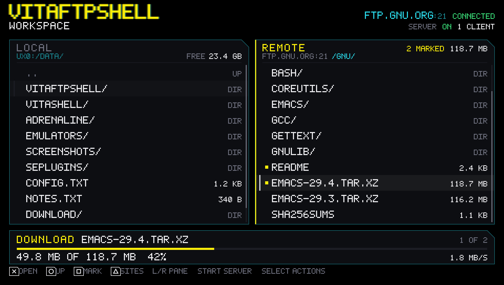

# vitaFTPShell

[](LICENSE)
[](https://github.com/ghostmeson/vitaftpshell/actions/workflows/ci.yml)

A twin-pane FTP workspace for the PS Vita. Browse a saved FTP site and the
console's own storage side by side, then move files between them without leaving
the console. The same app can serve the mounted `ux0:`, `ur0:`, and `uma0:`
volumes as an anonymous read-write FTP server while it is open.

The interface is a 960x544 Cyberpunk HUD built for the controller: two live
ledgers, a transfer dock, and no pointer.



*Design mockup of the settled WORKSPACE screen. This is a design render, not a
hardware screenshot.*

## Status

<!-- status:begin -->
`building`. vitaFTPShell is one PS Vita app with three roles: a passive FTP
client, a local file manager over every mounted user volume, and an anonymous
read-write FTP server on `ux0:`, `ur0:`, and `uma0:`. The seven screens, the
app/worker runtime, and the six Vita adapters are implemented, and the host
suites pass. The local workspace and the cross-pane folder transfer — recursive
download and upload, the verified move, the report, and the per-folder
read-only state — are host-complete. The console matrix runs once at v1 code
freeze (D95), so the project is `building`, not `verified`.

The live state and the single next action are on [the board](PROJECTS.md); the
hardware evidence is in [the evidence record](docs/VERIFICATION.md).
<!-- status:end -->

## What v1 will do

| Role | Behavior |
|---|---|
| **FTP client** | Saved sites with anonymous or login credentials, passive FTP only, remote browsing, download, upload, create, rename, and delete. MLSD first, LIST fallback, Unix and DOS listings. The folder transfer, its verified move, and `skipped.txt` are built on the host; the console rows are PENDING (R22/R23, D100). |
| **File manager** | Browse every mounted user volume (`ux0:`, `ur0:`, `uma0:`, `imc0:`, `gro0:`, `grw0:`, `app0:`), with `app0:` and `gro0:` read-only; a second local pane on the right; multi-select, local recursive folder copy, move, and delete, with protected-path rules and explicit confirmations. |
| **FTP server** | Anonymous read-write FTP on the mounted `ux0:`, `ur0:`, and `uma0:` volumes while the app is open. OFF at launch, up to four clients with one data transfer at a time, with the ON state and client count visible on every screen. |
| **Transfer dock** | One network transfer and one local job may run together, each with its own queue. Progress, size, speed, and cancel without blocking the workspace; a failed item is retried by running it again. |

Not in v1: SFTP, FTPS, HTTP, WebDAV, SMB, resume, sync, background transfers,
more than one network transfer or more than one local job at a time, or a
credential vault.

## Build

### Prerequisites

- A PS Vita on 3.65 with Enso. PSTV is out of scope.
- [VitaSDK](https://vitasdk.org/) 2026.08, including `libvita2d`.
- CMake 3.16 or newer.
- For the host tests only: a POSIX shell, a C99 compiler, and zlib.

```sh
export VITASDK=/path/to/vitasdk
export PATH="$VITASDK/bin:$PATH"

./build.sh
```

`build.sh` emits exactly one `vitaftpshell-v<version>-b<build>.vpk` in `build/`,
plus the unstripped ELF. `BUILD_NUMBER` is committed and monotonic: a rebuild
with unchanged packaged inputs reuses the number, and a changed input increments
it. `build/` is pruned to one artifact so "which build is on the Vita?" has one
answer.

### Host checks

The policy and graphics layers run without VitaSDK:

```sh
./tools/test/run.sh        # layering guard, docs guard, and host suites
./tools/preview/run.sh     # renders the settled screen states to build/preview/
```

The test runner compiles the real core, screens, and runtime against fake
network, filesystem, input, IME, clock, and log ports. The render suites assert
the recorded draw calls and strings at the settled geometry; the integration
suite drives the real reducer and worker through connect, list, mark, download,
cancel, a failed site save, shutdown with an active transfer, and quit with the
server on. The layering guard fails if any file under `src/` outside the seven
documented adapter files includes a `psp2/` or `vita2d.h` header.

### Install

With VitaShell's FTP server running on the console:

```sh
./send.sh <vita-ip>
```

`send.sh` uploads the current VPK and refuses an artifact whose build number does
not match `BUILD_NUMBER`, so a failed build cannot silently send the previous
file. To install manually, copy the VPK from `build/` to `ux0:data/` and open it
in VitaShell.

Installing requires **Enable Unsafe Homebrew**. The server and the local file
manager need unrestricted access to the mounted volumes, which the safe authid
refuses (D32).

## Safety model

These are product rules, enforced in the policy layer and the screens as they
land:

- The server is **OFF at launch**. Starting it is an explicit action, and its
  ON state, `ACCESS READ-WRITE` readout, and client count stay visible. The
  SERVER warning panel is removed (D88); this README and the project docs still
  state the anonymous exposure and the `ur0:tai/boot_config.txt` denial.
- The server denies all access to `ur0:tai/boot_config.txt`. It may read and
  write the app data folder and the `tai` folders (D87).
- The local manager may write inside `ur0:tai` and `ux0:tai` without the
  retired high-risk prompt. Nothing in the app writes, renames, or deletes
  `ur0:tai/boot_config.txt`.
- Volume roots, `ur0:data`, `ux0:data`, `imc0:data`, and the `tai` folders cannot
  be renamed, moved, or deleted. Every check uses the canonical path, and a
  rename checks both operands.
- `app0:` and `gro0:` are read-only: a write, create, paste, rename, move,
  delete, or download destination there is refused and changes nothing (D96).
- Every destructive action confirms and names its items. Cancel changes
  nothing.
- A paste whose items already live in the destination asks CANCEL or SAVE
  DUPLICATES; a mixed batch asks once and skips the items already there (D98).
- Saved passwords are stored unencrypted on the console and are never written to
  the session log.
- One network transfer and one local job may run together when their paths do not overlap; a collision asks WAIT/SKIP/CANCEL (D72).
- No kernel plugin, taiHEN payload, `*KERNEL` entry, or boot-time component.
- Downloads and uploads write a `.vftp.part` file, sync, and rename into place;
  a failed transfer never leaves a partial file looking complete.

## Architecture

Source dependencies point inward, toward policy. The core compiles and runs on
the host without a Vita header.

| Layer | Path | Holds |
|---|---|---|
| Policy | `src/core/` | FTP client/server, listing parsing, path and risk rules, site book, settings, store, log events |
| Platform ports | `src/platform/*.h` | Plain-C contracts for net, filesystem, input, text entry, clock, and log |
| Platform adapters | `src/platform/psp2_*.c` | SceNet, sceIo, SceCtrl, IME, clock, and log (U12) |
| Renderer | `src/gfx/` | Theme, font, and draw primitives |
| Presentation | `src/ui/` | Draws `UiState` and maps input to commands (U10/U11) |
| Runtime | `src/app/` | Frame loop, worker thread, rings, and snapshot handoff (U13) |
| Composition | `src/main.c` | Constructs adapters and starts the runtime |

One worker thread owns every long operation; the main thread owns only the UI.
One writer owns each piece of shared state. See
[`docs/ARCHITECTURE.md`](docs/ARCHITECTURE.md) for the ports, the data phase, the
threading handoff, and the path/denial table.

### Repository map

```text
src/core/        portable policy: protocol engines, parsers, path rules, store
src/gfx/         theme, font, draw, and the settled layout table
src/ui/          the seven screens, the dock, legends, and the renderer
src/app/         frame loop, the one worker, and the handoff consumer
src/platform/    plain-C port contracts and the six psp2_* adapters
src/main.c       composition root; constructs adapters and starts the app
tools/test/      layering guard, docs guard, host suites, and the app/worker integration test
tools/fake/      controllable NetPort, FsPort, input, IME, clock, log, and FTP peers
tools/preview/   software vita2d shim and the 960x544 preview
docs/            architecture, design, decisions, plan, third-party notices
sce_sys/         placeholder LiveArea art
```

## Documentation

| Document | Contents |
|---|---|
| [`STRATEGY.md`](STRATEGY.md) | Why the product exists, who it serves, boundaries, and metrics |
| [`docs/plans/2026-11-08-1103-feat-vitaftpshell-v1-plan.md`](docs/plans/2026-11-08-1103-feat-vitaftpshell-v1-plan.md) | Requirements, key decisions, implementation units, verification contract |
| [`PROJECTS.md`](PROJECTS.md) | The board: current phase, last job, next action, and the job log |
| [`docs/ARCHITECTURE.md`](docs/ARCHITECTURE.md) | Layers, ports, threading, handoff, and module rules |
| [`docs/DESIGN.md`](docs/DESIGN.md) | The settled layout, states, and input |
| [`docs/DECISIONS.md`](docs/DECISIONS.md) | Numbered decisions with context and consequences |
| [`docs/THIRD_PARTY.md`](docs/THIRD_PARTY.md) | Reused code, licenses, and protocol references |
| [`AGENTS.md`](AGENTS.md) | The project contract for agents and contributors |
| [`docs/README.md`](docs/README.md) | The documentation map |

## Contributing

vitaFTPShell's screen layout and protocol behavior are settled. Read
[`AGENTS.md`](AGENTS.md) before changing code, open an issue for a large change,
and run the host checks before sending a pull request:

```sh
./tools/test/run.sh
./tools/preview/run.sh
```

A change that alters behavior must update the plan or add a numbered decision.
Never weaken the path denials or the server's OFF-at-launch rule.

## License

vitaFTPShell is free software under the **GNU General Public License, version
3.0 only**. See [`LICENSE`](LICENSE).

The graphics base under `src/gfx/` is adapted from COCKPIT, Copyright (c) 2026
Upakul Talukdar, and retains its MIT notice in
[`LICENSES/COCKPIT-MIT.txt`](LICENSES/COCKPIT-MIT.txt). VitaShell and
libftpvita are behavioral references only; no code from them is vendored.

## Credits

- [VitaSDK](https://vitasdk.org/) and `libvita2d` for the toolchain and renderer.
- [VitaShell](https://github.com/TheOfficialFloW/VitaShell) for the file-manager
  and server behavior this project learned from.
- [libftpvita](https://github.com/xerpi/libftpvita) for FTP server behavior
  reference.
- [RFC 959](https://www.rfc-editor.org/rfc/rfc959),
  [RFC 3659](https://www.rfc-editor.org/rfc/rfc3659), and
  [RFC 2428](https://www.rfc-editor.org/rfc/rfc2428) for the protocol.
