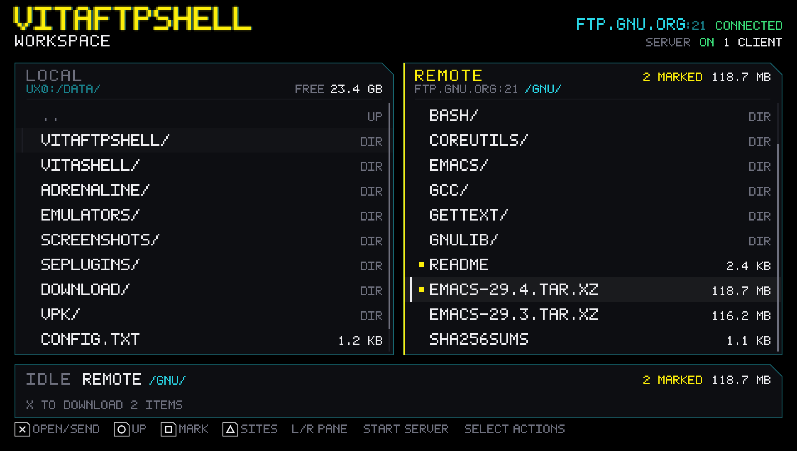
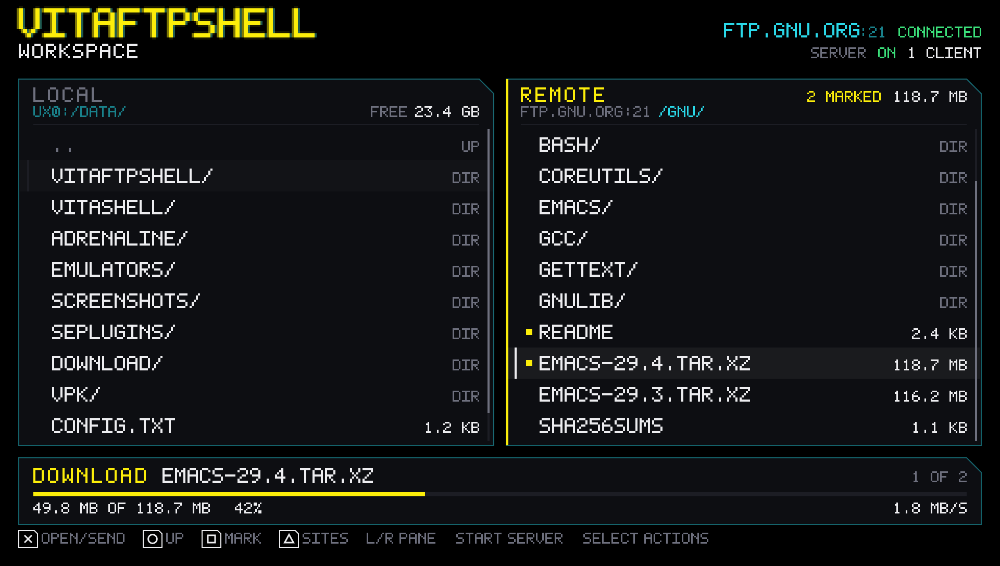
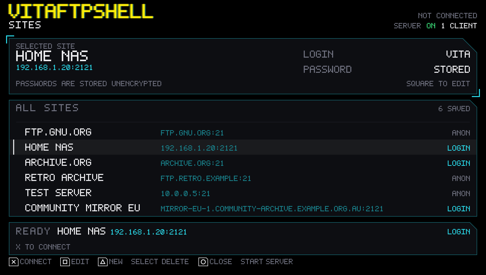
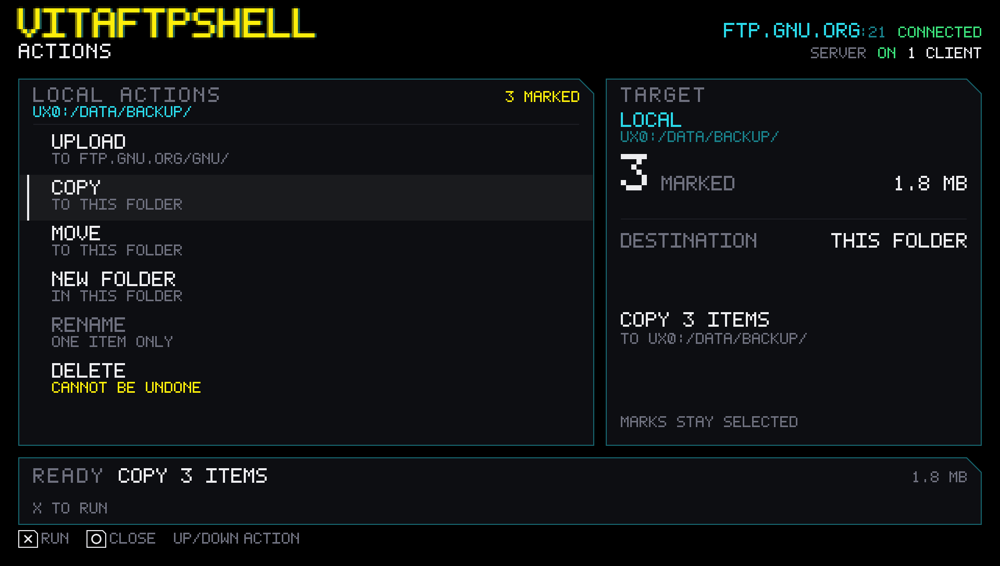
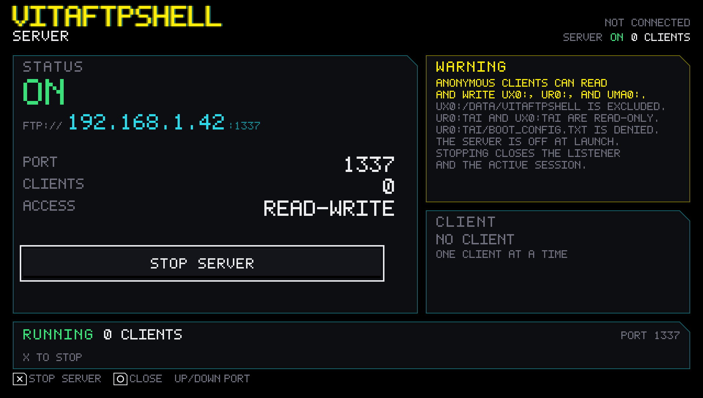

<p align="center">
  
</p>

<h1 align="center">vitaFTPShell</h1>

<p align="center">
  <strong>The PS Vita on both sides of the transfer.</strong><br>
  A twin-pane FTP client, local file manager, and anonymous FTP server for the console.
</p>

<p align="center">
  <a href="LICENSE"></a>
  <a href="https://github.com/ghostmeson/vitaftpshell/actions/workflows/ci.yml"></a>
  
  
  
</p>

vitaFTPShell is one PS Vita app with three roles: a passive FTP client, a local
file manager over every mounted user volume, and an anonymous read-write FTP
server. The console is the workspace, not a remote endpoint driven from a PC.

Two live ledgers put the console's own storage beside a saved FTP site, so a
file moves between them in one action. The interface is a 960×544 Cyberpunk HUD
built for the controller. There is no pointer and no desktop layout, and the
dock reports each transfer without hiding the lists.



*Design render of the settled WORKSPACE screen. This is a design mockup, not a
hardware screenshot.*

## Contents

- [Status](#status)
- [Features](#features)
  - [FTP client](#ftp-client)
  - [Local file manager](#local-file-manager)
  - [Cross-pane folder transfers](#cross-pane-folder-transfers)
  - [FTP server](#ftp-server)
  - [Interface and input](#interface-and-input)
  - [Reliability and diagnostics](#reliability-and-diagnostics)
- [Safety model](#safety-model)
- [Screens](#screens)
- [Controls](#controls)
- [Requirements](#requirements)
- [Build](#build)
- [Install and first run](#install-and-first-run)
- [Host checks](#host-checks)
- [Architecture](#architecture)
- [Limits and non-goals](#limits-and-non-goals)
- [Documentation](#documentation)
- [Contributing](#contributing)
- [License](#license)
- [Credits](#credits)

## Status

<!-- status:begin -->
`building`. vitaFTPShell is one PS Vita app with three roles: a passive FTP
client, a local file manager over every mounted user volume, and an anonymous
read-write FTP server on `ux0:`, `ur0:`, and `uma0:`. The seven screens, the
app/worker runtime, and the six Vita adapters are implemented, and the host
suites pass. The local workspace and the cross-pane folder transfer — recursive
download and upload, the verified move, the report, and the per-folder
read-only state — are host-complete, and the cross-pane code review's fixes are
applied on `main`. The console matrix runs once at v1 code freeze (D95), so the
project is `building`, not `verified`.

The live state and the single next action are on [the board](PROJECTS.md); the
hardware evidence is in [the evidence record](docs/VERIFICATION.md).
<!-- status:end -->

Every behavior on this page is implemented and covered by the host suites or
the build-time guards. The 34-row console matrix (27 `PENDING`, 7 `PART`,
0 `PASS`) is the remaining evidence gate. A host pass is never reported as a
hardware result. See [`docs/VERIFICATION.md`](docs/VERIFICATION.md) for the
row-by-row record.

## Features

### FTP client

- **Saved sites.** Anonymous or username/password logins, a seeded
  `ftp.gnu.org` example, and a six-row site book that wraps at both ends. A
  successful connect returns to the workspace with the remote pane active.
- **Site management.** A six-field editor covers name, host, port, anonymous
  mode, username, and password. Validation focuses the first invalid field,
  password entry is masked, a dirty editor asks before discarding, and deletion
  is confirmed.
- **Passive FTP over SceNet.** MLSD first, then LIST fallback with Unix and DOS
  listing parsing. Multiline replies, passive-mode negotiation, and timeouts
  are handled by one protocol engine.
- **Remote browsing.** Open folders, move the cursor, mark rows, refresh,
  and disconnect. The remote band shows the site, path, and connection state.
- **Remote changes.** Upload, create folder, rename, and delete, each with a
  named confirmation. The app checks an upload overwrite with MLST or SIZE when
  the server advertises them.
- **Download and upload queues.** An ordered batch with one active item,
  progress, bytes, rate, and cancel.
- **Session recovery.** A lost control channel shows `SESSION LOST` with
  `RECONNECT` or `DISMISS`, while a data-channel failure leaves the session up
  and the item retryable.
- **Unknown values.** A size or free-space figure the server or platform cannot
  report renders `--` instead of a guess or a zero.

### Local file manager

- **Every user volume.** `ALL DRIVES` lists `ux0:`, `ur0:`, `uma0:`, `imc0:`,
  `gro0:`, `grw0:`, and `app0:` in table order. An absent mount is an absent
  row; save data (`savedata0:`) and the protected system partitions never
  appear.
- **Read-only mounts.** `gro0:` and `app0:` carry `DRIVE RO`. A write, create,
  paste, rename, move, delete, or download destination there is refused with
  `READ-ONLY MOUNT`; reads and COPY stay live.
- **A second local pane.** The right pane can become another local browser over
  the same session. The switch preserves each view's folder, cursor, scroll,
  marks, and listing. A running transfer survives it.
- **Marks and one clipboard.** View-scoped marks with a count and known total,
  plus COPY, MOVE, PASTE, and CLEAR across both local views.
- **Recursive local folders.** Copy, move, and delete a whole tree. The app
  lists the tree before it copies anything, rolls back a failed run, and deletes
  from the deepest entry upward. A copy into its own subtree is refused before
  anything is touched.
- **Local changes.** New folder, rename, and delete work on the focused item or
  the marked set. Delete names every full path, including marks from another
  folder, and says it cannot be undone.
- **Duplicate handling.** A same-folder paste asks `CANCEL` or
  `SAVE DUPLICATES` and uses the copy-name rule (`A copy.TXT`, then
  `A copy 2.TXT`). A mixed batch asks one conflict question and records the
  already-here items as skipped.
- **Protected paths.** Volume roots, `ur0:data`, `ux0:data`, `imc0:data`,
  `ur0:tai`, and `ux0:tai` cannot be renamed, moved, or deleted. The `tai`
  contents and the app data folder remain writable by design. Every check uses
  the canonical path, and a rename checks both operands.
- **Risk marks.** High-risk paths (the `tai` folders, volume roots, the data
  folders themselves, and the files that control loading) draw a yellow
  diamond.
- **Free space.** `ux0:` reports free space. Before a download, the app refuses
  a known shortfall with `NOT ENOUGH SPACE`. Every other volume renders `--`.
- **No half-written files.** Downloads and uploads write a `.vftp.part` file,
  sync, and rename into place. A kept `.vftp.old` aside is drawn as `ASIDE` so
  it is reachable and never mistaken for the user's file.
- **Two navigation models.** D-pad row-by-row with wrap, and an analog stick
  step of one to five rows, repeating every 100 ms. Down from the last row enters
  the dock only while a lane is busy.

### Cross-pane folder transfers

- **A folder is one job.** DOWNLOAD on a remote folder, or UPLOAD on a local
  folder, walks the whole tree first, shows `SCANNING` with the folder count,
  then copies item by item. A marked set may mix files and folders and becomes
  one plan with one conflict question.
- **Merge or skip.** An existing destination merges. The conflict prompt offers
  `OVERWRITE ALL`, `SKIP EXISTING`, or `CANCEL`, names the destinations, and
  counts only real replacements.
- **Skips do not stop the tree.** An unsafe remote name, a read-only
  destination subtree, a refused listing, or a folder over an existing file is
  skipped with its reason and the rest proceeds. A tree beyond 4,096 entries is
  refused before the first byte.
- **A move verifies before it deletes.** The move asks once, naming the roots
  and the entry count, and warns that any skip or unverified entry keeps every
  source. Each destination folder is re-listed; a file counts only when its
  exact name and moved bytes match. The delete runs bottom-up, checks every
  source root, stops at the first failure, and never removes a verified copy.
- **Report file.** `skipped.txt` lands in the folder above the
  transferred root, with the direction, both roots, every entry the transfer
  did not complete, and its reason. It is replaced on every transfer that
  reaches its copy phase; a directory is never replaced, and a name collision
  takes `skipped 2.txt`.
- **Read-only is per folder.** A folder whose MLSD `perm` facts grant no write
  access dims UPLOAD, PASTE, MOVE, NEW FOLDER, RENAME, and DELETE with
  `READ ONLY`; DOWNLOAD and REFRESH stay live. A server that reports no `perm`
  stays enabled.
- **Free-space check.** A download sums its known bytes before the first byte
  and refuses a known shortfall with `NOT ENOUGH SPACE`.
- **One lane at a time.** The folder job owns the network lane from `SCANNING`
  until it finishes. A second folder transfer is dim with
  `TRANSFER IN PROGRESS`. A file download may queue behind it.

### FTP server

- **Anonymous read-write FTP.** Passive mode, OFF at launch, and started only
  when the user asks. While it runs, its ON state, `ACCESS READ-WRITE` readout,
  and client count stay visible on every screen.
- **Three mounted volumes.** The server exposes `ux0:`, `ur0:`, and `uma0:` as
  `UX0:`, `UR0:`, and `UMA0:` under a virtual `/`. The local manager sees all
  seven user volumes; the server deliberately does not.
- **Up to four clients, one data transfer.** Each session slot gets its own
  passive data port. A fifth client receives a busy reply.
- **Editable port.** Default `1337`, adjustable in the range 1024–65531 so
  every derived session port stays valid.
- **FTP commands.** USER, PASS, SYST, NOOP, OPTS, FEAT, QUIT, PWD, CWD,
  CDUP, TYPE, MODE, STRU, PASV, LIST, NLST, MLSD, RETR, STOR, DELE, MKD, RMD,
  RNFR, RNTO, SIZE, MDTM, MLST, and ABOR.
- **Safe writes.** STOR writes a temporary file and renames on close. A reset
  or timeout aborts the temp and leaves the previous destination byte-identical.
- **Visible state.** `OFF`, `STARTING`, and `ON` with the LAN address, port,
  client count, and current client operation. Bind failures and missing Wi-Fi
  are reported by name.
- **Shared path rules.** Client, server, and local manager share the same
  canonical-path and denial rules. A denial answers exactly as a missing path
  and creates nothing.

### Interface and input

- **Seven surfaces.** WORKSPACE, SITES, SITE EDITOR, SERVER, ACTIONS, CONFIRM,
  and system TEXT ENTRY, plus inline error and reconnect states.
- **Cyberpunk HUD.** 960×544, a hand-built 5×7 bitmap face, and three signal
  colors: yellow for network activity, risk, and waiting work; cyan for the
  cursor and a running local job; red for failure and refusal.
- **Transfer dock.** Progress, bytes, percentage, rate, elapsed time, item
  count, and phase counts. Folder jobs show `SCANNING`, `VERIFYING`, and
  `DELETING`; result words keep the operation and its reason. The dock is
  never modal and never covers a row.
- **Context actions.** A seven-row local ledger and an eight-row remote ledger.
  The remote rows are DOWNLOAD, MOVE, NEW FOLDER, RENAME, DELETE, REFRESH,
  DISCONNECT, and SWITCH. Every disabled row carries its reason, and the target
  panel always shows where the action goes.
- **One confirmation surface.** Delete, batch conflict, items already here,
  move, cancel a transfer, stop the server during a write, and discard editor
  changes. The safe option is focused first. The destructive or committing
  action is the yellow slab.
- **Two lanes in one dock.** One network transfer and one local job may run
  together. The local lane becomes a compact badge while the network lane owns
  the bar. A collision on the same canonical path asks `WAIT`, `SKIP`, or
  `CANCEL`.
- **Focusable cancel.** Down from the last row enters the dock while a lane is
  busy. Cross opens a cancel confirmation whose warning follows the folder
  phase. The result stays until the next transfer starts.
- **System text entry.** The Vita IME handles names, hosts, ports, usernames,
  passwords, new folders, and renames. Cancellation keeps the previous value;
  passwords use masked mode and never reach the session log.
- **Launcher and LiveArea art.** A file-stack launcher icon, a LiveArea page
  built from the workspace, and a `pic0` boot frame, all generated by the art
  script and checked into `sce_sys/`.

### Reliability and diagnostics

- **One worker thread.** The main thread owns only the UI. The worker owns
  network, filesystem, transfers, and the session. State snapshots pass between
  the two threads. One writer owns each piece of shared state.
- **Policy testable on the host.** The core compiles without a Vita header. Six
  adapters own the SDK calls, and a layering guard fails the build if any other
  file includes `psp2/` or `vita2d.h`.
- **Typed session log.** `ux0:data/vitaFTPShell/session.log` appends one
  tab-separated record per event, rotates at 256 KiB, and keeps three
  generations. Passwords are never a field and raw server replies are never
  logged, so a server reply cannot echo a credential into the file.
- **Atomic persistence.** Site book and settings live in
  `ux0:data/vitaFTPShell/sites.cfg` and `settings.cfg`, saved through a
  temporary file, sync, and rename. A failed save leaves the previous file
  byte-identical.
- **Failure attribution.** Every started transfer records one cause (app,
  server, network, storage, or user) and the stage it reached, so the dock, the
  log, and the release metric cannot drift.
- **Build gates.** The build checks the linked ELF's worker stack budget, keeps
  exactly one VPK, and refuses to upload an artifact whose build number does not
  match `BUILD_NUMBER`.

## Safety model

These are product rules enforced in the policy layer, not conventions:

- **The server is OFF at launch.** Starting it is an explicit action, and its
  ON state and anonymous read-write access stay visible.
- **`ur0:tai/boot_config.txt` is denied to every role.** The local manager and
  the server may read and write inside `ur0:tai` and `ux0:tai`; that one file
  is never written, renamed, or deleted.
- **System paths are protected.** Volume roots, `ur0:data`, `ux0:data`,
  `imc0:data`, `ur0:tai`, and `ux0:tai` cannot be renamed, moved, or deleted.
  The app creates only its own data folder.
- **Read-only mounts stay read-only.** A write to `gro0:` or `app0:` is refused
  before anything changes.
- **Destructive actions confirm.** The panel names the items and says delete
  cannot be undone. Cancel changes nothing.
- **No secrets in logs.** Passwords are stored unencrypted on the console by
  design, and never enter the session log or an error message.
- **No kernel component.** No taiHEN plugin, `*KERNEL` entry, background daemon,
  or boot-time code.
- **Atomic writes.** A failed transfer never leaves a partial file looking
  complete, and a failed local plan rolls back what it applied.

## Screens

| WORKSPACE — download in progress | SITES — saved site book |
|---|---|
|  |  |
| Two live ledgers, marks, and the transfer dock. | Anonymous and login sites with a preview card. |

| ACTIONS — local multi-select | SERVER — running with a client |
|---|---|
|  |  |
| The action ledger and its target panel. | Address, port, client count, and access readout. |

*All four images are design renders of the settled states, not hardware
screenshots.*

## Controls

| Input | Action |
|---|---|
| D-pad Up / Down | Move the selection one row; lists wrap at both ends |
| Left stick | Move the selection by deflection, one row at the deadzone edge to five at full deflection, repeating every 100 ms |
| Cross | Open a folder, send the selected or marked set, or confirm |
| Circle | Go to the parent folder, or cancel the current surface |
| Square | Mark an item; in SITES, edit the selected site |
| Triangle | Open ACTIONS; in SITES, add a site |
| Start | Open SERVER |
| Select | Open SITES |
| L / R | Switch the active pane between the left slot and the right view |
| Down at the last row | Enter the transfer dock while a lane is active or queued |
| Left / Right in CONFIRM | Choose an option |

## Requirements

- A PS Vita on **3.65 with Enso**. PSTV is out of scope; the spoofed 3.74
  system string is expected and does not change the target.
- **VitaSDK 2026.08**, including `libvita2d`.
- **CMake 3.16** or newer.
- For the host checks only: a POSIX shell, a C99 compiler, and zlib.

Installing requires **Enable Unsafe Homebrew**. The server and the local file
manager need unrestricted access to the mounted volumes, which the safe authid
refuses (D32).

## Build

```sh
export VITASDK=/path/to/vitasdk
export PATH="$VITASDK/bin:$PATH"

./build.sh
```

`build.sh` emits exactly one `vitaftpshell-v<version>-b<build>.vpk` in `build/`,
plus the unstripped ELF. `BUILD_NUMBER` is committed and monotonic: a rebuild
with unchanged packaged inputs reuses the number, and a changed input increments
it. `build/` is pruned to one artifact so "which build is on the Vita?" has one
answer.

The VPK is not byte-reproducible: the packaging step stamps each entry with its
build time, so rebuilding identical sources yields a different SHA-256. The
build number is the stable identity.

The build also runs `tools/check_worker_stack.py` against the linked ELF and
fails before packaging if the fixed worker call chain exceeds its 192 KiB stack
budget (D77).

## Install and first run

With VitaShell's FTP server running on the console:

```sh
./send.sh <vita-ip>
```

The upload form is `ftp://<vita-ip>:1337/ux0:/data/`. `send.sh` refuses an
artifact whose build number does not match `BUILD_NUMBER`, so a failed build
cannot silently send the previous file. To install manually, copy the VPK from
`build/` to `ux0:data/` and open it in VitaShell.

A typical first session:

1. Launch the app. The FTP server is **OFF**; the left pane opens at
   `ux0:data`.
2. Press **Select** to open SITES, connect to the seeded `ftp.gnu.org`, or add
   your own site with **Triangle**.
3. Mark files or a folder and press **Cross** to download. The dock shows the
   queue, progress, and terminal result.
4. Open ACTIONS with **Triangle** to copy, move, paste, rename, or delete
   locally, or to switch the right pane to a second local view.

To serve the console to a PC, press **Start**, confirm the port, and start the
server. Connect a standard FTP client to the shown address.

## Host checks

The policy, presentation, and graphics layers run without VitaSDK:

```sh
./tools/test/run.sh        # layering, asset, art, and docs guards + host suites
./tools/test/asan.sh       # every suite under AddressSanitizer
./tools/test/tsan.sh       # the threaded app under ThreadSanitizer
./tools/preview/run.sh     # renders the settled screen states to build/preview/
```

The runner compiles the real core, screens, and runtime against fake network,
filesystem, input, IME, clock, and log ports. The 24 host suites cover reply and
listing parsing, path and protection rules, the transfer queue, the transfer
plan, the local planner and executor, the server, the input reducer, the
handoff rings, the real app/worker integration, and the rendered draw calls at
the settled geometry. The docs guard fails when a link, design sheet, plan
inventory row, decision reference, build token, or shared status block drifts
from its owner.

CI runs the same suites on every push to `main` and every pull request, plus
ASan, TSan, the preview render, and a preview artifact upload.

## Architecture

Source dependencies point inward, toward policy. The core compiles and runs on
the host without a Vita header.

| Layer | Path | Holds |
|---|---|---|
| Policy | `src/core/` | FTP client and server, listing parsing, path and risk rules, site book, settings, store, log events, transfer queue, planners, executor, UI state |
| Platform ports | `src/platform/*.h` | Plain-C contracts for net, filesystem, input, text entry, clock, and log |
| Platform adapters | `src/platform/psp2_*.c` | SceNet, sceIo, SceCtrl, IME, clock, and log |
| Renderer | `src/gfx/` | Theme, font, and draw primitives |
| Presentation | `src/ui/` | Draws `UiState` and maps input to commands |
| Runtime | `src/app/` | Frame loop, the one worker, rings, and snapshot handoff |
| Composition | `src/main.c` | Constructs adapters and starts the runtime |

The FTP engine takes `NetPort`, not a socket; the file operations take `FsPort`,
not a file handle. A new file that reaches for a platform header is a layering
bug. See [`docs/ARCHITECTURE.md`](docs/ARCHITECTURE.md) for the ports, the data
phase, the threading handoff, the reservation table, and the path/denial rules.

### Repository map

```text
src/core/        portable policy: protocol engines, parsers, path rules, store
src/core/ftp/    passive FTP client and server state machines
src/gfx/         theme, font, draw, and the settled layout table
src/ui/          the seven screens, the dock, legends, and the renderer
src/app/         frame loop, the one worker, and the handoff consumer
src/platform/    plain-C port contracts and the six psp2_* adapters
src/main.c       composition root; constructs adapters and starts the app
tools/test/      guards, host suites, sanitizer scripts, and the integration test
tools/fake/      controllable NetPort, FsPort, input, IME, clock, log, and FTP peers
tools/preview/   software vita2d shim and the 960x544 preview
docs/            architecture, design, decisions, plans, and evidence
sce_sys/         launcher icon, LiveArea art, and boot frame
```

## Limits and non-goals

- **Plain FTP only.** No FTPS, SFTP, HTTP, WebDAV, or SMB in v1.
- **No background work.** No daemon, taiHEN plugin, boot-time server, resume,
  sync, or sleep/resume transfer. A transfer stops when the app closes.
- **One network transfer and one local job.** Only one of each runs at a time.
  Remote-to-remote copy is not offered; FTP has no copy command.
- **Bounded listings.** A folder longer than 2,000 rows shows `FIRST 2000`; a
  folder plan beyond 4,096 entries is refused before the first byte.
- **Partial free-space knowledge.** Only `ux0:` reports free space. An unknown
  value skips the check and renders `--`.
- **Sizes are required to verify a move.** A server that reports no file sizes
  can copy, but a move cannot be verified and keeps its sources.
- **Passwords are stored unencrypted.** They are never logged, but the site
  book is plain text on the console by design.
- **The report is a record, not an import.** Retrying a skipped entry means
  selecting it again; `skipped.txt` does not drive a resume.
- **The console matrix is pending.** v1 is not promoted to `verified` until
  every row passes on hardware. M24's `imc0:` leg cannot run on a PCH-1000.

## Documentation

| Document | Contents |
|---|---|
| [`STRATEGY.md`](STRATEGY.md) | Why the product exists, who it serves, boundaries, and metrics |
| [`PROJECTS.md`](PROJECTS.md) | The board: current phase, last job, next action, and the job log |
| [`docs/ARCHITECTURE.md`](docs/ARCHITECTURE.md) | Layers, ports, threading, handoff, and module rules |
| [`docs/DESIGN.md`](docs/DESIGN.md) | The settled layout, states, and input |
| [`docs/DECISIONS.md`](docs/DECISIONS.md) | Numbered decisions with context and consequences |
| [`docs/FIXES.md`](docs/FIXES.md) | Chronological fix index with each defect's evidence and hardware status |
| [`docs/VERIFICATION.md`](docs/VERIFICATION.md) | The console matrix, build evidence, and per-build test record |
| [`docs/THIRD_PARTY.md`](docs/THIRD_PARTY.md) | Reused code, licenses, and protocol references |
| [`docs/plans/2026-11-08-1103-feat-vitaftpshell-v1-plan.md`](docs/plans/2026-11-08-1103-feat-vitaftpshell-v1-plan.md) | Requirements, key decisions, implementation units, verification contract |
| [`AGENTS.md`](AGENTS.md) | The project contract for agents and contributors |
| [`docs/README.md`](docs/README.md) | The documentation map |

## Contributing

The screen layout and protocol behavior are settled. Read [`AGENTS.md`](AGENTS.md)
before changing code, open an issue for a large change, and run the host checks
before sending a pull request:

```sh
./tools/test/run.sh
./tools/preview/run.sh
```

A change that alters behavior must update the plan or add a numbered decision.
Never weaken the path denials, the read-only mount rules, or the server's
OFF-at-launch rule.

## License

vitaFTPShell is free software under the **GNU General Public License, version
3.0 only**. See [`LICENSE`](LICENSE).

The graphics base under `src/gfx/` is adapted from COCKPIT, Copyright (c) 2026
Upakul Talukdar, and retains its MIT notice in
[`LICENSES/COCKPIT-MIT.txt`](LICENSES/COCKPIT-MIT.txt). VitaShell and libftpvita
are behavioral references only; no code from them is vendored.

## Credits

- [VitaSDK](https://vitasdk.org/) and `libvita2d` for the toolchain and renderer.
- [VitaShell](https://github.com/TheOfficialFloW/VitaShell) for the file-manager
  and server behavior this project learned from.
- [libftpvita](https://github.com/xerpi/libftpvita) for FTP server behavior
  reference.
- [RFC 959](https://www.rfc-editor.org/rfc/rfc959),
  [RFC 3659](https://www.rfc-editor.org/rfc/rfc3659), and
  [RFC 2428](https://www.rfc-editor.org/rfc/rfc2428) for the protocol.
