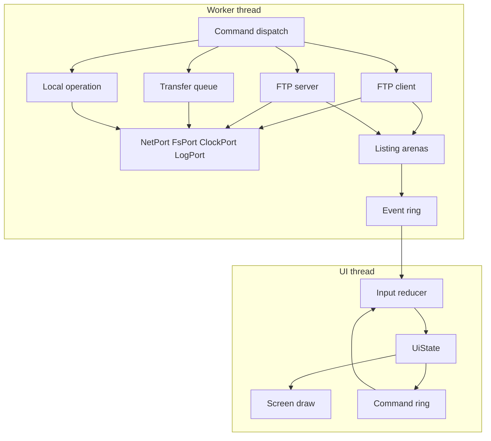
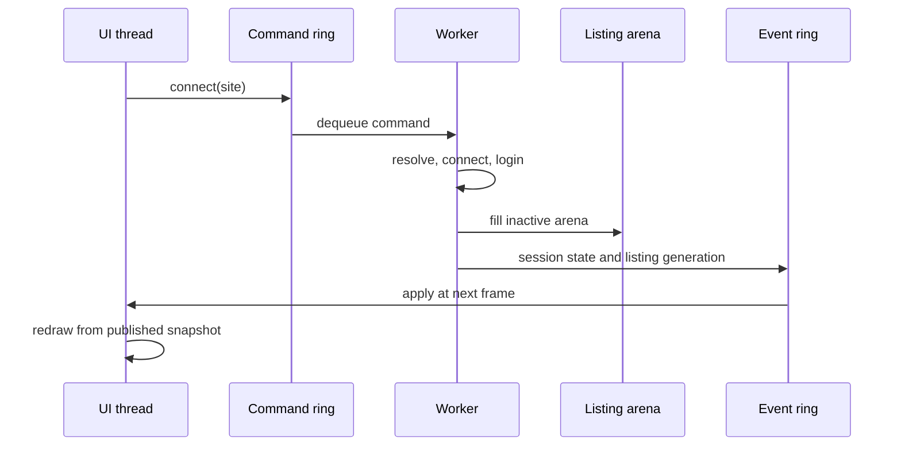
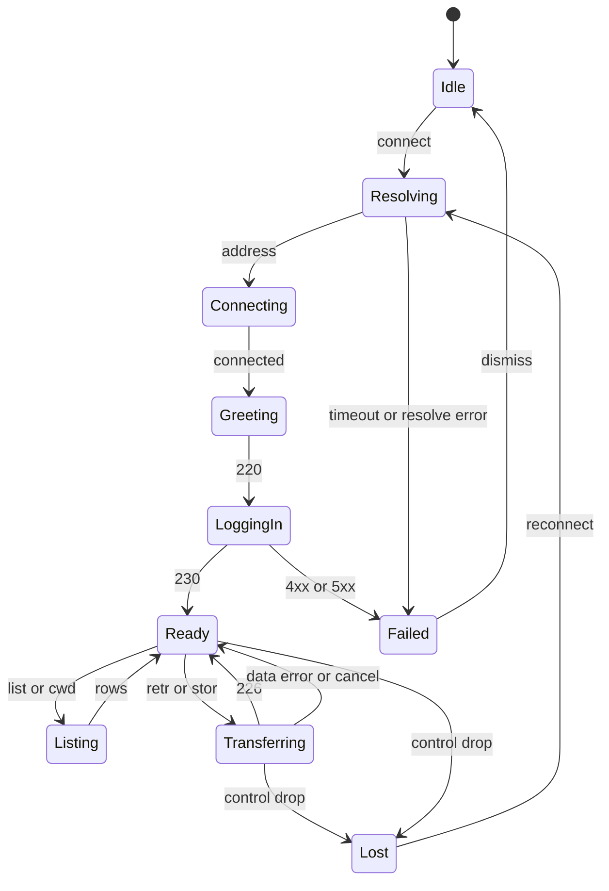
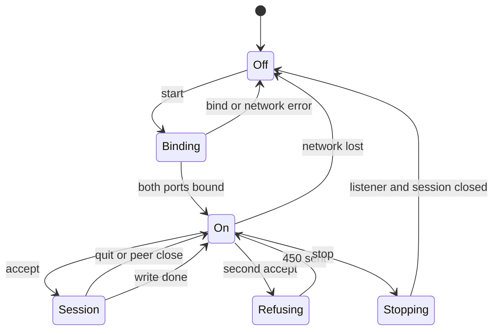
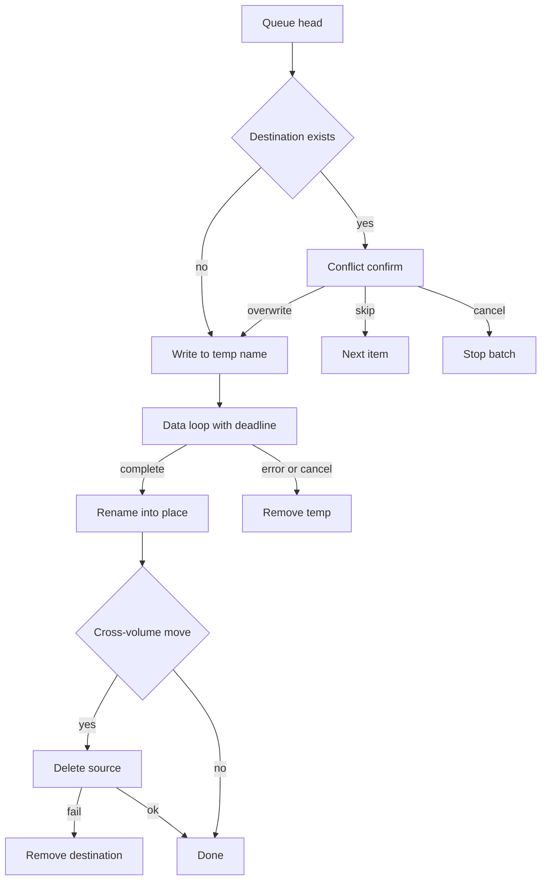
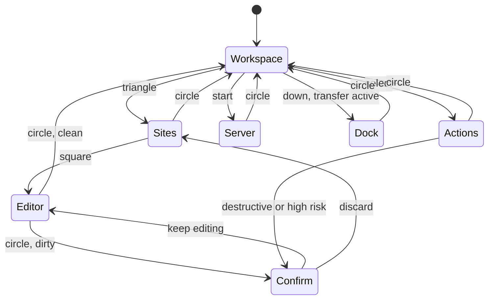

# vitaFTPShell v1 - Plan

**Product Contract preservation:** changed: R6, R9, R26, R35, R38, R41, R42, R53, R54, and R67 tightened to this session's choices and to gaps the architecture and document reviews proved ambiguous; R71-R73 added for high-risk paths and transfer attribution; the completion criterion replaced with the two-gate metric. The platform, `tai`, and transfer decisions are user-directed; R41's server-side overwrite and the R38/R53/R54 hardening are consequences of the security and feasibility review, recorded in D41 and D42. No other requirement changed.

File paths are relative to the git root; the app lives in `vitaFTPShell/`.

## Goal Capsule

- **Objective:** A Vita owner can browse a saved FTP site and the console's own volumes side by side, move files between them, and serve those volumes to another machine, without leaving the console and without a PC in the middle.
- **Means:** One GPLv3 app with one FTP engine serving both roles, one path-and-risk table shared by client, server, and local manager, a worker thread that owns every long operation, and the settled HUD from `vitaFTPShell/docs/DESIGN.md`.
- **Product authority:** `vitaFTPShell/STRATEGY.md` sets positioning, users, boundaries, and metrics; its transfer metric is refined by R73 and the two-gate criterion below.
- **Design authority:** `vitaFTPShell/docs/DESIGN.md` is layout law. Geometry, palette, the 5x7 face, and screen composition are not open here.
- **Execution profile:** `code`.
- **Stop conditions:** a new `[C]` claim outside an adapter, a geometry change outside `DESIGN.md`, a write path that can touch `boot_config.txt`, or a hardware claim without a hardware run.
- **Who finishes:** the plan is executed by an implementing agent through `ce-work`; only a hardware session promotes the project to `verified`.

---

## Product Contract

### Summary

vitaFTPShell makes the Vita the workspace for local and remote files: two live panes, saved sites, batch transfers, and a local file manager in one GPLv3 app. v1 also serves the console's files over anonymous FTP while the app is open, and uses the COCKPIT HUD. This contract fixes behavior, screens, and input; the implementation plan below fixes how it is built and verified.

### Problem Frame

VitaShell can serve the memory card, but it cannot connect out to an FTP server. A user who wants a file from a remote host has to start a PC, run a desktop client, download to the PC, then copy the file to the Vita. The console is treated as an endpoint, not a workspace.

The same split appears in file management. Local work happens in VitaShell; remote work happens on the PC. Moving a file between the two means two tools, two path vocabularies, and a context switch that starts and ends away from the console.

There is no known maintained on-device FTP client to close the gap. Plain FTP is old, but the constraints around it are not: a 5-inch screen, a controller, WiFi timeouts, limited memory, and a file manager that must be safe on a device with no Trash.

The cost is not one slow transfer. It is the habit of leaving the console to do console work, even when the file is already on the Vita or the server is one room away.

### Key Decisions

- **Console as a peer.** Both panes live on the Vita, so a transfer is a local action rather than a desktop round trip. Governs R1-R10. (session-settled: user-directed — chosen over a PC-first desktop port and a server-only VitaShell clone: the Vita is one side of the transfer.)
- **All three roles in v1.** Client, local manager, and anonymous server ship together, so the first release can replace VitaShell's transfer role. Governs R19-R56. (session-settled: user-directed — chosen over client-first/server-next: the release is the replacement, not a client MVP.)
- **Server is a compatibility surface.** It exists so VitaShell users need one app, but it does not drive the workspace design. Governs R47-R56. (session-settled: user-directed — chosen over a two-way hub and dropping server mode: it completes the tool without changing the core bet.)
- **Anonymous read-write on the Vita volumes.** The server exposes `ux0:`, `ur0:`, and `uma0:` without login and with write access, starting OFF. Governs R47-R56. (session-settled: user-directed — chosen over authenticated read-write and read-only: matches VitaShell and keeps upload simple.)
- **Always remember passwords.** Saved login sites store passwords unencrypted and reconnect without retyping; the UI states the risk. Governs R11-R18. (session-settled: user-directed — chosen over optional and never: FileZilla-like convenience, with plaintext storage accepted.)
- **Multi-select and recursive folders.** Batch file operations and folder transfers are v1, not later polish. Governs R28-R46. (session-settled: user-directed — chosen over files-only and single-item: a file manager must move folders.)
- **GPLv3, no vendored engine.** The project stays GPLv3; the FTP core, the file-operation policy, and the UI are written here, and COCKPIT's MIT graphics layer is adapted with its notice. Governs R28-R37. (session-settled: user-approved — chosen over vendoring VitaShell's file manager: its copy engine is bound to its own UI and would bypass this project's templed writes and path table; the license is kept deliberately, not forced.)
- **Plain FTP only.** No FTPS, SFTP, HTTP, or WebDAV in v1; secure transports are a later decision. Governs R19-R27. (session-settled: user-directed — chosen over FTPS and both: plain FTP is the launch target.)
- **No background daemon.** Transfers and the server end when the app exits; no kernel plugin or boot component. Governs R47-R63. (session-settled: user-directed — chosen over a daemon later and now: the app owns its lifetime.)
- **Serialize transfers and server sessions.** One active transfer and one server client keep v1's state and error model tractable. Governs R38-R56. (session-settled: user-approved — proposed as a v1 simplification and confirmed: avoids concurrent writers.)
- **Seed `ftp.gnu.org` as an example site.** First run has a working anonymous target; it is editable and never auto-connects. Governs R16. (session-settled: user-approved — proposed as a first-run example and confirmed: gives the primary flow a real target.)
- **Ship one UNSAFE eboot.** Serving and browsing `ur0:` and `uma0:` needs the permissions the safe authid refuses, so there is a single eboot with a single permission level. Governs R51, R52. (session-settled: user-directed — chosen over a safe build that drops or restricts those volumes: the server's job is the three volumes.)
- **High-risk paths warn; the local manager may edit inside the tai folders.** `boot_config.txt` stays denied outright, and the server keeps its blanket denial. Governs R33, R34, R71, R72. (session-settled: user-directed — chosen over read-only tai folders: a file manager that refuses the files its owner selects is not a file manager, so the warning and the row mark carry the risk instead.)
- **Transfer success is judged by cause class.** Every transfer records an outcome and a class, and only app-caused failures count against the release. Governs R73. (session-settled: user-directed — chosen over a raw completion rate: the network and the remote server can fail a transfer the app did nothing wrong on.)

### Actors

- A1. **Vita user.** The anonymous-first collector or the Vita-as-a-drive user, operating the console with a controller.
- A2. **Local filesystem.** The mounted volumes `ux0:`, `ur0:`, and `uma0:`, including absent volumes.
- A3. **Remote FTP server.** A public archive, personal server, or test server the Vita connects to.
- A4. **Remote FTP client.** A desktop or other client that connects to the Vita's server mode.
- A5. **System text input.** The Vita IME used for site fields, paths, and names.

### Requirements

**Workspace and navigation**

- R1. The app opens into a two-pane WORKSPACE: local files and the connected remote site, with one pane active at a time.
- R2. The local pane starts at the last local path when it still exists, otherwise at `ux0:data` when `ux0:` is mounted, otherwise at the first mounted volume root; it shows only volumes that respond.
- R3. The remote pane starts at the server's working directory after login; before a connection it shows a not-connected state and no stale rows. While loading it names the path being read; an empty folder says it is empty; after a control-channel drop it keeps its rows but disables row actions until reconnect.
- R4. The active pane shows its full path; the remote pane also shows the site name and `host:port`.
- R5. Up and Down move the row selection; the left stick scrolls the active list without changing selection; the selection stays visible.
- R6. Cross opens the selected directory; on a file or marked set it transfers to the other pane when the other side is connected. A directory under the cursor opens even when marks exist. With no remote session, it reports NOT CONNECTED, starts no transfer, and does not auto-connect.
- R7. Circle goes to the parent directory; at a volume root or remote `/` it does nothing and says so.
- R8. L and R switch the active pane and preserve each pane's path and selection.
- R9. Square marks or unmarks the selected row; the header shows the marked count and total known size. Marks are pane-scoped and persist across directory changes and L/R switches; when the cursor is not on a directory, Cross acts on the marked set whenever the count is above zero, and marks clear when the pane's connection or volume root changes.
- R10. Triangle opens SITES, Start opens SERVER, and Select opens ACTIONS for the active pane. The per-screen bindings below are authoritative; every screen lists its controls in the dock or strip.

| Screen | Up and Down | Accept | Back or cancel |
|---|---|---|---|
| WORKSPACE | Move the row selection; Down from the last row enters the dock when a transfer is active or queued | Cross opens a directory under the cursor, otherwise transfers the selected file or marked set | Circle goes to the parent; L and R switch the active pane; Square marks |
| Dock | Up returns to the last workspace row | Cross cancels the active transfer (R40) | Circle returns to the last row |
| SITES | Move the site selection | Cross connects; Square edits; Triangle creates; Select deletes | Circle closes |
| SITE EDITOR | Move between fields | Cross edits the focused field; Square saves | Circle cancels |
| SERVER | Move between the port and the start control | Cross starts or stops the server (R49); Cross on the port edits it (R48) | Circle closes |
| ACTIONS | Move the action selection | Cross runs the action | Circle closes |
| CONFIRM | Up and Down scroll the item list when it overflows; Left and Right choose an option | Cross confirms the focused option | Circle cancels |
| Reconnect | No selection | Cross reconnects | Circle dismisses |

**Sites and credentials**

- R11. SITES lists saved sites with name, host, port, and anonymous or login state.
- R12. A site stores name, host, port (default 21), username, password, and an anonymous flag; anonymous login sends `anonymous` as the user and `anonymous@` as the password.
- R13. The user can create, edit, delete, and connect a site; deletion requires confirmation.
- R14. Passwords are always remembered. The site file stores them unencrypted, and the editor states that before the first save.
- R15. A failed login shows the server's reply or a short mapped reason, stays disconnected, and preserves the site for editing.
- R16. First run includes an editable `ftp.gnu.org` anonymous example site; it is not auto-connected.
- R17. Sites and settings persist under `ux0:data`; when the card is unavailable, the app runs with an in-memory list and says saving is unavailable.
- R18. Passwords are masked in the editor and never shown in the site list or written to the session log.

**FTP client**

- R19. The client uses passive FTP only; active mode is not offered in v1. The data channel connects to the control connection's peer address, and a PASV reply advertising a different address is refused through R25.
- R20. Directory listings use MLSD when the server offers it, fall back to LIST, parse Unix and DOS formats, skip `.` and `..`, and sort directories before files.
- R21. Remote browsing supports enter, parent, refresh, and shows name, type, and size when known; unknown size renders `--`.
- R22. The client downloads files and recursively downloads folders.
- R23. The client uploads files and recursively uploads folders.
- R24. The client creates remote directories, renames, deletes files, and deletes directories; every remote delete requires an explicit confirmation that names the items and says it cannot be undone.
- R25. A remote command failure reports the server reply or a mapped reason; the app does not claim success.
- R26. A dropped control connection marks the session disconnected, stops active transfers with an error, and offers reconnect to the same site; a dropped data connection aborts the active transfer and keeps the session when the control channel is healthy. Resolve, connect, login, and the first listing share one 10-second budget, with caps of 3 s resolve, 3 s connect, 2 s greeting and login, and 2 s first listing; a data-channel read has its own 15 s idle deadline, and expiry puts the dock in a stalled state naming the last completed step, stops the transfer, and keeps the session when only the data channel timed out.
- R27. The client supports plain FTP only in v1; FTPS and SFTP are outside the product. A server reply that rejects the session is reported through R25.

**Local file manager**

- R28. The local pane lists files and directories on the mounted subset of `ux0:`, `ur0:`, and `uma0:`; an absent volume is absent, not an error row, and no other mount is listed. The pane names a loading path, an empty folder, and an unavailable volume instead of showing a blank list.
- R29. Local operations include create folder, rename, delete, copy, and move, on one item or a multi-selection.
- R30. Folder copy, move, and delete recurse; the confirmation names the item count and total known size.
- R31. Copy and move work across volumes; a copy or move from a path into itself or its descendant is refused.
- R32. Delete is permanent; the confirmation names the items and says it cannot be undone.
- R33. Volume roots and protected system directories cannot be renamed, moved, or deleted; the app names the protection.
- R34. `ur0:tai/boot_config.txt` is never written, renamed, or deleted by the local manager, the server, or a download from a remote site.
- R35. Local operations show progress and can be cancelled; a cancelled or failed operation leaves no partial output presented as complete. A copy, move, upload, or download leaves the destination unchanged on cancel. A recursive delete cannot be rolled back, so it stops after the item in flight and reports `DELETED n OF m`; the remaining items stay.
- R36. The local pane shows free space for its volume when the platform reports it, and `--` when it does not.
- R37. Names that do not fit truncate with `..`; the full name remains available in the actions or confirm view. Non-ASCII names render with a fallback glyph but operations use the original bytes.

**Transfers**

- R38. One transfer is active at a time; additional items are queued in selection order. A server-side transfer occupies the same slot and is shown in the dock; a server data command, or a server command that mutates a path (`STOR`, `DELE`, `RNFR`, `RNTO`, `MKD`, `RMD`), while another operation owns the slot is refused with a 450 busy reply.
- R39. The dock shows the active item, direction, transferred bytes, total bytes and percentage when known, and queue depth; when the total is unknown it shows transferred bytes with `--` for total and percentage; when idle it shows the active pane and selection summary.
- R40. Cancelling the active transfer requires confirmation; queued items remain and can be cleared.
- R41. Any app-side transfer whose destination exists asks once: OVERWRITE ALL, SKIP EXISTING, or CANCEL; a single item is treated as a batch of one. An existing destination directory is merged, never replaced: missing folders are created, files inside follow the same rule one by one, and SKIP EXISTING applies per file. A file received in server mode overwrites through the templed write without a console prompt, because the anonymous client is the one writing and the console may be unattended; the SERVER warning discloses it (D41).
- R42. A failed or cancelled transfer leaves no destination file that looks complete; every write goes to a temporary name in the destination directory and is renamed into place only after the complete file is closed, so a failure leaves the previous destination byte-identical. A partial is removed. A cross-volume move is all-or-nothing: the source is deleted only after the copy is renamed into place, and if that delete fails the destination is removed as well, so the volumes never disagree about whether the file moved; if the rollback also fails, the dock names both paths. This applies to files received in server mode as well as app-side transfers.
- R43. Transfers continue while the user navigates either pane; the dock is not modal.
- R44. Uploads and downloads preserve file names and relative folder structure; a remote-supplied name containing `/`, `\`, `:`, NUL, or a `..` segment is refused with an inline error before any local path is built.
- R45. The app refuses a folder transfer whose destination is inside the source.
- R46. Every completed transfer refreshes the destination pane and keeps the transferred item selected when it is visible.

**Server mode**

- R47. The server is OFF at launch and never starts automatically.
- R48. SERVER shows OFF or ON, control port (default 1337), local IP, connected client count, and a warning that anonymous clients can read and write. The port can be edited from SERVER. The warning names the exposed volumes and the excluded app data folder. When a client is connected, it names the current operation, path, and transferred and total bytes, with `--` when unknown.
- R49. Cross starts and stops the server; starting without a network shows a clear error and leaves it OFF. A bind failure names the port, says another server may be using it, and leaves the server OFF so the port can be changed.
- R50. The server accepts one client at a time; a second connection is refused with a busy reply.
- R51. The server exposes the mounted subset of `ux0:`, `ur0:`, and `uma0:` as top-level directories; absent volumes are absent, and no other mount is exposed.
- R52. Anonymous login has read-write access to the exposed volumes.
- R53. The server denies all access to `ur0:tai/boot_config.txt` and to the app's own data folder under `ux0:data`, and denies every write, create, rename, and delete inside `ur0:tai` and `ux0:tai`, plus destructive commands on volume roots, `ur0:data`, `ux0:data`, and protected system directories. A rename checks both operands. Every check uses the canonical path.
- R54. The server supports passive mode and the commands a desktop client needs to browse, download, upload, create, rename, and delete. A data connection is accepted only when its peer address equals the control connection's peer; anything else is closed without arming, and the listener backlog is drained when PASV arms.
- R55. Stopping the server closes the listener and the active session; the UI returns to OFF and reports the stop. If a write is in flight, the stop requires confirmation.
- R56. The server can run while the client and file manager are in use; its ON state and client count stay visible on every screen.

**Safety, persistence, and diagnostics**

- R57. No kernel plugin, `*KERNEL` entry, or boot-time component ships in v1.
- R58. Local destructive operations require an explicit confirmation that names the items; transfer conflicts follow R41; cancel changes nothing.
- R59. A failed write or storage error is reported inline; success is shown only after the operation completes.
- R60. Settings persist: saved sites, last local path, last site, and server port.
- R61. The app writes a bounded session log with connection, transfer, and server outcomes, without passwords.
- R62. The app never deletes or recreates volume roots, `ur0:tai`, `ux0:tai`, `ur0:data`, or `ux0:data`; startup creates only its own data folder, and user-requested directories are created only where the user points them.
- R63. Every error state says what failed and what the user can do next; no failure is silent.

**High-risk paths and transfer attribution**

- R71. The local manager may modify files inside `ur0:tai` and `ux0:tai`; every write, create, rename, or delete there, and on any other path classified high risk, first shows a high-risk confirmation naming the path and saying a bad edit can stop the console booting. R34 still denies `boot_config.txt` outright.
- R72. Rows for high-risk paths carry a warning mark, and ACTIONS names the risk on its target panel, so the risk is visible before an action is chosen.
- R73. Every started transfer records an outcome and a cause class — app, server, network, storage, or user — in the session log.

**HUD and screens**

- R64. The app uses the COCKPIT visual system: 960x544, the palette, the 5x7 face, the spacing scale, the panel chrome, and uppercase ASCII labels.
- R65. Screen inventory is WORKSPACE, SITES, SITE EDITOR, SERVER, ACTIONS, CONFIRM, system text entry, and inline error or reconnect.
- R66. The header shows the wordmark, the active screen, the connection identity, and server ON or OFF with client count.
- R67. The transfer dock is part of WORKSPACE; a screen that replaces the workspace keeps the active transfer visible in its header or strip. The most recent completed or failed transfer's terminal state, including a failure reason, stays visible until the next transfer starts; a transfer the user cancelled returns the dock to idle. Destructive confirms and unrecoverable errors are the only interrupts.
- R68. Yellow is the alert channel; red is not used for alerts. A value the platform cannot report renders `--`, never a guess.
- R69. Text entry uses the system keyboard; if it is unavailable, the app reports it and keeps the previous value.
- R70. The UI stays responsive during transfers and long directory operations; input is never blocked for the duration of a file transfer.

### Key Flows

- F1. Anonymous first download
  - **Trigger:** The user opens SITES on first run and chooses the `ftp.gnu.org` example.
  - **Actors:** A1, A2, A3.
  - **Steps:** Connect, log in anonymously, read the listing, open a directory, mark a file, and press Cross to transfer it to the local pane. The dock shows progress; the local pane refreshes and selects the new file.
  - **Outcome:** The file is on the Vita with no PC in the path.
  - **Covers:** R11-R27, R38-R46.

- F2. Upload to a saved login site
  - **Trigger:** The user connects a saved site with a username and password, marks local files or a folder, and presses Cross.
  - **Actors:** A1, A2, A3.
  - **Steps:** If destinations exist, one batch prompt asks OVERWRITE ALL, SKIP EXISTING, or CANCEL. The uploads queue, the dock tracks each file, and the remote pane refreshes when the batch finishes.
  - **Outcome:** The remote tree matches the selected local tree for the chosen files.
  - **Covers:** R11-R27, R38-R46.

- F3. Local batch operation
  - **Trigger:** The user marks local items, opens ACTIONS, and chooses copy, move, or delete.
  - **Actors:** A1, A2.
  - **Steps:** The confirmation names the item count and total known size, and shows the high-risk warning when any target is high risk (R71). Protected roots are refused. The operation runs with progress and the destination pane refreshes.
  - **Outcome:** The local tree reflects the operation, or nothing changed on cancel or failure.
  - **Covers:** R28-R37, R57-R63, R71-R72.

- F4. Serve the console to a PC
  - **Trigger:** The user opens SERVER and presses Cross to start it.
  - **Actors:** A1, A2, A4.
  - **Steps:** The warning names the anonymous read-write risk. The server shows ON, its IP address, and the control port. A PC connects anonymously, browses `ux0:`, `ur0:`, and `uma0:`, and uploads or downloads. The client count updates. The user stops the server.
  - **Outcome:** The PC has moved files to or from the Vita, and the listener is closed.
  - **Covers:** R47-R56.

- F5. Cancel or recover
  - **Trigger:** The user cancels an active transfer, or the WiFi connection drops.
  - **Actors:** A1, A2, A3.
  - **Steps:** The data stream stops, an incomplete destination is removed, and the dock reports the failure with its class (R73). A dropped control connection marks the session disconnected and offers reconnect; a data-only failure offers a retry of that item. A dropped network stops the server and says so.
  - **Outcome:** No partial file looks complete, and the local pane remains usable.
  - **Covers:** R26, R35, R40, R42, R59, R63, R73.

- F6. Manage sites and credentials
  - **Trigger:** The user creates or edits a site.
  - **Actors:** A1, A3, A5.
  - **Steps:** The editor takes name, host, port, username, password, and anonymous state. The first save states that passwords are stored unencrypted. The site list connects, edits, or deletes the entry.
  - **Outcome:** The site reconnects without retyping a password, and its stored state is visible.
  - **Covers:** R11-R18.

- F7. Edit a system file
  - **Trigger:** The user opens `ur0:tai` or `ux0:tai` and selects a file.
  - **Actors:** A1, A2, A5.
  - **Steps:** The row carries a risk mark (R72). ACTIONS names the risk on the target. Choosing rename or delete opens the high-risk confirmation; CONTINUE then opens the IME for a rename, or runs the delete. The write goes to a temporary name and renames into place.
  - **Outcome:** The file changed deliberately, or nothing changed on cancel.
  - **Covers:** R33, R34, R71, R72.

### Acceptance Examples

- AE1. Anonymous connect and download
  - **Covers:** R11-R27, R39.
  - **Given:** `ftp.gnu.org` is reachable and the example site is unchanged.
  - **When:** The user connects, opens a directory, marks a file, and confirms the transfer.
  - **Then:** The remote list renders, the dock reports a sized file complete at 100%, the file appears in the local pane, and no error is shown.

- AE2. Failed login
  - **Covers:** R15.
  - **Given:** A saved site has a wrong password.
  - **When:** The user connects.
  - **Then:** The remote pane stays disconnected, the server reply or a mapped reason is shown, and the site remains editable.

- AE3. Batch conflict
  - **Covers:** R41.
  - **Given:** A five-file batch has two existing destinations.
  - **When:** The user chooses OVERWRITE ALL, SKIP EXISTING, or CANCEL.
  - **Then:** OVERWRITE ALL copies five and replaces two; SKIP EXISTING copies three; CANCEL copies none and leaves all destinations unchanged.

- AE4. Cancel a download
  - **Covers:** R40, R42.
  - **Given:** A download is in progress.
  - **When:** The user confirms cancel.
  - **Then:** The transfer stops, no complete-looking partial remains, the dock returns to idle, and the remote session stays connected when the control channel is healthy.

- AE5. Protected delete
  - **Covers:** R33, R34, R53.
  - **Given:** The user selects a volume root, `ur0:tai`, or `ur0:tai/boot_config.txt`.
  - **When:** The user requests delete or rename on the directory, or write, rename, or delete on `boot_config.txt`.
  - **Then:** Each request is refused, the protection is named, and nothing changes. The server-side denial remains in AE7.

- AE6. Server start without network
  - **Covers:** R49.
  - **Given:** WiFi is disconnected.
  - **When:** The user starts the server.
  - **Then:** The server stays OFF and the error names the network problem.

- AE7. Anonymous server read-write
  - **Covers:** R50-R55.
  - **Given:** The server is ON and a PC connects anonymously.
  - **When:** The PC browses `ux0:`, `ur0:`, and `uma0:`, uploads a file, renames it, and deletes a copy.
  - **Then:** Each operation succeeds, the client count shows one, `boot_config.txt`, the app's own data folder, and a `ur0:tai` upload are denied, and stopping the server closes the session.

- AE8. Multi-select recursive upload
  - **Covers:** R9, R23, R38, R43, R44.
  - **Given:** A local folder contains three files and is marked.
  - **When:** The user uploads it.
  - **Then:** Three queued transfers appear, the remote folder structure matches, and each file completes in order.

- AE9. Missing memory card
  - **Covers:** R17, R62.
  - **Given:** `ux0:` is unavailable at launch.
  - **When:** The user browses `ur0:` and opens SITES.
  - **Then:** The app runs, the site list is in memory, a save-unavailable warning appears, and no directory is created on the missing volume.

- AE10. Non-ASCII name
  - **Covers:** R37.
  - **Given:** A local file has a non-ASCII name.
  - **When:** The user renames or deletes it.
  - **Then:** The row shows a fallback glyph, the operation uses the original bytes, and the file is changed correctly.

- AE11. High-risk write
  - **Covers:** R33, R34, R71, R72.
  - **Given:** `ux0:tai/plugins.txt` exists and the local pane is open at `ux0:tai`.
  - **When:** The user selects it, opens ACTIONS, and chooses RENAME.
  - **Then:** The row carried a risk mark, ACTIONS named the risk, CONFIRM titled `WRITE INSIDE UX0:TAI` carried the boot warning with CANCEL and CONTINUE, CONTINUE opened the IME, and CANCEL changed nothing.

- AE12. Attributed failure
  - **Covers:** R26, R73.
  - **Given:** A download is at 40% and WiFi drops.
  - **When:** The transfer fails.
  - **Then:** The dock shows FAILED with the mapped reason, the log line records `cls=network` and the stage it reached, the session shows SESSION LOST, and the release report does not count it as an app failure.

### Success Criteria

- The v1 hardware matrix passes: `ftp.gnu.org` over passive FTP, a local MLSD server, a Unix LIST-only server with MLSD disabled, a DOS-listing test server, and a PC client against the Vita server.
- No transfer fails with an `app` cause class anywhere in the matrix. Every other failure is recorded with its class and the stage it reached, and the session report lists all of them.
- At least 95% of transfers that were neither user-cancelled nor network-interrupted complete, over at least 20 attempts in the scripted hardware session.
- The scripted hardware session produces no crash dump.
- Connect-to-first-listing is measured as one 10-second total budget covering resolve, connect, login, and the first listing or visible error on a home connection, with the caps R26 states.
- No scripted operation writes `ur0:tai/boot_config.txt` or deletes a volume root or protected system directory.
- No cancelled or failed transfer leaves a destination file that looks complete.
- An anonymous PC client can browse, upload, rename, and delete through the Vita server; `boot_config.txt` is denied; stopping the server closes the session.
- Cancel takes effect within 5 seconds and leaves the UI responsive.
- The host test suite passes without linking a Vita header into policy code.

### Scope Boundaries

**Deferred for later**

- Resume or restart of partial transfers.
- Scheduled transfers, folder sync, and comparison.
- Multiple active transfers.
- Multiple simultaneous server clients.
- An encrypted credential vault or master password.
- Additional transfer protocols beyond plain FTP.
- Themes, plugins, and alternate HUD layouts.
- A paged or virtualised listing beyond the 2000-entry cap.
- Server-side copy or move between exposed volumes (RFC 959 has no such command).

**Outside this product's identity**

- A PC-first desktop workflow or a desktop-client port.
- VitaShell feature parity: archive extraction, USB mounting, media playback, and every utility in that shell.
- A general network browser for HTTP, WebDAV, SMB, SFTP, or cloud storage.
- A background daemon or a taiHEN system plugin that keeps transfers or the server alive after the app exits.
- Kernel plugins, `*KERNEL` entries, or `boot_config.txt` management.

### Dependencies / Assumptions

- The target is a PS Vita on 3.65 Enso with VitaSDK 2026.08 and libvita2d. The displayed firmware may read 3.74 because the unit is spoofed; APIs follow 3.65.
- Installing the app requires "Enable Unsafe Homebrew" on the console, and the install flow warns. See D32.
- `ftp.gnu.org` accepts anonymous passive FTP. Public server behavior can change without notice.
- The Vita has no maintained on-device FTP client. This is an unverified premise from `STRATEGY.md`; v1 does not depend on it for correctness.
- The system IME is available for text entry. If it cannot load, the app reports the failure and keeps the previous value.
- `ux0:`, `ur0:`, and `uma0:` may not all be present. An absent volume is normal, not an error.
- The Vita socket path is unverified on hardware: `vita-cap-test` is `built`, not `verified`. The first hardware session is the WiFi proof.
- A project status of `verified` requires hardware evidence; host tests alone cannot promote it.

### Outstanding Questions

**Resolve Before Planning**

None.

**Resolved during planning**

| Question | Answer |
|---|---|
| Authid and mounts | One UNSAFE eboot for all three volumes. D32, KTD1 |
| Passive data-port strategy | Control port plus one, single, bound to the LAN address. D39, KTD6 |
| Threading and writers | One worker thread owns every long operation; the UI thread owns UI state only. D38, KTD3, KTD4 |
| Listing limits and memory | 2000 rows per pane in a fixed arena, `FIRST 2000` notice, no paging. KTD7 |
| Site and settings format | Two line-oriented percent-encoded text files under `ux0:data/vitaFTPShell/`, temp-then-rename. KTD8 |
| Text entry fallback | Settled in design: `TEXT ENTRY UNAVAILABLE`, value unchanged. `docs/DESIGN.md` |
| Log format, cap, rotation | Monotonic-ms line records, 64 KiB cap, one rotated generation. KTD9 |
| Server MLSD | MLSD, LIST, and NLST; FEAT advertises all three. KTD10 |
| Server foundation | Written in the core, nothing vendored; VitaShell and libftpvita are references. D40, KTD2 |
| VitaShell parity scope | Defined by the command table in KTD10, not by feature parity. D40 |
| Local `tai` policy | Writable behind a high-risk confirmation; `boot_config.txt` denied. D30, D31 |

**Deferred product decisions**

| Question | Answer |
|---|---|
| Completion rate | Zero app-class failures plus 95% over non-cancelled, non-network attempts, minimum 20. D33 |
| Cross-volume copy or move | All-or-nothing with destination rollback. D36, R42 |
| Single remote delete | Confirms, like a local delete. D34, R24 |
| One-press retry | The dock retries the failed item after a data-channel failure. D35 |
| Server on network change | Stops, returns to OFF, and names the reason. D37 |
| Server-side upload overwrite | Replaces the existing file without a console prompt; the warning discloses it. D41 |

**Deferred to implementation**

Arena sizes after a memory measurement, the reply-line cap against real servers, whether `sceIoRename` replaces an existing target, the IME initialisation order, the mksfoex flags for this SDK build, and the icon and LiveArea art.

### Sources / Research

- `vitaFTPShell/STRATEGY.md` — product direction, users, boundaries, and metrics.
- `vitaFTPShell/docs/DESIGN.md` — the settled layout, states, and input.
- `vita-cockpit/docs/DESIGN.md` — palette, type scale, spacing, panel anatomy, restraint.
- `vita-cockpit/docs/DECISIONS.md` D42 — UNSAFE required for `uma0:`; safe returns `0x80010030` on a mounted card, confirmed on hardware.
- `vita-cockpit/src/gfx/*`, `vita-cockpit/tools/fake/*`, `vita-cockpit/tools/test/run.sh` — the graphics layer, the fake-port pattern, and the host test shape this plan adapts.
- `vita-cockpit/build.sh`, `vitaFTPShell/AGENTS.md` — artifact naming, `BUILD_NUMBER`, one-artifact pruning.
- `vita-cap-test/src/main.c` — the only socket code in the workspace: resolver, non-blocking connect with `select`, bounded send and receive.
- `agent-wiki/01-platform.md`, `04-userland-apps.md`, `13-fact-check.md` — authid layers, file and network APIs, and which claims are hardware-confirmed.
- `vitasdk/arm-vita-eabi/include/psp2/net/net.h` — `sceNetSocket` through `sceNetSocketClose`, `sceNetInetPton`, resolver calls.
- `vitasdk/arm-vita-eabi/include/psp2/ime_dialog.h` — `SceImeDialogParam` with title, initial text, max length, password text box, and cancel mode.
- `vitasdk/arm-vita-eabi/include/psp2/io/*` — `sceIoDopen`/`sceIoDread`, `sceIoOpen`, `sceIoRename`, `sceIoGetstat`, `sceIoDevctl`.
- `vita-cockpit/docs/plans/2026-11-04-1515-feat-cockpit-system-plugin-ftp-menu-plan.md` — the withdrawn FTP-server plan and its lifecycle, stop, and path-denial lessons.
- RFC 959, <https://www.rfc-editor.org/rfc/rfc959> — commands, replies, and data connections.
- RFC 3659, <https://www.rfc-editor.org/rfc/rfc3659> — MLSD, MLST, SIZE, MDTM, REST.
- RFC 2428, <https://www.rfc-editor.org/rfc/rfc2428> — EPSV and EPRT; v1 answers 502.
- VitaShell, <https://github.com/TheOfficialFloW/VitaShell> — GPLv3 file manager; behavioral reference, not vendored.
- libftpvita, <https://github.com/xerpi/libftpvita> — FTP server reference; not used.

---

## Planning Contract

### Key Technical Decisions

- KTD1. One UNSAFE eboot, built by `vita_create_self(... UNSAFE)`, with no safe variant. The app reads and writes all three volumes, and the safe authid refuses `sceIoDevctl` and unrestricted `ur0:`/`uma0:` access. (session-settled: user-approved — chosen over a safe build that drops or restricts those volumes: R51 and R52 need them.) See D32.
- KTD2. One protocol engine in `vitaFTPShell/src/core/ftp/` with two roles: a passive client state machine and a passive server state machine over the same reply parser, listing formatter, path table, and transfer planner. Nothing from VitaShell or libftpvita is vendored. (session-settled: user-approved — chosen over vendoring VitaShell's server: a second implementation's path denials could drift from R53's.) See D40.
- KTD3. One worker thread owns every long operation: the client session, the server listener and its one slot, the transfer queue, and the local batch job. The main thread owns the UI and never performs I/O beyond the frame draw. (session-settled: user-approved — chosen over a single cooperative loop: a blocking name resolve would freeze a frame and R70 forbids it.) See D38.
- KTD4. Thread handoff is two fixed-capacity rings plus published listing snapshots. Commands and events are plain fixed-size records with no pointers into either thread's state. Both ring indices and the listing publish index use release/acquire ordering, not plain stores. A pane has three listing generations: the worker fills one the UI has released, publishes it with a release store, and the UI copies the index once at a frame boundary; the worker never fills the two most recently published generations. Each ring has a per-class overflow rule: progress coalesces to the newest value, while terminal transfer state, a cancel acknowledgement, and a server state change are latched flags that cannot be dropped. The site book saves through a bulk lane carrying a generation number, because it is not a fixed-size record.
- KTD5. All sockets are non-blocking. The worker waits through an aggregate `NetPort` call — a handle set, a timeout, and the ready subset — so no file outside an adapter names `select`. The adapter implements the wait with the libc `select` over the socket layer and keeps `sceNetEpollWait` as the fallback if a mixed control, data, and listener set misbehaves. Each stage carries a deadline and no stage blocks on a file body. Resolution is the one bounded blocking call, and it runs on the worker, never on the UI thread. A data phase has four sub-states — armed after PASV, accepted, active, and draining — and any non-data command or refusal invalidates it; after an abort the control channel drains the 426/226 pair before the next command is parsed.
- KTD6. The server's passive data port is the control port plus one, bound to the LAN address and advertised as that address and port. The address comes from the `NetPort` link query, which reports up or down and an address that is explicitly unknown rather than `0.0.0.0`; when it is unknown the server does not start. The port editor accepts 1024-65534 so the data port stays valid, and a bind failure on either port names both. See D39.
- KTD7. Each pane holds at most 2000 rows in a fixed arena. A longer directory keeps the first 2000 in the source's order and the pane band shows `FIRST 2000` in yellow; no paging, because LIST has no offset and a re-read costs more than the cap.
- KTD8. Sites and settings are two line-oriented text files, `sites.cfg` and `settings.cfg`, under `ux0:data/vitaFTPShell/`, with a version header and percent-encoded fields. Saving writes a temporary file, closes it, and renames it over the target. A file that fails to parse is read for whatever lines are valid and is never overwritten until the user saves.
- KTD9. The session log is `session.log` beside those files, one tab-separated record per line: monotonic milliseconds since start, event name, then `key=value` fields. At 64 KiB it is renamed to `session.old.log` and a new file starts; only one generation is kept. Passwords never appear, and a server's reply text is never a log field, because a hostile server can echo a credential back; site names and hosts may be logged.
- KTD10. The server answers MLSD with RFC 3659 facts, LIST with Unix lines, and NLST; FEAT advertises `MLST type*;size*;modify*;perm*;` plus `UTF8`. PORT and EPRT answer 502, REST answers 502, and the rest of the command set is the table below.
- KTD11. One path module owns canonicalization, the volume table, the protected set, and the risk table, and all three roles call it. Canonicalization removes `.` and empty segments, collapses separators, clamps `..`, and compares the volume and every segment case-insensitively against the denial and risk tables while passing the original bytes to the filesystem, because the exposed volumes are case-insensitive and a case variant must not slip past a denial. `boot_config.txt` is a denial, not a warning; `ur0:data` and `ux0:data` are protected for every role; the tai folders and volume roots are high risk for the local manager and a blanket write denial for the server.
- KTD12. Every file the app creates is written under a reserved temporary name in the destination directory, synced, and renamed into place after a successful close. Replace-on-rename is a `FsPort` capability, not an adapter assumption: the core asks whether the target can be replaced, and the fallback — rename the target aside, rename the new file in, remove the aside — lives in the core executor so it can be planned, logged, and rolled back. Temp and aside names are deterministic from the destination, and before a destination is written the executor restores or clears a stale aside left by an interrupted run. The store and the executor sync the temp before the rename and the directory after it, so the property "old or new, never neither" holds against a process kill and, where the platform honors the sync, against power loss.
- KTD13. The local operation planner produces an explicit plan before it touches the filesystem: the ordered list of creates, copies, renames, and deletes, the conflict decision, the risk classification of every write step (source and destination), and the rollback steps. The executor walks the plan and reports progress; it makes no policy decisions. The queue, the planner, and the executor are three modules, so a queue defect, a recursion defect, and a rollback defect never share a test run.
- KTD14. The server's virtual root is `/`, containing `UX0:`, `UR0:`, and `UMA0:` as directories. Volume names match case-insensitively; everything below a volume passes through byte for byte. `..` clamps at `/`, and every resolved path is canonicalized and re-checked against the denial and protected tables before any call. A rename checks its source and its destination.
- KTD15. Host tests link the real policy against fake ports and a scripted peer in each direction: a fake FTP server for the client, a fake FTP client for the server, an in-memory filesystem with injectable failures, a fake clock, and a draw recorder. A test that only proves a constant is not a test.
- KTD16. The graphics layer (`draw`, `font`, `theme`, `layout`) is adapted from COCKPIT under its MIT notice, with `vita2d.h` confined to `draw.c`. Geometry constants come from `docs/DESIGN.md` and nowhere else.
- KTD17. The build is CMake plus `build.sh`: `BUILD_NUMBER` in the project root, a source hash that reuses the number when nothing changed, `vitaftpshell-v<version>-b<build>.vpk`, and exactly one artifact in `build/`. Host tests are a separate script and never enter the VPK.
- KTD18. Screen state is one `UiState` written only by the input reducer. Draw code reads it and returns nothing; a screen that mutates state is a defect. The reducer emits commands, and the worker's events are applied at a frame boundary.

### High-Level Technical Design

**Components.** Two threads, six ports, one policy core.

**Handoff.** The UI never waits on the worker and the worker never draws.

**Client states.** One machine, driven by events, with a deadline per stage.

**Server states.** OFF is the only resting state, and every path back to it closes the listener.

**Transfer pipeline.** The one slot, the conflict gate, and the rollback.

**Screen lifecycle.** The settled navigation, including the dock as a focus target.

### Server command table

| Command | Reply and behavior |
|---|---|
| USER, PASS | 331 then 230 for `anonymous`; 530 otherwise |
| SYST, NOOP, OPTS UTF8 | 215, 200, 200 |
| FEAT | 211 with MLST facts and UTF8 |
| PWD, CWD, CDUP | 257, 250, 250; volume names case-insensitive; `..` clamps |
| TYPE, MODE, STRU | 200 for I and A, S, F; 504 otherwise |
| PASV | 227 with the LAN address and the data port |
| LIST, NLST, MLSD | 150 then 226; 425 when the data connection fails |
| MLST | 250 with the named path's facts; 550 when denied or missing |
| RETR | 150, bytes, 226; 550 when denied or missing |
| STOR | 150, temp write, 226 after rename; 550 when denied |
| DELE, MKD, RMD | 250; 550 on denial or a non-empty directory |
| RNFR, RNTO | 350 then 250; 550 when either operand is denied or missing |
| SIZE, MDTM | 213 when known; 550 otherwise |
| ABOR | 426 then 226 when a transfer is active, 225 otherwise |
| PORT, EPRT | 502, passive only |
| REST, APPE | 502, resume is out of v1 |
| QUIT | 221, then close |

Every command above that mutates a path, and every data command, answers 450 while another operation owns the slot (R38). Reply text never carries a device prefix, and a denied path answers exactly as a missing one.

### Implementation Constraints

- `vitaFTPShell/src/core/` includes only the C standard library. No `psp2/` header, no `vita2d.h`, no socket or file handle in a struct that crosses inward.
- `vitaFTPShell/src/ui/` includes core and gfx headers only; it draws state and maps input to commands.
- `vitaFTPShell/src/main.c` constructs the adapters and starts the loop; nothing else constructs.
- Only `vitaFTPShell/src/platform/psp2_*.c` and `vitaFTPShell/src/gfx/draw.c` may include a platform header.
- Every adapter return value is checked. A platform value that cannot be read renders `--`.
- Any unverified Vita behavior carries a `[C]` comment in the adapter that depends on it.

### Assumptions

- The 2026.08 SDK's libc exports `select` and it works over `sceNet` sockets, as `vita-cap-test` uses it for one HTTP round trip; `sceNetEpollWait` is the fallback for a mixed control, data, and listener set.
- At least 20 MB of heap is available at launch, against a planned 6 MB of listing generations and buffers.
- The card and USB volumes mount at `ux0:` and `uma0:` and can be absent independently.
- The IME dialog is available after the common-dialog system is initialized, and masked text is honored by the platform.

### Sequencing

Policy first, adapters last, hardware last. Units 1-9, 15, 16, and 17 need no Vita beyond the compiler; units 10-11 draw; units 12-13 adapt and compose; unit 14 is the only one that claims hardware behavior.

### Phased Delivery

Six phases. Each ends at a gate that is observable without the next phase, then the
run stops, reports, and commits. A phase never starts on a red gate.

| Phase | Units | Gate |
|---|---|---|
| 1. Build shape | U1 | `./build.sh` emits one `vitaftpshell-v01.00-b<n>.vpk`; the test script fails when a file outside the seven-name allowlist includes a platform header |
| 2. Contracts, graphics, and shared policy | U2, U3, U4, U5 | Ports compile with fakes; the preview renders a panel on the host; parsers cover MLSD, Unix, DOS, and every denial spelling; the site book round-trips and saves atomically |
| 3. Protocol engines | U6, U7 | The scripted server and the scripted client drive every state; every denial asserts that nothing was created |
| 4. Operations and state | U8, U16, U17, U9, U15 | Queue, planner, executor, reducer, and handoff suites green; a kill at each write step leaves old or new, never neither; a producer faster than the consumer loses nothing |
| 5. Screens and composition | U10, U11, U12, U13 | Every settled state renders from state; the integration test passes on the host |
| 6. Hardware verification | U14 | M1-M8 pass with zero app-class failures, recorded in `docs/VERIFICATION.md` |

Phase 2 runs U2 and U3 in parallel, then U4, which needs the port types, then U5,
which needs the parsers. Phase 4 runs U8 and U16 first, then U17, then U9, then
U15, because the handoff rings carry the command vocabulary U9 defines. Phase 5
runs U10 and U11 against the host renderer, U12 in parallel since it depends on the
engines and not the screens, and U13 last. Phase 6 opens by installing U13's build
and confirming it launches; that is M1's precondition, not a separate gate.

### Risks and accepted costs

| Risk | Treatment |
|---|---|
| Anonymous read-write server on the LAN | OFF at launch, visible ON state and client count, a warning that names the volumes, the denial table, and one log line per accepted client and per finished transfer. Accepted: the product is a compatibility surface, and the risk is disclosed before the first start. |
| `UNSAFE` is required to install | Stated in the README and the install flow; the permission level is used only for file access. Accepted: a server that cannot write two of its three volumes is not the product (D32). |
| SceNet behavior is unverified on hardware | Everything unverified is isolated in `psp2_net.c` with a `[C]` note, and M1 is the first proof. The connect path is the same shape `vita-cap-test` uses. |
| A rename that cannot replace a target | The capability is asked at run time and the fallback is planned, logged, and reversible (KTD12). |
| Memory for listing generations | Three generations per pane at 2000 rows is about 3.4 MB; the assumption is a 6 MB budget, measured in U14. |
| A PC browsing while a local batch runs gets 450 | Accepted for v1: R38 and D9 give the slot to one transfer. Exempting listings from the slot would be a product change and needs a decision. |
| A server upload overwriting an existing file | Decided in D41: overwrite without a console prompt, disclosed in the warning. A 550 alternative is recorded there if the disclosure proves insufficient. |
| UNSAFE plus an anonymous writer can damage saved data | The app's own folder is excluded from the server, and the protected and denied tables cover the boot paths. Accepted: everything else is the user's own storage, which is the point of the server. |

### Deferred to Implementation

- Exact arena sizes after the first memory measurement on hardware.
- The reply-line cap, nominally 4096 bytes, confirmed against real servers.
- Whether `sceIoRename` replaces an existing target; the fallback in KTD12 covers the answer either way.
- The IME initialization order and whether the dialog needs a frame between init and status.
- The mksfoex flags this SDK build needs for `VERSION` and `CONTENT_ID`.
- Icon, pic0, and LiveArea art.

---

## Implementation Units

| U | Title | Files touched | Depends on |
|---|---|---|---|
| U1 | Build shape, packaging, and the layering guard | `vitaFTPShell/CMakeLists.txt`, `build.sh`, `BUILD_NUMBER`, `send.sh`, `sce_sys/`, `src/main.c`, `tools/test/run.sh` | - |
| U2 | Ports and host fakes | `vitaFTPShell/src/platform/*.h`, `tools/fake/*` | U1 |
| U3 | Graphics base | `vitaFTPShell/src/gfx/*`, `tools/preview/*` | U1 |
| U4 | Replies, listings, paths, formatting | `vitaFTPShell/src/core/{reply,listing,path,fmt}.c` | U2 |
| U5 | Site book, settings, store, log events | `vitaFTPShell/src/core/{site,settings,store,logev}.c` | U2, U4 |
| U6 | FTP client state machine | `vitaFTPShell/src/core/ftp/client.c` | U2, U4 |
| U7 | FTP server state machine | `vitaFTPShell/src/core/ftp/server.c` | U2, U4 |
| U8 | Transfer queue and slot arbitration | `vitaFTPShell/src/core/xfer.c` | U4 |
| U9 | Input reducer and UI state | `vitaFTPShell/src/core/{input,uistate,uiact}.c` | U5, U8, U16 |
| U10 | Screens I: header, workspace, dock | `vitaFTPShell/src/ui/{header,workspace,dock,render}.c` | U3, U9 |
| U11 | Screens II: sites, editor, actions, server, confirm, text entry | `vitaFTPShell/src/ui/*.c` | U3, U9, U10 |
| U12 | Platform adapters | `vitaFTPShell/src/platform/psp2_*.c` | U2, U6, U7, U8, U17 |
| U13 | Composition, worker thread, persistence wiring | `vitaFTPShell/src/main.c`, `src/app/*`, `sce_sys/*` | U6-U12, U15, U17 |
| U14 | Hardware bring-up and the verification record | `vitaFTPShell/docs/VERIFICATION.md` | U13 |
| U15 | Command, event, and listing handoff | `vitaFTPShell/src/core/handoff.c` | U2, U9 |
| U16 | Local operation planner | `vitaFTPShell/src/core/fsop_plan.c` | U4 |
| U17 | Operation executor, templed writes, rollback | `vitaFTPShell/src/core/fsop_run.c` | U2, U8, U16 |

### U1. Build shape, packaging, and the layering guard

- **Goal:** A build that produces one uniquely named VPK and a host test script that fails when the dependency rule is broken.
- **Requirements:** R57, KTD17.
- **Dependencies:** none.
- **Files:** `vitaFTPShell/CMakeLists.txt`, `vitaFTPShell/build.sh`, `vitaFTPShell/BUILD_NUMBER`, `vitaFTPShell/send.sh`, `vitaFTPShell/sce_sys/` (placeholder icon, pic0, LiveArea), `vitaFTPShell/src/main.c`, `vitaFTPShell/tools/test/run.sh`, `vitaFTPShell/.gitignore`.
- **Approach:** Mirror `vita-cockpit/CMakeLists.txt` and `vita-cockpit/build.sh`. Title ID `VFTPSHELL`; version `01.00`; `vita_create_self` with `UNSAFE`; artifact `vitaftpshell-v01.00-b<n>.vpk`. `BUILD_NUMBER` lives in the project root and the source hash decides whether it increments. `src/main.c` is the minimum that links and launches; later units fill it. `run.sh` compiles host tests with `cc -std=c99 -Wall -Wextra` and begins with a guard that scans the whole tree against the seven-file allowlist and fails when any other file includes `psp2/` or `vita2d.h`. A guard that only reads `src/core` would miss the same violation in `src/app` or `src/ui`, which is where a `select` or a `vita2d` call is most likely to appear.
- **Patterns to follow:** `vita-cockpit/build.sh` for stamping and pruning; `vita-cockpit/tools/test/run.sh` for the compile-and-run shape.
- **Test scenarios:**
  - `./build.sh` from clean produces exactly one `vitaftpshell-v01.00-b1.vpk` and leaves the unstripped ELF.
  - A second `./build.sh` with no source change reuses the number; touching `src/main.c` increments it.
  - `run.sh` exits non-zero when a `psp2/` include is added to any file outside the seven-name allowlist, in `src/core`, `src/app`, or `src/ui`.
  - The VPK name contains the version and the build number, and `build/` holds no second artifact.
- **Verification:** The build and the guard both run from a clean checkout with only `VITASDK` set.

### U2. Ports and host fakes

- **Goal:** Six plain-C contracts and controllable fakes that make policy testable without a Vita.
- **Requirements:** R2, R26, R36, R62, KTD15.
- **Dependencies:** U1.
- **Files:** `vitaFTPShell/src/platform/{net,fs,input,ime,clock,log}.h`, `vitaFTPShell/tools/fake/{fake_net,fake_fs,fake_input,fake_ime,fake_clock,fake_log}.c` and matching headers, `vitaFTPShell/tools/test/test_ports.c`.
- **Approach:** `NetPort` carries resolve, connect, send, receive, close, listen, accept, an aggregate wait (handle set, timeout, ready subset), and a link query returning up or down with an address that is explicitly unknown. `FsPort` carries list, stat, open, read, write, close, mkdir, rmdir, rename, remove, free space, and a replace-on-rename capability, with a directory enumerated one entry per call so a 2000-row read needs no allocation of its own. `InputPort` returns the pressed-edge set and the stick. `TextInputPort` returns UTF-8 or cancellation. `ClockPort` returns monotonic milliseconds and sleeps. `LogPort` appends one bounded line. Errors are plain enums; no SDK type appears.
- **Test scenarios:**
  - The fake filesystem lists a seeded tree in the order it was seeded, reports an absent volume as absent, and reports free space as unknown when told to.
  - A directory read that fails mid-enumeration returns an error, not a short list.
  - The fake net queues replies and payloads; a receive with no queued data reports would-block rather than blocking.
  - The aggregate wait returns only handles that are ready, and a timeout returns an empty set rather than an error.
  - The link query reports an unknown address as unknown, never as `0.0.0.0`.
  - A rename that cannot replace a target reports the capability as absent, and the fake can be told either way.
  - The fake clock advances only when slept, and never goes backwards.
  - The fake log captures a line and drops one longer than the cap instead of truncating mid-field.
  - The fake IME returns a scripted string, then cancellation, then a failure to open.
- **Verification:** A policy module can be written against the fakes with no conditional compilation and no `psp2/` include.

### U3. Graphics base

- **Goal:** The COCKPIT drawing vocabulary available to the UI, with geometry coming only from `docs/DESIGN.md`.
- **Requirements:** R64, R68, KTD16.
- **Dependencies:** U1.
- **Files:** `vitaFTPShell/src/gfx/{draw,font,theme,layout}.c` and headers, `vitaFTPShell/tools/preview/{run.sh,vita2d_soft.c,stub/}`, `vitaFTPShell/tools/preview/preview.c`.
- **Approach:** Copy COCKPIT's `draw.c`, `font.c`, and `theme.c` with their notices, drop the panels that do not apply, and add the layout constants for the seven surfaces. `vita2d.h` appears only in `draw.c`; the preview links a software shim so a screen can render on the host.
- **Test scenarios:**
  - `font_width` of a ten-glyph string equals nine advances plus one glyph width.
  - A string wider than its box truncates to `..` and never exceeds the box.
  - The theme exposes the palette values from `docs/DESIGN.md` and no new colour.
  - Every layout region lies inside 960x544 and the settled gaps are on the spacing scale.
- **Verification:** `tools/preview/run.sh` writes a PNG of a filled panel and the preview renders without a Vita.

### U4. Replies, listings, paths, and formatting

- **Goal:** The shared text and path policy every role depends on.
- **Requirements:** R2, R19-R21, R28, R31, R33, R34, R37, R44, R53, R71.
- **Dependencies:** U2.
- **Files:** `vitaFTPShell/src/core/{reply,listing,path,fmt}.c` and headers, `vitaFTPShell/tools/test/{test_reply,test_listing,test_path,test_fmt}.c`.
- **Approach:** A reply is a code plus text plus a multiline body; PASV and EPSV parsing return an address and port or a refusal. Listings parse into entries carrying name bytes, type, and an optional size; MLSD reads facts, Unix reads the permission block and the `ls -l` shape, DOS reads the fixed columns. Path normalization handles join, parent, volume detection, case-insensitive volume match, and the risk and denial tables. Formatting turns bytes, rates, and percentages into display strings with `--` for unknown.
- **Test scenarios:**
  - `220 hello`, a multiline `211-` block ending `211 End`, and a bare `200` each parse to code and text.
  - A reply line without a space after the code, and a line over the cap, are rejected as malformed.
  - `227 Entering Passive Mode (192,168,1,42,19,140)` yields 192.168.1.42:5004; a host that differs from the control peer is refused.
  - MLSD with `type=dir;size=0;modify=20260101120000; name with spaces` yields a directory with a spaced name.
  - MLSD with no `size` yields an absent size, not zero.
  - Unix `-rw-r--r-- 1 u g 1234 Nov 08 12:00 FILE NAME` yields a file, 1234 bytes, spaced name; `total 48` and `.`/`..` are skipped.
  - DOS `<DIR>` and a numeric size both parse, with the two-space name boundary honored.
  - Entries sort directories first, then by name, and `.`/`..` never appear.
  - `ux0:data/../tai` normalizes to `ux0:tai`; `..` at a volume root clamps; `UX0:` and `ux0:` resolve to the same volume.
  - `UX0:/TAI/X.SUPRX`, `UR0:/TAI/./BOOT_CONFIG.TXT`, and `//UR0://TAI//CONFIG.TXT` all canonicalize to a denied path.
  - A destination name containing `/`, `\`, `:`, or a `..` segment is refused.
  - `ur0:tai/boot_config.txt` is denied; `ur0:tai/config.txt` is high risk; `ux0:data/vitaFTPShell/sites.cfg` is normal; `ux0:` and `ux0:data` are protected.
  - 999 bytes, 1.2 KB, 118.7 MB, and unknown render as `999 B`, `1.2 KB`, `118.7 MB`, and `--`.
- **Verification:** The parsers accept every real listing form in the hardware matrix and reject nothing valid.

### U5. Site book, settings, store, and log events

- **Goal:** Persistence and diagnostics as pure policy: parse, validate, serialize, rotate, and never lose a file.
- **Requirements:** R11-R18, R60, R61, R73.
- **Dependencies:** U2, U4.
- **Files:** `vitaFTPShell/src/core/{site,settings,store,logev}.c` and headers, `vitaFTPShell/tools/test/{test_store,test_logev}.c`.
- **Approach:** The site book is a fixed-capacity array of site records with a seeded `ftp.gnu.org` entry. `store` serializes and parses the two text files, percent-encoding values, and exposes a save that writes a temp name and renames. `logev` formats a record and decides rotation from the current size.
- **Test scenarios:**
  - A site round-trips with a password containing a tab, a percent sign, and a newline.
  - A line with too few fields is dropped; the rest of the book still loads.
  - A file whose header is not the expected version loads nothing and marks the book unparsed, and no save happens until the user acts.
  - A save writes a temp file and renames it; when the rename fails, the original is byte-identical.
  - A populated book with known passwords produces no log line containing any password, across every event type.
  - A 530 whose reply text echoes the supplied password puts the text on the card and never in the log.
  - The log writes a record under the cap, and at the cap renames to `session.old.log` and starts a new file.
- **Verification:** Killing the app between temp write and rename leaves the previous site file readable, and the sync before the rename is observable in the fake.

### U6. FTP client state machine

- **Goal:** Passive connect, login, list, browse, download, upload, and every mapped failure.
- **Requirements:** R19-R27, R38, R44.
- **Dependencies:** U2, U4.
- **Files:** `vitaFTPShell/src/core/ftp/client.c` and header, `vitaFTPShell/tools/test/test_client.c`, `vitaFTPShell/tools/fake/fake_ftpd.c`.
- **Approach:** The machine advances on events from the port and from the clock. Each stage carries a deadline; the data channel is a separate socket the machine opens after PASV and closes on completion, error, or cancel. The data phase follows KTD5's four sub-states, and every non-data command invalidates an armed connection. Every failure maps to a class and a stage. The machine reports state changes and listing snapshots; it never touches the UI.
- **Test scenarios:**
  - A 120 greeting followed by 220 proceeds to login.
  - Anonymous login sends `anonymous` and `anonymous@`; a login site sends its stored pair.
  - A 530 leaves the session disconnected with the reply preserved for the card footer.
  - FEAT advertising MLSD selects MLSD; no FEAT falls back to LIST; a failed MLSD falls back to LIST.
  - CWD failure keeps the previous path and reports the reply.
  - A download completes with the exact byte count and a 226.
  - A data-channel reset marks the transfer `cls=network`, keeps the session, and leaves no destination file.
  - A control drop mid-transfer marks the transfer failed and the session lost.
  - The shared budget expires at resolve, at connect, at login, and at the first listing, each producing a distinct stalled state naming the stage.
  - A data read that goes idle past its deadline stalls and keeps a healthy session.
  - Cancel sends ABOR and closes the data socket, and the temp file is removed.
  - After a cancel that leaves 426 then 226 in the stream, the next command's reply is read as its own, not as the abort's.
  - A 227 advertising a foreign address is refused with a server-class reason.
  - A 450 in reply to RETR leaves no armed data connection, so the next RETR opens a fresh one.
  - A download whose destination folder is inside `ur0:tai` carries the high-risk flag into the plan before the transfer starts.
  - A recursive download into an existing destination folder merges it and applies the file rule per file.
- **Verification:** The scripted server can drive every state in the machine and every mapped failure to a distinct message.

### U7. FTP server state machine

- **Goal:** A listener, one client slot, the command table, and the full denial set.
- **Requirements:** R47-R56, KTD11, KTD14.
- **Dependencies:** U2, U4.
- **Files:** `vitaFTPShell/src/core/ftp/server.c` and header, `vitaFTPShell/tools/test/test_server.c`, `vitaFTPShell/tools/fake/fake_ftp_client.c`.
- **Approach:** Bind the control socket, then the data socket at control plus one. Accept one client; a second accept gets a 450 and is closed. Commands parse against the table; every path resolves through `path` and re-checks the denial table after normalization. The data phase follows KTD5: PASV arms one connection, a non-data command or a refusal disarms it, and an abort drains its own reply pair. A `STOR` overwrites an existing destination through the templed write and never asks the console (D41); the warning panel discloses it.
- **Test scenarios:**
  - Greeting is 220; `USER anonymous` is 331 and `PASS anything` is 230; any other user is 530.
  - `PASV` returns the LAN address and control port plus one.
  - `LIST /UX0:/DATA` returns Unix lines; `MLSD` returns facts; `NLST` returns names.
  - `RETR` sends the bytes and 226; a missing file returns 550.
  - `STOR ux0:data/x.bin` writes a temp file and renames on close; a mid-write disconnect leaves the previous destination untouched and no temp file.
  - A second `STOR` of the same name overwrites without a console prompt and leaves exactly one file (Covers AE7).
  - `STOR ur0:tai/x.suprx`, `DELE ux0:tai/config.txt`, `RNFR /UR0:/TAI/CONFIG.TXT`, and `RNTO ux0:tai/config.txt` each return 550.
  - `STOR ux0:tai/boot_config.txt` returns 550 and creates nothing, including `UR0:/TAI/./BOOT_CONFIG.TXT` and a repeated-separator spelling.
  - `DELE /UX0:` and `RMD /UR0:` return 550; `RNFR /UX0:/DATA` and `RNTO /UX0:/DATA-OLD` return 550 with nothing moved.
  - `CWD /UX0:/DATA` maps to `ux0:data`; `CWD /../../` clamps to `/`.
  - A second client while one is connected receives 450 and is closed; the first is unaffected.
  - A data command, or a mutating command, while the slot is busy receives 450, and no data connection stays armed afterwards.
  - A data connection from an address other than the control peer's is closed and delivers no bytes.
  - An `ABOR` during a write returns 426 then 226, and the next command's reply is aligned.
  - `MLST ux0:data` returns 250 with facts; a denied path returns 550.
  - `PORT` and `REST` return 502; an unknown command returns 502.
- **Verification:** Every command in the table has a test, and every denial has a test that asserts nothing was created.

### U8. Transfer queue and slot arbitration

- **Goal:** One active slot, ordered batches, and one busy signal that both roles obey.
- **Requirements:** R38-R41, R43.
- **Dependencies:** U4.
- **Files:** `vitaFTPShell/src/core/xfer.c` and header, `vitaFTPShell/tools/test/test_xfer.c`.
- **Approach:** The queue holds descriptors in selection order and exposes one active item plus a busy fact. It does not write files and does not talk to a peer; a test can drive it with a fake job. The server and the client both ask the same busy fact before claiming the slot.
- **Test scenarios:**
  - Queue order is selection order and the second item never starts before the first ends.
  - Claiming the slot while it is busy reports busy without disturbing the active item.
  - Releasing the slot starts the next item and reports its descriptor.
  - Cancelling the active item leaves the queued items in order.
  - R41's three outcomes are recorded on the batch and survive a restart of the queue's walk (Covers AE3).
  - A terminal outcome is latched so a slow reader still sees it once.
- **Verification:** Both roles obtain the slot through this one fact, and a busy slot has no second writer.

### U9. Input reducer and UI state

- **Goal:** One writer for screen, focus, selection, marks, dock, and modal, with every binding from the plan's input table.
- **Requirements:** R1-R10, R13, R40, R65-R70, R72.
- **Dependencies:** U5, U8, U16.
- **Files:** `vitaFTPShell/src/core/{input,uistate,uiact}.c` and headers, `vitaFTPShell/tools/test/{test_uistate,test_input}.c`.
- **Approach:** `input` turns the pressed-edge set and stick into semantic events with repeat. `uistate` is the only writer of `UiState`; it applies an event and emits zero or more commands. `uiact` is the command vocabulary and its payloads; a plan produced by U16 is what the confirm target draws.
- **Test scenarios:**
  - Every row of the plan's input table produces the stated effect.
  - Marks persist across CWD and L/R, clear on a connection loss and on a volume-root change, and survive a completed batch (Covers AE8).
  - Down from the last row enters the dock only when a transfer is active or queued; Circle returns to the last row.
  - A 12-item CONFIRM list scrolls with Up/Down, the count and options stay fixed, and the offset clamps at both ends.
  - Circle on a dirty editor opens DISCARD; on a clean editor it closes.
  - A CONFIRM with a high-risk target carries the risk body and still focuses CANCEL first.
  - IME cancellation leaves the previous value and the same focus.
  - Delete on a volume root is refused with the protection named and changes nothing (Covers AE5).
- **Verification:** The reducer's state after a scripted input sequence can be asserted field by field, with no draw call.

### U10. Screens I: header, workspace, dock

- **Goal:** The main surface drawn from state, with the settled geometry.
- **Requirements:** R64-R68, R70, R72.
- **Dependencies:** U3, U9.
- **Files:** `vitaFTPShell/src/ui/{header,workspace,dock,render}.c` and headers, `vitaFTPShell/tools/test/test_render_workspace.c`.
- **Approach:** Each region draws from a `const UiState` and returns nothing. The pane draws ten 30 px rows, the mark square, the cursor bar, the scrollbar, the risk glyph at x+27, and the value column at x+w-14. The dock draws its five states.
- **Test scenarios:**
  - Ten rows fit at 30 px and the eleventh is reachable only by scrolling.
  - A name wider than the row truncates with `..` and the value column is not overlapped.
  - The active pane draws the yellow edge and title; the inactive one does not.
  - A truncated listing draws `FIRST 2000` in yellow on the band.
  - A high-risk row draws the 6x6 diamond at x+27 and the name starts at x+40.
  - The dock renders idle, active, done, failed, and no-session states with the right words.
  - An unknown total renders `--` for total and percentage, never `0`.
- **Verification:** The recorded draw calls place every element at the geometry in `docs/DESIGN.md`.

### U11. Screens II: sites, editor, actions, server, confirm, text entry

- **Goal:** The other five surfaces and the IME states.
- **Requirements:** R11-R18, R48-R49, R55, R65-R69, R71-R72.
- **Dependencies:** U3, U9, U10.
- **Files:** `vitaFTPShell/src/ui/{sites,editor,actions,server,confirm,textentry}.c` and headers, `vitaFTPShell/tools/test/test_render_screens.c`.
- **Approach:** Same rule as U10: draw from state, return nothing. Geometry and copy come from `docs/DESIGN.md`, and the sheets in `docs/design/` are the visual reference.
- **Test scenarios:**
  - The SITES card shows the password footer for a login site and `NO PASSWORD STORED` for an anonymous one.
  - A six-row table draws a scrollbar only when the book exceeds six rows.
  - The editor draws `NOT USED` on credential rows when anonymous is on, and skips them in focus order.
  - ACTIONS draws the disabled reason per action for single, multi, and protected states.
  - SERVER draws OFF, STARTING, ON with a client, the bind failure with the port focused, and `NO NETWORK - CONNECT TO WI-FI`.
  - CONFIRM draws two 200 px options or three 170 px options with the micro label.
  - The high-risk CONFIRM body draws the path and the boot warning.
  - The IME unavailable state draws `TEXT ENTRY UNAVAILABLE` and `FIELD UNCHANGED`.
- **Verification:** A PNG per state matches the settled sheet's composition, region by region.

### U12. Platform adapters

- **Goal:** The only files that talk to the Vita, each mapping errors to the plain enums the core expects.
- **Requirements:** R2, R26, R32, R36, R49, R55, R61, R69, KTD1.
- **Dependencies:** U2, U6, U7, U8, U17.
- **Files:** `vitaFTPShell/src/platform/{psp2_net,psp2_fs,psp2_input,psp2_ime,psp2_clock,psp2_log}.c`.
- **Approach:** `psp2_net` initializes the network stack and net control, resolves, connects non-blocking with `select`, and maps `sceNet` errors. `psp2_fs` wraps `sceIo*`, reads free space through the devctl with the `sceAppMgrGetDevInfo` fallback for `ux0:`, and reports unknown when both fail. `psp2_ime` initializes the common dialog and the IME dialog, polls status per frame, and returns UTF-8 or cancellation. `psp2_clock` uses the process time. `psp2_log` appends and rotates. Each unverified claim carries a `[C]` naming it and why.
- **Test expectation:** none on the host -- adapters need the Vita. Verification is the build plus the U14 matrix.
- **Verification:** The build links with no warning under `-Wall -Wextra`, and the adapter files are the only ones that include `psp2/`.

### U13. Composition, worker thread, persistence wiring

- **Goal:** The app runs: adapters constructed once, the worker started, input and events exchanged, sites and settings loaded and saved, the log opened.
- **Requirements:** R17, R43, R56, R60, R61, R70.
- **Dependencies:** U6-U12, U15, U17.
- **Files:** `vitaFTPShell/src/main.c`, `vitaFTPShell/src/app/{app,worker}.c` and headers, `vitaFTPShell/sce_sys/*`.
- **Approach:** `main` constructs the adapters and calls the app. `app` owns the frame loop and the UI state; `worker` owns the protocol and file work. Commands and events cross the U15 rings; listings cross its published generations. Saves are requested by the UI as commands and executed by the worker, so no thread writes a file the other reads.
- **Test scenarios:**
  - A scripted session drives connect, list, mark, download, and cancel through the real reducer and worker with fakes, ending with the destination byte-identical to the source.
  - A save failure surfaces as `SAVE UNAVAILABLE` and keeps the book in memory.
  - Shutdown with a transfer active cancels it and leaves no temp file.
  - A quit while the server is ON closes the listener and the session.
- **Verification:** The integration test passes on the host; the first console launch is U14's M1.

### U14. Hardware bring-up and the verification record

- **Goal:** The matrix, measured and written down.
- **Requirements:** Success Criteria, R73.
- **Dependencies:** U13.
- **Files:** `vitaFTPShell/docs/VERIFICATION.md`.
- **Approach:** Install the VPK with Unsafe Homebrew enabled. Run each matrix row, record the session log excerpt, the elapsed connect-to-listing, and every failure with its class. Fix findings in the unit that owns them and rebuild; never patch a binary by hand.
- **Test expectation:** the matrix below is the test.
- **Verification:** The matrix passes with zero app-class failures, or the failing row is written down with its evidence.

### U15. Command, event, and listing handoff

- **Goal:** The cross-thread protocol as testable policy, before any producer or consumer exists.
- **Requirements:** R43, R56, R70, KTD4.
- **Dependencies:** U2, U9.
- **Files:** `vitaFTPShell/src/core/handoff.c` and header, `vitaFTPShell/tools/test/test_handoff.c`.
- **Approach:** Rings of fixed records with release/acquire indices, per-class overflow, and latched terminal flags. Listing generations are three per pane, published with a release store and released by the reader at a frame boundary. The site-book save uses the bulk lane. The protocol is policy: no platform call, so a host test can drive a producer faster than the consumer.
- **Test scenarios:**
  - A producer that fills the command ring faster than the consumer never loses a `server stop` or a `cancel`.
  - A hundred progress events coalesce to the newest without changing the terminal outcome.
  - A latched server-state change is still observed after the reader has drained every later event.
  - A listing published while the reader holds the previous generation never mutates the held rows.
  - Three publishes with no read in between never overwrite the generation the reader is on.
  - The bulk lane carries a book larger than one record and reports a generation, so a stale read is detected.
  - A record copied out of a ring is byte-identical to the one enqueued.
- **Verification:** The host test fails when release/acquire is removed from the publish index, which is the only way to prove the ordering matters.

### U16. Local operation planner

- **Goal:** A plan the executor can walk, produced without touching the filesystem.
- **Requirements:** R29-R32, R35, R42, R45, R58, R71.
- **Dependencies:** U4.
- **Files:** `vitaFTPShell/src/core/fsop_plan.c` and header, `vitaFTPShell/tools/test/test_fsop_plan.c`.
- **Approach:** The planner takes the action, the marked set, the current folder, the destination of every write step, and the directory facts it was given, and returns the ordered steps plus the rollback list and the risk flags. It performs no I/O, so a test asserts the plan itself. Risk is a property of each write step, not of the role or the marked set.
- **Test scenarios:**
  - A folder copy plans parents before children and creates the destination folder first.
  - Copying a folder into its own descendant is refused before any step exists.
  - A cross-volume move plans copy, rename, delete source, then destination rollback as the failure step.
  - A same-folder copy plans a duplicate under a new name; a same-folder move is refused.
  - A five-item batch with two existing destinations carries the conflict decision once (Covers AE3).
  - A marked set containing `ur0:tai/config.txt` sets the high-risk flag on the plan.
  - A copy or move whose destination folder is inside `ux0:tai` sets the high-risk flag on the plan, and a new folder there carries it too.
  - An existing destination folder is merged: missing folders are created and no folder is ever planned for deletion to satisfy a conflict.
  - Delete on a volume root, `ur0:data`, `ux0:data`, or `boot_config.txt` produces no plan and names the protection (Covers AE5).
  - A 12-item delete produces a plan whose confirmation list is scrollable and complete (Covers AE11).
- **Verification:** A review of the plan for a recursive move reads as the operation itself, with no filesystem call in the module.

### U17. Operation executor, templed writes, and rollback

- **Goal:** Execute a plan through `FsPort`, with the atomic-write discipline and the rollback.
- **Requirements:** R35, R42, R59, KTD12, KTD13.
- **Dependencies:** U2, U8, U16.
- **Files:** `vitaFTPShell/src/core/fsop_run.c` and header, `vitaFTPShell/tools/test/test_fsop_run.c`.
- **Approach:** The executor asks the port whether a rename replaces an existing target, writes each file under the reserved temp name, renames into place, and applies the plan's rollback on failure. Before writing a destination it restores or clears a stale aside left by an interrupted run.
- **Test scenarios:**
  - Overwrite succeeds where the port reports replace-on-rename.
  - Overwrite through the aside fallback leaves exactly one file and no aside.
  - A kill between the aside rename and the new rename leaves a recoverable aside, and the next write restores it before proceeding.
  - Cancel mid-copy removes the temp file and leaves the destination unchanged (Covers AE4).
  - A storage error at write leaves no file and reports `cls=storage`.
  - Cross-volume move with a successful delete leaves only the destination.
  - Cross-volume move where the delete fails removes the destination and reports `MOVE FAILED - NOTHING CHANGED`.
  - Cross-volume move where the rollback also fails names both paths and `MOVE INCOMPLETE`.
  - A destination that exists under SKIP is untouched, byte for byte.
  - An existing destination folder is merged, and no folder is deleted to satisfy OVERWRITE ALL.
  - A write is synced before the rename and the destination is synced after it.
  - A recursive delete cancelled after two of five items reports `DELETED 2 OF 5` and leaves three.
- **Verification:** Every step of the plan has a test that kills the run at that step and asserts "old or new, never neither".

### Hardware matrix

| Row | Setup | Passes when |
|---|---|---|
| M1 | `ftp.gnu.org`, anonymous, passive | Connect to first listing under 10 s; a 1 MB+ download completes with matching size |
| M2 | LAN server with MLSD | MLSD is used, browse and download complete |
| M3 | LAN server with MLSD disabled | LIST fallback parses, browse and download complete |
| M4 | DOS-listing server | Names, sizes, and folders parse; a download completes |
| M5 | FileZilla against the Vita server | Browse all three volumes, upload, rename, delete |
| M6 | Denials through the server | `boot_config.txt`, `ux0:tai` upload, volume-root delete all refuse, and nothing is created |
| M7 | Second client and stop-during-write | 450 to the second client; stop during a write confirms and leaves no partial |
| M8 | Network loss and cancel | Server stops and reports; cancel takes effect within 5 s; no crash dump |

---

## Verification Contract

| Gate | Command | Proves |
|---|---|---|
| Layering guard | `(cd vitaFTPShell && ./tools/test/run.sh)` | Only the seven named files include a platform header; the guard fails on any other file |
| Policy suite | same script | Parsing, paths, store, log, client, server, queue, planner, reducer |
| Render suite | same script | Draw-call geometry per screen and state |
| Preview | `(cd vitaFTPShell && ./tools/preview/run.sh)` | Every settled state renders on the host |
| Build | `(cd vitaFTPShell && ./build.sh)` | One `vitaftpshell-v<version>-b<build>.vpk`, unstripped ELF kept |
| Docs | the workspace link and code-fence check in `AGENTS.md` | No broken link, no odd fence |
| Hardware | M1-M8 in `docs/VERIFICATION.md` | The product works on the console |

A unit is not done because its tests pass; it is done when its scenarios pass, the guard still passes, and the build still produces one artifact. `verified` is a project status granted only by M1-M8.

---

## Definition of Done

- Every unit's scenarios exist and pass in `tools/test/run.sh`; no feature-bearing unit has an empty test list.
- The layering guard passes: only the seven files named in `AGENTS.md` include a `psp2/` or `vita2d.h` header, in any directory.
- `./build.sh` produces exactly one VPK named `vitaftpshell-v<version>-b<build>.vpk`, and `build/` holds no second artifact or stale intermediates.
- Every screen state in `docs/DESIGN.md` renders from state alone, with no hard-coded row data.
- The server's denial set is proven by tests that assert nothing was created, not only that a reply code was returned.
- No write path can reach `ur0:tai/boot_config.txt`; the test that tries it exists in both the local and server suites.
- The session log never contains a password, proven across every event type.
- `docs/ARCHITECTURE.md`, `docs/DECISIONS.md`, `docs/THIRD_PARTY.md`, and `docs/DESIGN.md` match the code; `PROJECTS.md` carries the phase and the next action.
- Every `[C]` claim lives in an adapter and names the claim and the reason.
- M1-M8 have run on the console with their evidence in `docs/VERIFICATION.md` before the project moves to `verified`.
- Abandoned attempts are removed: no dead module, no unused port function, no commented-out branch left behind.
