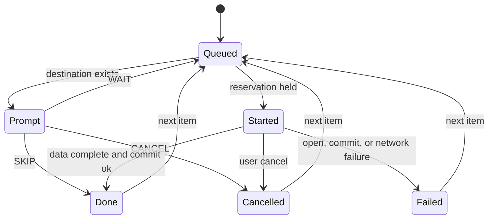
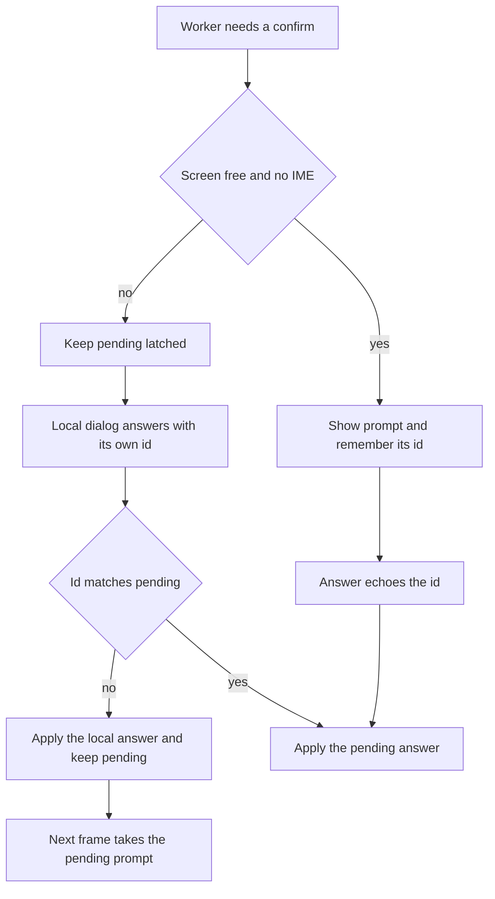
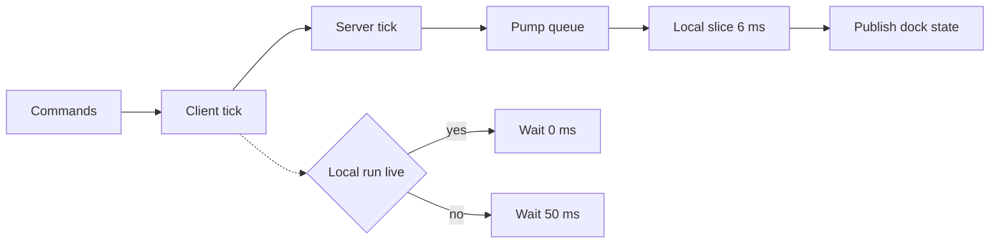

# vitaFTPShell b50 Review Remediation - Plan

## Goal Capsule

- **Objective:** A b50 build in which a failed local open ends as one failed item instead of a dead transfer lane, a local job starts and stops beside a network transfer, every confirm answer applies only to the prompt it answers, and the console run can verify those paths.
- **Means:** Fix the review's findings in one pass, host-test each failure path first, then produce one b50 artifact for the M1-M13 console run (KTD1-KTD12).
- **Authority:** `AGENTS.md` and `docs/DECISIONS.md` govern the project; this plan's R-IDs govern the remediation's scope; `docs/DESIGN.md` governs layout and words.
- **Execution profile:** test-first for every failure path, then one build. The host suite is the evidence gate; the console run is the release gate.
- **Stop conditions:** every R-1..R-15 either met or recorded as deferred; the host suite, stack gate, and sanitizer runs green; one uniquely named b50 VPK; the console rows recorded with `PASS`, `PART`, or `PENDING`.
- **Who finishes:** the implementer lands U1-U11 and builds b50; the operator installs it and runs M1-M13; the project stays `building` until every row passes.

---

## Product Contract

### Summary

Remediate the 29 findings from the full review of b49, plus the five lane-flow gaps the planning research found in the same code, so the next console build exercises a transfer lane that cannot wedge, two lanes that stop independently, and prompts that cannot steal each other's answers.

### Problem Frame

b49 is the first build with the parallel lanes, and it has never run on the console. A full review of the branch found one defect that ends the session: when a download's destination folder has been deleted, or an upload's source has vanished, the client reports the failure synchronously and the worker discards it because the lane is latched only afterwards. The queue item stays active, every later transfer queues behind it, the server answers 450 to every data command, and only quitting recovers.

The remaining findings are smaller but sit on the same paths the console run must exercise: the local lane refuses to start while a network transfer runs, contrary to the settled two-lane rule; a cancellation clears both docks; a local dialog's answer can be consumed by a transfer prompt; a 177 KiB command array lives on the UI stack; a download moves one 2 KiB chunk per worker tick; a blocking connect can outlive a server transfer's deadline; and the project's own binding documents still describe the single-slot product.

Shipping b50 with the lane wedge would burn the console run on its first failed transfer and leave the two-lane feature unverified. The remediation is therefore sequenced so the lane is correct before anything else is measured.

### Requirements

**Lane correctness**

- R1. A transfer whose local open fails ends as one failed item: the queue item leaves the queue, the reservation is released, the dock shows one red terminal with the reason, and the next transfer starts.
- R2. A local action starts while an unrelated network transfer or server client runs; overlapping paths go to the WAIT/SKIP/CANCEL prompt, never a blanket refusal.
- R3. A cancelled lane stops only that lane: the other lane's dock, queue, reservation, and server state survive, and the badge shows the waiting, cancelling, and terminal words the design defines.
- R4. A confirm answer applies only to the prompt it answers; a transfer prompt deferred by a local dialog survives that dialog and is shown when the screen frees, and a transfer held at a prompt is visible and cancellable from the dock.

**UI resources and pacing**

- R5. The UI thread's command dispatch holds no large stack frame and never re-enters itself, and the build gate measures both.
- R6. A LAN download is not capped by the worker tick, and both lanes keep making progress while the other runs; a connect or resolve may stall the local lane for its connect window.

**Server**

- R7. Starting a client connection while a server client is transferring does not interrupt that transfer.
- R8. The server's passive data port serves the control peer and refuses a foreign peer without failing the legitimate transfer; a reply that cannot be queued stops non-ABOR/QUIT command consumption and leaves one server error and one log line, so no reply is lost without a record; and a silent control session is closed instead of holding the only slot forever.

**Commit path and operator text**

- R9. The transfer temp and aside names have one owner; a failed aside restore is reported truthfully and the displaced copy is reachable.
- R10. A conflict prompt names the operation and the item it will replace, and a capacity refusal names capacity.

**Truth and evidence**

- R11. The binding documents describe the shipped two-lane product, and decision statuses name the build that carries them.
- R12. The host suite covers the changed paths: local open failure, two-lane progress, WAIT resume with a destination appearing, a deferred prompt, lane-scoped cancel, aside restore failure, and threaded app mode.
- R13. One b50 artifact builds with zero warnings, an ASan/UBSan-clean integration run, a green stack gate, and every host suite passing.
- R14. The console run records M1-M13 on b50; the project stays `building` until they pass.
- R15. The app processes a queued quit command and its final save before the frame loop ends, and a frame drawn after a listing release shows the pane's prior rows rather than a released buffer.

### Key Decisions

- **Reservation-table mutual exclusion replaces the single-slot guard.** A local action is not refused because a network lane is busy; the reservation table decides overlap, per D72. Governs R2, R3.
- **The server closes a control session after 30 seconds of silence** with `421` and one log line. This is a product-visible behavior the review rejected as pre-existing; it is added here because one silent peer otherwise holds the only client slot until the user restarts the server. The tradeoff is accepted: a client that idles mid-browse loses its session, the panel shows the connected client, and recovery is the server-stop confirm. (session-settled: user-approved - proposed with the tradeoff in the scoping synthesis and confirmed.) Governs R8.

### Scope Boundaries

- In scope: the 29 review findings and the five lane-flow gaps the planning research found in the same functions (the local-action guard, the synchronous transfer terminal, deferred-prompt ownership, WAIT resume, waiting-lane cancel).
- Out of scope: new features, new screens, a second worker thread, any kernel or boot component, FTPS/SFTP/HTTP/WebDAV, and a push or pull request.
- The project's deferred product choices stay deferred: recursive remote folder transfer (R22/R23, D65), a hidden-file toggle, and a `.vftp.old` recovery wizard.

#### Deferred to Follow-Up Work

- **Non-blocking connect and PASV connect.** Both need a `NetPort` in-progress result and adapter changes. This plan takes the interim CONNECT refusal (KTD8) and records the blocking PASV connect as a residual risk.
- **A larger fake filesystem and a partial-I/O model.** The 8 KiB `FAKE_FS_CONTENT_MAX` bounds pump tests; the fakes never short-write. Extending them is its own test-infrastructure job.
- **`test_ports` honesty.** The suite pins the fakes' behavior; it is moved out of the port-coverage count rather than rewritten here.

#### Outside This Product's Identity

- A PC-first UI, a background transfer daemon, a boot-time server, and VitaShell feature parity remain outside the product.

### Success Criteria

- A host case deletes a download's destination folder, observes one failed terminal and no active lane, then completes a second transfer.
- A host case runs a held download beside a local paste, cancels each lane in turn, and observes the other lane's bytes continue.
- A host case opens a site-delete dialog while a transfer conflict is pending, answers DELETE, and observes the site removed and the conflict prompt shown afterwards.
- The console records M1-M13 on b50, including the new rows in the Verification Contract.
- The stack gate reports the worker and UI budgets with the transfer chain and the folder scan included.

---

## Planning Contract

### Key Technical Decisions

- KTD1. **A synchronous local open failure returns a failure result, and the worker owns the terminal.** `ftp_client_download`/`ftp_client_upload` return a distinct non-OK result on a temp/source open failure and stop emitting the operation-done event for that path. After a successful call, the worker latches and announces only while the queue item is still active: a network failure the client reports inside the call has already released the item, so a later latch would recreate the wedge. Chosen over latching the lane before the call: the latch-before shape makes the terminal run inside `start_transfer_item`, and `client_operation_done` ends with a `pump_queue` call that would then nest once per failed item on the 192 KiB worker stack — the b40 crash class on the transfer path.
- KTD2. **The terminal handler gates on queue ownership, not the lane latch.** `client_operation_done` checks `xfer_busy(&worker->queue)` and never pumps the queue from inside a transfer call; `worker_step` pumps every step. This keeps one owner for "is an item active" and removes the last nested pump.
- KTD3. **The local-action guard keeps only local-lane terms.** `handle_action` refuses only when a local run, a held plan, or an executing local batch owns the lane; `reserve_local_plan` decides cross-lane overlap. Chosen over keeping the network terms: the current guard contradicts D72 and makes the WAIT prompt unreachable.
- KTD4. **Cancel events carry the lane, and a waiting local lane counts as live.** The reducer clears only the named lane; `open_dock_cancel` treats `waiting` as a lane; the cancel command names the lane the user saw; a lane start resets its terminal counters.
- KTD5. **Every confirm carries a prompt sequence.** `HandoffConfirm` gains an id, `PendingWork` remembers it, the reducer echoes it on the emitted command, and the worker accepts only its own id. Kind alone is ambiguous because three transfer prompts and two reducer dialogs share `UI_CONFIRM_CONFLICT`.
- KTD6. **`feed` does not re-enter.** The IME-unavailable and command-ring-full events become a deferred event drained at the top of the next frame; the command buffer moves into `App`. Chosen over double-buffering by depth: one buffer plus no self-call is the shape the worker stack gate already enforces.
- KTD7. **The data pumps consume a named per-tick budget, and the network wait is a parameter.** The client and server loops run until would-block, close, error, or budget, mirroring the local lane's slice; `ftp_client_tick`/`ftp_server_tick` take the wait in milliseconds and the worker passes zero while a local run is live.
- KTD8. **Client commands that would arm a passive data connection are refused while the server is busy.** The guard is one predicate, `transfer_active || xfer_busy || ftp_server_busy`, evaluated before any teardown, and it covers CONNECT, RECONNECT, REFRESH, and the automatic post-action refresh, so the blocking PASV connect cannot outlive the server's idle deadline and a queued client item is not silently dropped by a session reset. A connected but idle server session does not trip the guard. The PASV connect itself stays blocking; with the guard in place the only stall left is the client's own connection window, recorded under Residual Risks. (session-settled: user-approved - chosen over a non-blocking connect rewrite: the port has no in-progress result, and the refusal closes the server-transfer risk now.)
- KTD9. **The server bounds its accept and its replies.** `server_try_accept` drains a named number of queued connections per tick, closing foreign sockets, and repeats on later ticks until it finds the control peer or the pending deadline passes. A reply-backlog flag stops non-ABOR/QUIT command consumption above a high-water mark, clears on drain, and reports one server error plus one log line per session. The 450 refusal retries once when the socket is writable and closes regardless. The idle close's tradeoff is recorded with the deciding entry: a browsing client that sends nothing for 30 seconds loses its session, and the panel shows the connected client until it does.
- KTD10. **One sidecar owner lives in `core/path.c`.** Suffix constants plus a builder and two predicates replace the four builders; the reservation pair test is rewritten on the predicate; the store keeps its private `.old`/`.tmp` convention inside the app data folder. A destination, rename target, or new folder whose final component ends in a sidecar suffix is refused, so the app never creates a name its own recovery would treat as its own.
- KTD11. **Sidecar visibility keeps the recoverable copy reachable.** `.vftp.part` is always hidden because it is never a valid file. A `.vftp.old` is always shown, carrying a debris mark, because it may be the only copy of a displaced file; hiding it would make an invisible deletion possible. No row is ever hidden for having a base file.
- KTD12. **The stack gate grows to the UI chain and the recursive scan.** `feed`'s frame and self-call are checked against a named ceiling, `fact_tree` is multiplied by its depth constant, and the 256 KiB main-thread figure gets a repo-local citation in `docs/DECISIONS.md`.

### Residual Risks and Dispositions

| Risk | Disposition | Owner |
|---|---|---|
| A user file whose name ends in a sidecar suffix is deleted by the next write to the base name | Mitigated: the app refuses to create such a name; a file that arrived from outside the app is recorded in a decision entry with `PENDING` evidence | U8, U11 |
| The PASV data connect still blocks for up to 12 seconds | Accepted: the server guard (KTD8) means no client command arms one while the server is busy; the client's own data deadline governs its transfer. A connected but idle server session does not trip the guard, so a 12-second connect counts against that peer's 30-second idle budget | KTD8, U6 |
| A second cancel overwrites the single critical-command slot | Mitigated: an overwrite increments the existing dropped-command counter, surfaced with the other loss counters | U2, U9 |
| `reset_remote_session` discards queued client items | Accepted: DISCONNECT and a lost session own that teardown (D66); CONNECT now refuses before it, which is the only path the fix changes | U6 |
| A full event ring loses a terminal event | Mitigated: loss counters surface one dropped-work notice, and a lane start resets its dock | U9, U2 |
| Filesystem name folding beyond ASCII case is unverified | Accepted and recorded in the open-decisions list; reservations stay ASCII-case-insensitive | U11 |
| The local manager may write inside the `tai` folders | Accepted: D30's high-risk confirmation owns it; not weakened | U11 |
| The name-resolver fallback has no worker-side timeout | Accepted: a resolve can stall the local lane for its window; the connect guard covers the server case | KTD8, R6 |
| A network item hitting a held path retries with no prompt or deadline | Mitigated: the network lane reuses the PATH BUSY prompt and holds the item head-of-line with a visible waiting state | U2 |
| The app could skip its final save when the reducer sets quit | Mitigated: the app keeps ticking until the worker reports quit | U13 |
| The 20-second data deadline runs while the connection is draining | Mitigated: the idle deadline applies only to an active data connection; the command deadline governs the final reply | U5 |
| `UiState` can hold a row pointer into a released listing generation | Mitigated: the previous generation is released immediately before the next acquire, so one slot is held across frames, and the threaded test exercises the cycle under the thread sanitizer | U13, U12 |
| The host fakes are process-wide singletons | Accepted: the one threaded test runs in its own binary | U12 |
| A client call can report a terminal synchronously after starting, for example a control-write failure at PASV arm | Mitigated: the worker latches and announces only while the queue item is still active | U1 |

### High-Level Technical Design

The transfer item has one lifecycle, and every failure path ends in a terminal before the next item starts.

A confirm has one owner and one identity, so a local dialog cannot consume a transfer answer.

One worker step bounds the network wait by whether a local slice is waiting behind it.

### Assumptions

- The 256 KiB main-thread stack figure comes from the workspace fact-check note on the COCKPIT core dumps. The plan cites it through a new decision entry; if the loader turns out to use a different size, the gate's ceiling is still a valid budget, only the citation changes.
- The fake filesystem's 8 KiB content cap is enough to prove a budgeted pump moves more than one chunk per tick. A larger-payload proof is deferred with the fake extension.
- The console can produce a foreign data peer only with a second device or a host fake; where it cannot, the host test is the recorded evidence and the M row says so.

### Sequencing

U1 first: it unblocks every transfer test. U2 and U3 follow in the same lane cluster because they touch the handoff and the reducer. U4 and U5 change the UI and worker budgets before any performance claim. U6-U8 are independent server and commit-path work. U9 and U10 are low-risk cleanup and wording. U11 updates the binding docs once the behavior is settled. U12 adds the evidence and builds b50.

---

## Implementation Units

**Unit Index**

| Unit | Title | Files touched | Depends on |
|---|---|---|---|
| U1 | End a failed transfer honestly | `src/core/ftp/client.*`, `src/app/worker.c` | none |
| U2 | Let the local lane start and stop alone | `src/app/worker.c`, `src/core/uistate.*`, `src/ui/dock.c` | U1 |
| U3 | Route each confirm to its own prompt | `src/core/handoff.*`, `src/core/uistate.*`, `src/app/*` | U2 |
| U4 | Move the UI command buffer and gate the stack | `src/app/app.*`, `tools/check_worker_stack.py` | U1 |
| U5 | Budget the pumps and bound the wait | `src/core/ftp/client.*`, `src/core/ftp/server.*` | U1 |
| U6 | Keep a server transfer alive through CONNECT | `src/app/worker.c` | U5 |
| U7 | Bound the server session and replies | `src/core/ftp/server.*` | U5 |
| U8 | Give the sidecar one owner and honest recovery | `src/core/path.*`, `src/core/reserve.*`, `src/core/ftp/ftp.c`, `src/core/fsop_run.c` | U1 |
| U9 | Retire dead surface and single-source mappings | `src/core/*`, `src/app/*`, `src/ui/actions.c` | U1-U3 |
| U10 | Name the operation and the item | `src/core/fsop_plan.c`, `src/app/worker.c` | U8 |
| U11 | Tell the truth in the docs | `AGENTS.md`, `docs/*` | U1-U10 |
| U12 | Prove it on the host and the console | `tools/test/*`, `docs/*`, `PROJECTS.md` | U1-U11 |
| U13 | Keep the last frame and the last save | `src/app/app.c`, `src/core/uistate.*` | U4 |

### U1. End a failed transfer honestly

- **Goal:** A local open failure produces one failed terminal, releases the item and reservation, and leaves the lane idle and usable.
- **Requirements:** R1
- **Dependencies:** none
- **Files:** `src/core/ftp/client.c`, `src/core/ftp/client.h`, `src/app/worker.c`, `tools/test/test_client.c`, `tools/test/test_integration.c`
- **Approach:**
  - Add one distinct client result for a local open failure and return it from `ftp_client_download` and `ftp_client_upload` instead of returning `FTP_CLIENT_OK`; the failure detail stays in the client's existing last-detail field, and the value is unreachable from the command helpers that share the result type.
  - Stop emitting the operation-done event on that path; the worker's existing `result != FTP_CLIENT_OK` branch becomes the single owner of the failure terminal, mapping the new result to the storage cause and the transfer stage, while pre-operation refusals keep the app cause.
  - After a successful call, latch and announce only while the queue item is still active; a terminal the client reported synchronously inside the call has already released it, and latching afterwards would recreate the wedge.
  - In that branch, release the item and the network reservation, emit one red dock terminal with the mapped reason and the destination base name, and advance the batch.
  - Gate `client_operation_done` on `xfer_busy(&worker->queue)` instead of the manual latch, and remove its trailing `pump_queue` call; `worker_step` already pumps every step.
  - Add the destination-folder preflight before the overwrite prompt, matching the upload path's existing refusal.
  - Refresh the local parent after a failed item so a vanished folder shows as gone.
- **Patterns to follow:** the refusal branch at `src/app/worker.c:2288`; the upload folder refusal; `xfer_release` and `batch_finish`.
- **Test scenarios:**
  - A download whose destination is an existing directory ends with one FAILED terminal, no ACTIVE dock, and no `.vftp.part`.
  - A download whose destination folder was removed after listing ends the same way, and a second download of another file then completes.
  - An upload whose source is removed after listing ends with a SOURCE OPEN FAILED terminal and the next upload completes.
  - After a failed item, CANCEL answers KEEP and DISCONNECT is accepted; the server's 450 clears once the queue is empty.
  - A two-item batch aimed at the same missing folder drains both items and ends idle.
  - The existing client case that asserts an open failure still returns OK is updated to the new result with no operation-done event.
  - Both failure paths record the storage cause class in the session log, not the app class.
  - A transfer whose control write fails at the passive-connection step ends as a failed item with no active lane and no second transfer blocked behind it.
- **Verification:** the new integration cases pass; the dock never shows ACTIVE for an item that already ended; the stack gate is unchanged; the release gate counts no app-class failure for these paths.

### U2. Let the local lane start and stop alone

- **Goal:** A local action starts while a network transfer runs, a network item held by a local path asks WAIT/SKIP/CANCEL instead of retrying invisibly, and a lane-scoped cancel leaves the other lane intact.
- **Requirements:** R2, R3
- **Dependencies:** U1
- **Files:** `src/app/worker.c`, `src/app/app.c`, `src/core/fsop_run.c`, `src/core/uistate.c`, `src/core/uistate.h`, `src/core/handoff.c`, `src/core/handoff.h`, `src/ui/dock.c`, `src/ui/dock.h`, `src/ui/workspace.c`, `docs/DESIGN.md`, `tools/preview/preview.c`, `tools/test/test_uistate.c`, `tools/test/test_integration.c`, `tools/test/test_render_workspace.c`
- **Approach:**
  - Move `local_batch_begin` below the busy guard and keep the dropped-id de-duplication ahead of it.
  - Reduce the guard to local-lane terms only (KTD3); the reservation table owns cross-lane overlap.
  - Carry a direction on the cancelled event, copy it through the app's handoff dispatch, and clear only the named lane in the reducer; name the status word per lane.
  - Increment the dropped-command counter when a cancel overwrites the single critical-command slot, so two quick lane cancels cannot vanish.
  - Treat a waiting local lane as live for the dock cancel, and route the confirm's CANCEL LOCAL/NETWORK to the lane the user saw.
  - Reset skipped, failed, and cancelled counters when a lane starts; show the cancelling word during the stop window.
  - Render a WAITING panel when the local lane is alone (word WAITING, the item or blocker as subject, yellow, no bar), and keep the badge only when the network lane runs; add the composition, the preview state, and the render case with the unit.
  - On WAIT resume, re-stat the plan's destinations and re-apply the existing-destination rule; route every non-resume through the existing terminal emitters and clear the waiting flag.
  - When `start_transfer_item` finds a held path, keep the claimed item, ask the same PATH BUSY prompt with the blocker named, show the network lane waiting, and resume, skip, or cancel on the answer. The item never retries without a prompt or a deadline.
  - Report a cancelled multi-file delete as CANCELLED, not PARTIAL: the delete branch of the executor's failure path finishes CANCELLED when the run was cancelled (D75).
- **Patterns to follow:** the local waiting badge at `src/ui/dock.c:372`; `local_batch_cancel`; `busy_retry`; D78's lane words.
- **Test scenarios:**
  - A held download runs; a local paste starts and both docks advance.
  - CANCEL NETWORK stops the download and leaves the local badge and bytes running.
  - CANCEL LOCAL stops the paste and leaves the network bar and bytes running.
  - A solo waiting lane opens the cancel prompt, and cancelling it ends as CANCELLED without touching a later transfer.
  - A file created at the destination during WAIT raises the conflict prompt on resume instead of overwriting.
  - A two-item local batch whose second item begins after a download starts is not refused.
  - The next local start after a cancel shows running colors, not a stale cancelling word.
  - Two lane cancels issued before the worker pops the first one both take effect or are counted as dropped, never silently lost.
  - A download queued behind a local tree copy asks PATH IN USE naming the blocker; WAIT holds it with a visible waiting state and resumes when the copy releases.
  - The server's 450 stops once the held item resumes or is skipped.
- **Verification:** the integration test asserts the state table; the render suite covers the WAITING panel and the counter reset; DESIGN names the solo waiting composition.

### U3. Route each confirm to its own prompt

- **Goal:** A local dialog's answer never consumes a deferred transfer prompt, and the deferred prompt is shown when the screen frees.
- **Requirements:** R4
- **Dependencies:** U2
- **Files:** `src/core/handoff.c`, `src/core/handoff.h`, `src/core/uistate.c`, `src/core/uistate.h`, `src/core/uiact.h`, `src/app/worker.c`, `src/app/app.c`, `src/ui/dock.c`, `docs/DESIGN.md`, `tools/preview/preview.c`, `tools/test/test_uistate.c`, `tools/test/test_integration.c`
- **Approach:**
  - Add a prompt id to the confirm request, the worker's pending record, the UI confirm state, and the emitted command (a named field, not the generic value).
  - The worker accepts a confirm only when the id matches; a mismatch falls through to the site, server-stop, and discard branches and leaves the pending record latched.
  - The app keeps its existing arbitration: a prompt is taken only when no dialog owns the screen, so the deferred prompt reappears on the next drain after the dialog closes.
  - Give a transfer blocked at a prompt a dock waiting presence and a cancel path.
- **Patterns to follow:** the handoff confirm take/request pair; the app's `drain_events` confirm gate; the PATH BUSY waiting flag.
- **Test scenarios:**
  - A transfer conflict is pending while the site-delete dialog is open; DELETE removes the site, the conflict prompt appears afterwards, and OVERWRITE applies.
  - A mismatched prompt id fed directly at the handoff and reducer level leaves the pending prompt intact; a same-kind local conflict cannot be constructed through the worker while a transfer prompt is pending, so the id check is proven at that boundary instead.
  - STOP SERVER and DISCARD answers still apply while a transfer prompt is pending.
  - A transfer blocked at a prompt is visible on the dock and cancellable.
- **Verification:** the site-delete integration case passes; no prompt loop remains.

### U4. Move the UI command buffer and gate the stack

- **Goal:** The UI dispatch holds no large stack frame, never re-enters itself, and the build gate measures both it and the recursive folder scan.
- **Requirements:** R5
- **Dependencies:** U1
- **Files:** `src/app/app.c`, `src/app/app.h`, `tools/check_worker_stack.py`, `docs/DECISIONS.md`, `docs/VERIFICATION.md`
- **Approach:**
  - Move the command array into `App` as a heap-owned member passed to the reducer.
  - Defer the IME-unavailable event and the command-ring-full event to one pending event drained at the top of the next frame, so the dispatch function has one live frame.
  - Extend the gate with a UI-chain check (the dispatch frame ceiling and its self-call) and a recursive-scan check multiplying the folder-scan frame by its depth constant, requiring the self-call.
  - Record the 256 KiB main-thread figure and both new ceilings in `docs/DECISIONS.md`, citing the evidence copied into `docs/VERIFICATION.md`.
- **Patterns to follow:** the existing `handle_action` and fixed-chain checks; the local batch's "advance from the step frame" rule; D77.
- **Test scenarios:**
  - The IME-unavailable path delivers its error on the next frame without a nested dispatch.
  - A full command ring reports COMMAND QUEUE FULL once and still applies the next input.
  - The gate fails when a synthetic large local is added to the dispatch function, and passes after the move; the check is recorded in the verification document because the host runner executes C only.
- **Verification:** the dispatch frame is under 1 KiB in the linked ELF; both gate checks run from `build.sh`; the manual gate check is recorded.

### U5. Budget the pumps and bound the wait

- **Goal:** A download moves more than one chunk per worker step, and a local job keeps its slice while a remote pane is connected.
- **Requirements:** R6
- **Dependencies:** U1
- **Files:** `src/core/ftp/client.c`, `src/core/ftp/client.h`, `src/core/ftp/server.c`, `src/core/ftp/server.h`, `src/app/worker.c`, `tools/test/test_client.c`, `tools/test/test_server.c`, `tools/test/test_integration.c`
- **Approach:**
  - Add named per-tick byte and time budgets beside the local lane's constants; loop the receive and send pumps until would-block, close, error, or budget, and refresh the data deadline once per pump call.
  - Move the receive scratch buffer into the client struct and coalesce progress events as the seqlock already requires.
  - Pass the wait in milliseconds to the client and server tick functions; the worker passes zero while a local run is live and the named network wait otherwise.
  - Keep the existing data-first ordering in the client and control-first ordering in the server, because ABOR and QUIT must still be served.
  - Refresh the data-idle deadline only in the iteration that moved bytes; a pump call that moves nothing must not re-arm it.
  - Apply the data-idle deadline only while the connection is active; once the payload is drained, the command deadline governs the final reply, so a slow 226 does not discard a complete download.
- **Patterns to follow:** `WORKER_LOCAL_BYTES_PER_STEP` and the local pump loop; the seqlock progress latch.
- **Test scenarios:**
  - A 6 KiB payload arrives in one tick through repeated receives.
  - A would-block mid-payload resumes on the next tick without losing bytes.
  - A connected client tick with a local run live returns within the slice.
  - The server send and store pumps move multiple chunks per tick.
  - Progress events stay coalesced at one sample per pump.
  - A complete payload whose final 226 arrives after the data-idle window still commits the file.
  - A pump call that moves zero bytes leaves the deadline in place, and a stalled server transfer still ends with 426.
- **Verification:** the host cases pass; the console records the observed rate in M12 without a hard threshold.

### U6. Keep a server transfer alive through CONNECT

- **Goal:** A connect attempt during a server client transfer is refused without touching the transfer or the queued client items.
- **Requirements:** R7
- **Dependencies:** U5
- **Files:** `src/app/worker.c`, `tools/test/test_integration.c`, `docs/DECISIONS.md`
- **Approach:**
  - Use the single predicate `transfer_active || xfer_busy || ftp_server_busy`, evaluated before the disconnect and session reset, for CONNECT and RECONNECT.
  - Refuse REFRESH on the same facts, but keep the refresh request latched and re-issue it on the first step the server is idle; a CWD remains allowed so a navigated pane resolves itself instead of going stale.
  - Show the existing TRANSFER IN PROGRESS error in the remote pane; the SITES card clears through the existing error event.
  - Keep D66's teardown rule intact: only DISCONNECT or a lost session resets the remote session, never a refused connect.
- **Patterns to follow:** the client-transfer connect guard; the DISCONNECT refusal; D72.
- **Test scenarios:**
  - A held server transfer runs; CONNECT is refused; the server transfer completes and the queued client items survive.
  - A refused CONNECT does not clear the current remote session.
  - A REFRESH during a held server transfer is deferred, the server transfer completes, and the listing then refreshes.
  - A remote navigation during a server transfer ends on a listed pane, not stale rows.
- **Verification:** the integration cases pass with a held server transfer.

### U7. Bound the server session and replies

- **Goal:** A foreign data peer cannot fail a legitimate transfer, replies are never silently dropped, and a silent control peer is closed instead of holding the slot.
- **Requirements:** R8
- **Dependencies:** U5
- **Files:** `src/core/ftp/server.c`, `src/core/ftp/server.h`, `src/core/handoff.h`, `src/app/app.c`, `src/core/uistate.c`, `src/ui/server.c`, `src/app/worker.c`, `tools/test/test_server.c`, `docs/DECISIONS.md`
- **Approach:**
  - Drain a named number of queued connections per tick, closing foreign sockets, and repeat on later ticks until the control peer arrives or the pending deadline passes; answer 425 only when no matching peer arrived.
  - Track reply-append failure as a backlog; above a high-water mark stop consuming non-ABOR/QUIT commands, report one server error and one log line per session, and clear the flag when the buffer drains.
  - Check the 450 refusal send; retry once when writable and close the socket regardless.
  - Add a control-session deadline refreshed by received bytes and by an active transfer; on expiry send 421 and close with one log line.
- **Patterns to follow:** the existing passive accept loop; the 450 busy refusal; the data-deadline checks.
- **Test scenarios:**
  - A foreign peer connects to the data port first; the legitimate RETR still completes with 226 and no 425.
  - No peer arrives; the command answers 425 at the pending deadline.
  - A peer pipelines commands without reading; replies stop being consumed above the high-water mark, ABOR still works, and draining clears the flag.
  - The second control peer receives 450 rather than a reset, and the first session survives.
  - A silent control peer is closed at the idle deadline with 421 and one log line.
  - The accept drain uses one tick's budget and resumes on the next tick, not a wall-clock loop.
- **Verification:** the server suite covers each case; the backlog error reaches the server panel; M12 records the second peer and the idle close.

### U8. Give the sidecar one owner and honest recovery

- **Goal:** Temp and aside names come from one module, and a failed restore tells the truth and leaves the old copy reachable.
- **Requirements:** R9
- **Dependencies:** U1
- **Files:** `src/core/path.c`, `src/core/path.h`, `src/core/reserve.c`, `src/core/reserve.h`, `src/core/ftp/ftp.c`, `src/core/fsop_run.c`, `src/app/worker.c`, `src/core/ftp/server.c`, `src/core/uistate.h`, `src/ui/workspace.c`, `tools/preview/preview.c`, `tools/test/test_path.c`, `tools/test/test_reserve.c`, `tools/test/test_fsop_run.c`, `tools/test/test_server.c`, `tools/test/test_render_workspace.c`
- **Approach:**
  - Add the suffix constants, one builder, and the suffix and pair predicates to `path.c`; delete the private builders in the FTP temp write and the executor; rewrite the reservation pair test on the predicate; delete the unused reserve helper.
  - Leave the store's `.old` and `.tmp` names alone and document them as private to the app data folder.
  - Check every aside-restore rename; report OLD COPY KEPT AS the aside base name on failure; use NOTHING CHANGED only when the restore succeeded; treat a failed aside cleanup as success with a notice.
  - Run the aside recovery before every overwrite path, including the download commit.
  - Apply the visibility rule: hide `.vftp.part`; show `.vftp.old` always, with a debris mark (row flag, word, and colour) in both the local pane and the server listing, so the recoverable copy stays reachable and is never mistaken for the user's file.
  - Refuse to create a destination, rename target, or new folder whose final component ends in a sidecar suffix, through the existing refusal path; only recovery owns such a name.
- **Patterns to follow:** `path_canonicalize` and the case-insensitive helpers already in `path.c`; the reserve pair relation; the executor's D76 hint pattern.
- **Test scenarios:**
  - A forced restore failure leaves the destination absent, names the aside, and reports the old copy as kept.
  - A forced aside-cleanup failure reports success with a notice, not a failed rename.
  - A stranded aside row is visible and marked; a `.vftp.part` row is absent; an aside whose base exists is absent.
  - The reservation pair still conflicts for both suffixes.
  - A download overwrite and a local rename both leave no aside after success.
  - Creating a file or folder named with a sidecar suffix is refused.
  - `A.BIN` and `a.bin` conflict in the reservation table.
- **Verification:** the path, reserve, executor, server, and render suites pass; M12's overwrite leaves no debris.

### U9. Retire dead surface and single-source the mappings

- **Goal:** One owner per mapping, no unused exports, and no silently dropped events.
- **Requirements:** R3, R10
- **Dependencies:** U1, U2, U3
- **Files:** `src/core/handoff.c`, `src/core/handoff.h`, `src/core/xfer.c`, `src/core/xfer.h`, `src/core/uiact.c`, `src/core/uiact.h`, `src/core/uistate.c`, `src/core/cause.c`, `src/app/app.c`, `src/app/worker.c`, `src/ui/actions.c`, `src/gfx/theme.c`, `src/gfx/draw.c`, `src/gfx/font.c`, `src/platform/fs.h`, `src/platform/psp2_fs.c`, `tools/test/test_uistate.c`, `tools/test/test_xfer.c`
- **Approach:**
  - Delete the unused exports and the duplicate FTP cause and stage name tables; keep `FS_ENTRY_OTHER` because the adapter produces it; delete `FS_OPEN_WRITE_CREATE`.
  - Decide the conflict and terminal latch owner: the worker's batch latch stays, the queue's three unused exports and their fields are deleted, and the queue's lost counter is removed or surfaced with the other loss counters.
  - Keep the three loss counters and surface them through the existing log-loss notice pattern.
  - Add one local-action table keyed by action, consumed by the guard, the executor switch, the direction mapper, and the conflict context name, so the table is the single source for all four.
  - Add one confirm-resolution helper in the reducer used by both key branches.
  - Delete the direct site write in the app and seed the sites through the existing event.
  - Replace the actions screen's string comparisons with a flag on the actions state.
- **Patterns to follow:** the log-loss counter pattern; `ui_command_name`; the reducer's single-owner rule.
- **Test scenarios:**
  - Every action maps to a plan kind or is refused, including a new action added to one place.
  - Both confirm key branches produce the same command for each kind.
  - The sites screen renders before the first publish without a direct write.
  - A full event ring produces one dropped-work notice.
  - One conflict answer and one terminal count are owned in one place, and the deleted queue surface has no caller.
- **Verification:** the build has no unused-symbol warnings; the suites pass.

### U10. Name the operation and the item

- **Goal:** A conflict prompt says RENAME and names the file it will replace; a capacity refusal names capacity.
- **Requirements:** R10
- **Dependencies:** U8
- **Files:** `src/core/fsop_plan.c`, `src/core/uiact.c`, `src/core/uiact.h`, `src/app/worker.c`, `src/main.c`, `tools/test/test_fsop_plan.c`, `tools/test/test_integration.c`
- **Approach:**
  - Record the existing destination in the rename plan and derive the prompt context and item name from one action-to-context helper.
  - Give a same-name rename a skipped count so the batch terminal reads SKIPPED, not RENAMED.
  - Return a distinct capacity result from plan reservation and name it, with a terminal for every non-resume path.
  - Name the frame and tick literals.
- **Patterns to follow:** the local conflict prompt; the batch terminal words; D71.
- **Test scenarios:**
  - A rename onto an existing file shows RENAME, the destination name, and its known size.
  - A rename SKIP ends as SKIPPED, and an OVERWRITE leaves no aside.
  - Reservation exhaustion reports a capacity message, not TRANSFER TOO LARGE.
- **Verification:** the plan and integration suites pass; the confirm preview renders the new text.

### U11. Tell the truth in the docs

- **Goal:** The binding documents describe the two-lane product and the shipped status.
- **Requirements:** R11
- **Dependencies:** U1-U10
- **Files:** `AGENTS.md`, `docs/PROJECT.md`, `docs/ARCHITECTURE.md`, `docs/DECISIONS.md`, `docs/DESIGN.md`, `docs/FIXES.md`, `docs/VERIFICATION.md`
- **Approach:**
  - Rewrite the single-slot sentences in `AGENTS.md`, `docs/PROJECT.md`, and `docs/ARCHITECTURE.md` to the reservation rule and fix the stale worker-stack size.
  - Stamp D72 and D73 with the builds that carry them and extend the decision index to the new entries.
  - Add one superseding entry for D9's one-transfer clause and D51's local-action refusal clause, naming D72 as the governing rule and b50 as the build that carries it; without it the old refusal can be reintroduced as a bug fix.
  - Add the decisions this plan creates: the local-lane guard, prompt identity, the UI stack budget, the sidecar owner and visibility rule, the interim connect refusal, and the server idle close.
  - Add the unverified name-folding behavior and the sidecar-suffix refusal to the open decisions, with the ASCII-case-insensitive reservation rule stated.
  - Index every fixed defect in `docs/FIXES.md` with build, evidence, and status.
  - Copy the main-thread stack evidence (the dump names and the stack-base offset) into `docs/VERIFICATION.md` and cite that section from the decision entry.
  - Leave the suite and preview counts to U12, which adds them; do not pre-state the totals here.
- **Test expectation:** none - documentation. Verified by the workspace link and code-fence check and by a search for the retired single-slot wording.
- **Verification:** no stale single-slot sentence remains; the decision index matches the highest entry.

### U12. Prove it on the host and the console

- **Goal:** b50 exists, every host gate is green, and the console rows are ready.
- **Requirements:** R12, R13, R14
- **Dependencies:** U1-U11
- **Files:** `tools/test/test_integration.c`, `tools/test/test_app_thread.c`, `tools/test/run.sh`, `tools/test/asan.sh`, `tools/test/tsan.sh`, `docs/VERIFICATION.md`, `docs/FIXES.md`, `PROJECTS.md`
- **Approach:**
  - Add the two-lane progress test, the WAIT-resume test with a destination appearing, the deferred-prompt test, and the lane-scoped cancel test to the integration suite.
  - Add one threaded app test in its own binary because the fakes are process-wide singletons; assert the listing arrives through the handoff, exercise acquire, draw, and release across a new generation under the thread sanitizer, and assert the join completes.
  - Add a sanitizer script beside the existing thread-sanitizer script: ASan/UBSan for the integration suite and the threaded binary, TSan for the threaded binary.
  - Run the full host gate, the sanitizer runs, the preview, and `build.sh`; produce one b50 VPK.
  - Record the b50 host-run section with the gate numbers and the M12 observation table, including the new rows.
  - Set the project's next action to the console run; keep the status `building`.
- **Patterns to follow:** the existing integration harness (held data peer, app ticks, fake filesystem); the verification row shape.
- **Test scenarios:**
  - The two-lane test asserts both files finish and both docks reach a terminal.
  - The WAIT test creates a file at the destination during the wait and asserts the prompt.
  - The threaded test runs the worker thread, ticks the app, and joins on quit.
  - The local-open-failure test (U1) and the aside-restore test (U8) run in the same suite.
  - The threaded test runs under the thread sanitizer with no report.
- **Verification:** every suite passes; the ASan/UBSan and TSan runs are clean; the stack gate reports the worker, UI, and recursion numbers; one uniquely named VPK exists; the documentation check reports no issues.

### U13. Keep the last frame and the last save

- **Goal:** A queued quit is processed before the frame loop ends, and a frame drawn after a listing release shows the pane's prior rows.
- **Requirements:** R15
- **Dependencies:** U4
- **Files:** `src/app/app.c`, `src/core/uistate.c`, `src/core/uistate.h`, `tools/test/test_integration.c`, `tools/test/test_render_workspace.c`
- **Approach:**
  - Keep ticking the app until the worker reports quit after the reducer sets quit, so the quit command, the app-stop log line, and the final save all run.
  - Release the previous listing generation immediately before the next acquire, so exactly one slot is held across frames and no frame can draw a released buffer.
- **Patterns to follow:** the frame's acquire and release loop; the listing generation counter.
- **Test scenarios:**
  - Quitting while a worker command is queued still processes the quit command, writes the app-stop log line, and saves settings.
  - A frame drawn with no listing event shows the same rows as the previous frame.
  - A new listing generation replaces the rows without a blank frame.
- **Verification:** the integration and render cases pass; the threaded test exercises the cycle under the thread sanitizer.

---

## Verification Contract

| Gate | Command | Applies to | Done signal |
|---|---|---|---|
| Layering and host suites | `./tools/test/run.sh` | every unit | every suite passes and the platform-include guard reports no new file |
| Sanitizers | `tools/test/asan.sh` for the integration suite, `tools/test/tsan.sh` for the threaded binary | U1, U2, U3, U8, U12, U13 | no sanitizer finding in either run |
| Render states | `./tools/preview/run.sh` | U2, U8, U10 | the newer states render; the state count is recorded |
| Worker and UI stack | `./build.sh` runs `tools/check_worker_stack.py` | U4, U12 | worker chain, action frame, UI dispatch frame, and recursion product inside their ceilings |
| Packaging | `./build.sh` | U12 | one uniquely named b50 VPK, zero warnings |
| Console matrix | `./send.sh` then the operator run | U12 | M1-M13 recorded on b50; `PASS`, `PART`, or `PENDING` per row |

M12's observation table gains rows for: a download into an absent destination (one failed terminal, no active lane, next transfer starts); a download onto a folder (refused before the prompt); the pump rate (recorded, not thresholded) with a local copy beside it; a foreign data peer (host evidence if no second device); a second control peer seeing 450; CONNECT during a server transfer (refused, transfer completes); a site delete while a transfer prompt is pending; a rename onto an existing file (prompt text, SKIP, no aside); a cancelled multi-file delete reading CANCELLED; and the lane words after each cancel.

The final build re-runs M1-M13, not only M12, because the client, server, executor, worker, dock, and crash-pass paths all change.

---

## Definition of Done

- Every R-1..R-15 is met, or is recorded as deferred with its reason in Scope Boundaries or `docs/FIXES.md`.
- Every unit's test scenarios exist as named cases and pass; no feature-bearing unit ships without them.
- The dispatch frame is under 1 KiB in the linked ELF; the worker chain, action frame, and recursion product are inside their ceilings.
- `./tools/test/run.sh`, the ASan/UBSan and TSan runs, and `./tools/preview/run.sh` pass; `./build.sh` emits one b50 VPK with zero warnings.
- `docs/FIXES.md` carries one row per fixed defect with build, evidence, and status, and every one of the 29 review findings maps to a row or a recorded deferral; `docs/VERIFICATION.md` carries the b50 host run, the stack evidence, and the extended M12 table.
- `PROJECTS.md` names the console run as the single next action and keeps the status `building`.
- `AGENTS.md`, `docs/PROJECT.md`, `docs/ARCHITECTURE.md`, and `docs/DECISIONS.md` describe the shipped two-lane product and the new decisions.
- The workspace documentation check reports no broken links or odd code fences.
- No abandoned-experiment code remains in the diff; the deferred items are not half-built.
- `verified` is not claimed without the console rows.

---

## Appendix

### Review Finding Trace

The 29 surviving b49 review findings, each mapped to the unit that fixes it or the section that defers it. Finding 5 was rejected in validation as pre-existing and is excluded. The full evidence stays in the review's own record; this table is the in-repo trace the project requires.

| # | Severity | Finding | Owner |
|---|---|---|---|
| 1 | P0 | Local open failure wedges the transfer lane permanently | U1 |
| 2 | P1 | AGENTS.md still declares one transfer slot as settled scope | U11 |
| 3 | P1 | feed() reserves 177 KiB of the 256 KiB UI stack | U4 |
| 4 | P1 | Download pumps one 2 KiB chunk per worker tick | U5 |
| 6 | P1 | Sidecar naming duplicated in four modules; canonical predicate unused | U8 |
| 7 | P1 | Blocking client connect kills an in-flight server transfer | U6 |
| 8 | P1 | Two-lane worker concurrency and WAIT resume have no end-to-end test | U12 |
| 9 | P2 | App writes UiState.sites outside the reducer; third copy of row mapping | U9 |
| 10 | P2 | UiAction to FsOpKind and XferDirection enumerated in three places | U9 |
| 11 | P2 | Local action refused during a transfer leaves a phantom batch that steals CANCEL | U2 |
| 12 | P2 | Control replies discarded silently when a pipelining peer stops reading | U7 |
| 13 | P2 | Fourteen exported helpers, the duplicated FTP cause/stage names, and two port enum values have no caller | U9 |
| 14 | P2 | Confirm key handling duplicates the kind-to-command mapping | U9 |
| 15 | P2 | XferQueue conflict and terminal latches are dead; the worker keeps a second copy of the same policy | U9 |
| 16 | P2 | Production threaded app mode is never exercised on the host | U12 |
| 17 | P2 | Rename overwrite prompt mislabels action and item name | U10 |
| 18 | P2 | Dropped UI events are silent; handoff_event_lost is never read | U9 |
| 19 | P2 | Local dialog answer consumed by a deferred worker prompt | U3 |
| 20 | P2 | Cancelled multi-file delete reports a failed batch | U2 |
| 21 | P2 | Aside restore is ignored; a failed restore strands the destination and reports "NOTHING CHANGED" | U8 |
| 22 | P2 | 50 ms blocking select starves the local lane each tick | U5 |
| 23 | P2 | Data-port peer check lets any LAN host break a transfer | U7 |
| 24 | P2 | ACTIONS screen reads protected-root policy from display strings | U9 |
| 25 | P2 | Worker-stack gate claims a folder-scan recursion check it never runs | U4 |
| 26 | P3 | Reservation-table exhaustion is reported as 'TRANSFER TOO LARGE' | U10 |
| 27 | P3 | vftp.part/vftp.old sidecars are never hidden from either listing | U8 |
| 28 | P3 | Decision records still call the shipped lanes implementation-pending | U11 |
| 29 | P3 | Busy refusal write result ignored on non-blocking socket | U7 |
| 30 | P3 | Frame and worker tick intervals are bare literals | U10 |
