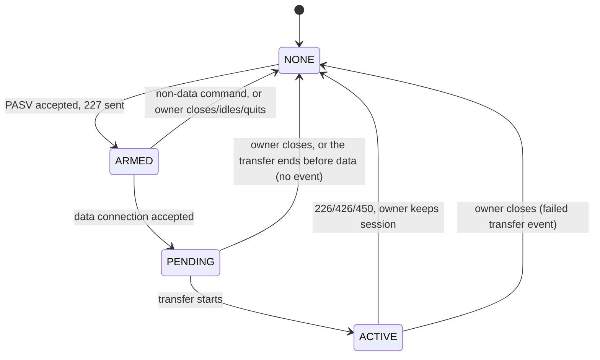
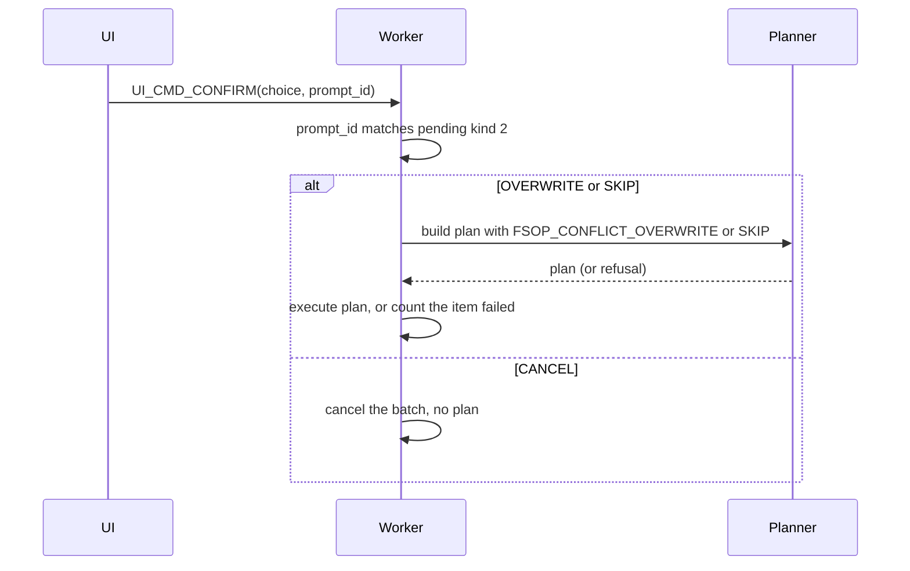
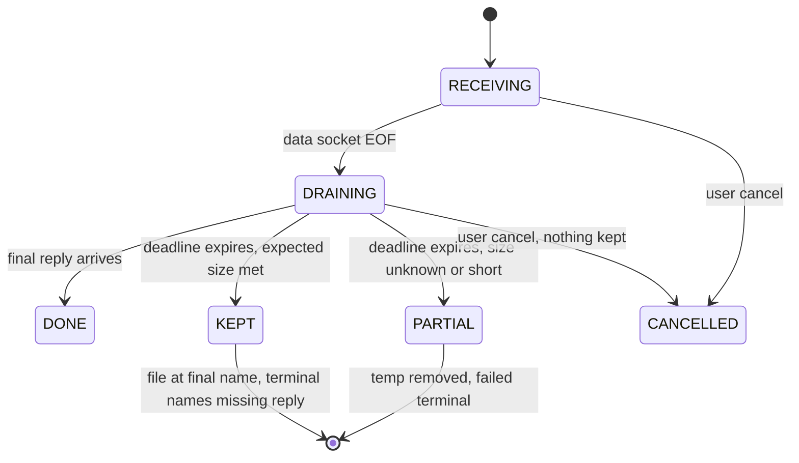

# vitaFTPShell Review Remediation - Plan

## Goal Capsule

- **Objective:** A user can answer a rename conflict and see the file renamed, a console transfer lane never freezes waiting for a reply that will never come, and closing or idling out one FTP client never blocks the next one. The binding documents then describe the build this plan ships, so the console run measures real behavior.
- **Means:** Fix the review's confirmed defects in its own order, each with the test that proves it, then reconcile the docs and close the test-evidence gaps before one build.
- **Authority:** `AGENTS.md` and `docs/DECISIONS.md` govern the project; `docs/FIXES.md` is the record of build and hardware status; this plan's R-IDs govern the remediation's scope; `docs/DESIGN.md` governs layout and words; `docs/plans/2026-11-08-1103-feat-vitaftpshell-v1-plan.md` governs the product.
- **Stop conditions:** every R1-R11 is met or recorded as deferred; the host suite, sanitizer run, stack gate, and document checks are green; one uniquely named VPK exists; `docs/FIXES.md`, `docs/VERIFICATION.md`, and `PROJECTS.md` carry the change.
- **Who finishes:** the implementer lands U1-U8 and produces the next VPK; the operator runs the M1-M13 console matrix on it as the next job. The project stays `building` until that matrix passes.

---

## Product Contract

### Summary

Remediate the three confirmed P1 defects and the remaining actionable findings from the full review of the unpushed branch, so the next console build exercises a conflict prompt that acts, a transfer that ends, and a server that frees its single data slot. The pass also reconciles the documents agents work from and adds the test evidence the range still owes.

### Problem Frame

The review of 45 unpushed commits found no P0, three confirmed P1s, and a set of P2/P3 defects on paths the console run must exercise. All three P1s are behavior a user or a peer client sees:

- A rename onto an existing name raises the DESTINATIONS EXIST prompt, and answering it runs nothing. The base had an answer branch for that prompt; it was deleted while the producer stayed, so the file is never renamed and the batch is booked as failed.
- A download that has received every byte waits forever for the server's final reply. The deadline that used to cover that wait was removed, so a server that goes silent freezes the lane, the queue, and CONNECT until the user cancels, and cancelling then deletes a complete file.
- A session that disconnects or idles out between PASV and its data command keeps the server's single data slot. Every other client's PASV then answers `450 Busy` until the server restarts.

The remaining findings are smaller but sit on the same paths: a foreign ABOR disarms the owner's PASV, a session's own metadata query answers `450`, a PASS argument can reach the session log, the local terminal badge disappears while the network lane runs, the CLIENT panel mixes one peer with another session's command, and five binding documents still describe the pre-b60 product. Shipping the next build with these known would spend the console run proving defects the host suite could have caught.

### Requirements

**Transfer correctness**

- R1. A conflict answer performs the chosen action for the pending local item, or reports that item as failed; it never clears the prompt and does nothing.
- R2. A transfer that has received or sent all expected bytes and then loses the final reply ends within a bounded time; a download keeps the file at its final name and names the missing reply, while a download with missing bytes keeps nothing.
- R3. A server session that closes or idles out releases its data-transfer ownership, including an armed PASV, so another client can transfer.
- R4. No session can abort, disarm, or consume another session's data connection.
- R5. A session can read the metadata of a file it is downloading, and cannot read or write a path another session or lane holds.
- R6. No PASS argument reaches the session log on any command path, including the reply-backlog drop path.

**Operator truth**

- R7. Server and local path checks share one case-folding and ancestor rule, and the reservation contract its header documents matches its behavior.
- R8. WORKSPACE shows the local lane's terminal state, and the CLIENT panel attributes a peer, operation, and path to one session.

**Truth and evidence**

- R9. Every binding document states the shipped four-session, one-transfer server, the removed SERVER warning panel, and the decisions and builds that carry them.
- R10. No surface from the retired high-risk confirmation remains reachable or compiled.
- R11. The host suite, sanitizer run, and stack gate cover the changed paths, the stack gate reads its recursion depth from the source it measures, and timing windows introduced or touched by this work are named constants.

### Key Decisions

- D86. **The server accepts four control sessions with one data transfer at a time.** (session-settled: user-directed — chosen over a single client: FileZilla opens several sessions for one job.) Governs R3, R4.
- D87. **The server and the local manager may write the app data folder and `tai`; `ur0:tai/boot_config.txt` and the system roots stay denied.** (session-settled: user-directed — chosen over keeping app data and `tai` closed to the server: the owner accepted the exposure.) Governs R5.
- D88. **The SERVER warning panel stays removed.** (session-settled: user-directed — chosen over keeping the disclosure panel: the owner accepted the reduced disclosure.) Governs R9.

### Success Criteria

- `./tools/test/run.sh` passes every suite, including the new cases named in U1-U6 and U8.
- `./tools/test/asan.sh` builds and runs every host suite clean.
- `./tools/check_worker_stack.py` passes and its self-test proves it fails when the depth constant exceeds the budget.
- `./tools/preview/run.sh` renders 40 states: the retired high-risk state leaves in U8 and the kept-download state enters in U2, so the pinned count does not change; `./tools/check_assets.sh` is green.
- `./build.sh` emits one uniquely named VPK from the final source state with zero compiler warnings; its number is whatever the build contract assigns.
- The documentation link and code-fence check from `AGENTS.md` reports no issues, and `git diff --check` is clean.
- The console matrix is not a criterion of this plan; it remains the next job.

### Scope Boundaries

**In scope**

- The 28 actionable review findings other than the worker split: the three P1s, and the P2/P3 defects, test gaps, dead surface, and stale documents listed in U1-U8.

**Deferred to Follow-Up Work**

- The `worker.c` split (review finding #10). It is a 3,530-line structural change; keeping it out holds this diff reviewable before the console run. The stack-gate depth fix (U8) still lands now so the split cannot silently invalidate the gate. Evidence that would pull it forward: another feature landing in the same file after this build.
- The M1-M13 console matrix on the build this plan produces. It needs that VPK and a hardware session.
- The per-transfer SIZE/MLST preflight before RETR (review finding #7): a download whose size changed after the listing is deleted as a partial when the final reply is lost. The failure direction protects truncation; the fix needs a client step and a download-test rewrite.
- The two review test gaps: an owner RETR metadata test with a busy guard, and a true two-item queue terminal. Both are recorded in `docs/FIXES.md`.
- Recursive remote folder transfer (R22/R23), the hidden-file toggle, and the `.vftp.old` recovery wizard remain deferred product choices.

**Considered and not built**

- Non-blocking connect and PASV connect: both need a `NetPort` in-progress result and adapter changes; the current blocking window is bounded and the review did not find it regressed this range.
- A data-connection peer check on port as well as address: two clients on one host can share an address, but rejecting a mismatched port would also reject legitimate NAT and would need evidence from a real client failure first.
- Folded-path rejection for trailing dots or spaces: the Vita filesystem's folding behavior is unverified, and a blanket refusal would reject valid names. Recorded as a `[C]` open claim instead.
- The remaining review residual risks (sidecar `RNTO` asymmetry, reservation arena duplicating plan strings, a second cancel overwriting the first, `FEAT` advertising a `perm` fact never emitted, a stale PASV address after DHCP change) are recorded by U7 in `docs/FIXES.md` with their evidence, so they do not live only in this plan. Each needs a concrete failure on hardware or a test before it becomes planned work.

**Outside this product's identity**

- No SFTP/FTPS, background daemon, boot-time server, PC-first workflow, or VitaShell parity work. The product boundaries in `STRATEGY.md` are unchanged.

---

## Planning Contract

### Key Technical Decisions

- KTD1. **The conflict answer re-plans the action instead of resuming a saved plan.** The prompt frees the plan, so the answer must call the executor with the chosen conflict decision; retaining the plan across an unbounded user dialog would hold arena memory and could describe a filesystem that changed. Rejected: keeping the plan alive and resuming it.
- KTD2. **The final-reply wait gets its own deadline branch, and expiry ends the control session.** The generic stage deadline routes to `client_lost`, which discards the file; the data deadline was removed deliberately. A dedicated deadline keeps the file decision local, covers RETR and STOR alike, and uses the existing 10 s command timeout as its value. Tearing down the control session prevents a late 226 from being read as the next command's reply; the remaining queue then ends as one cancelled batch terminal naming the lost session, rather than clearing silently. Rejected: reusing `stage_deadline`, leaving the control session open for a late reply, and letting the session-lost path empty the queue without a terminal.
- KTD3. **Keep a completed download only when the expected size is known and met.** A missing final reply can also mean the payload was truncated. The expected size is the listing's size in this build; the per-transfer SIZE/MLST preflight the plan first chose is deferred because it adds a client step and rewrites every download test. Committing on unknown size would keep a short file under the target name; deleting on a known complete size would lose a good download. Rejected: always keep, always delete, and a preflight that would delay this pass.
- KTD4. **An armed data slot is released by one owner-scoped teardown helper, separate from the transfer event.** Widening the transfer-event test would make a bare PASV close emit a failed transfer with a stale name. The helper releases whenever the closing session owns the slot; the event stays on the active and pending-accept states. Rejected: widening `had_transfer`, and adding a second close path.
- KTD5. **The self-path exemption is owner-only, read-only, and download-only, enforced in the server path check; reservations stay lane-blind.** The exemption applies only while the requesting session owns an ACTIVE or PENDING transfer, only to a metadata read, and only when the path equals the one recorded for that transfer; the recorded path is cleared when the slot is released. An upload's destination is a sidecar, so its metadata is answered as not found rather than exempted. A lane parameter cannot distinguish four sessions sharing one lane and would let one session read another's held path. Rejected: adding a lane argument to the reservation check, and exempting an upload's destination.
- KTD6. **The CLIENT panel reads one session's record from the server event.** The panel currently pairs the last accepted peer with whichever session spoke last. Carrying the session index with the event restores the pairing the design describes. Rejected: relabeling the panel `LAST CLIENT` and dropping the peer/path pairing.
- KTD7. **The stack gate reads `WORKER_REMOTE_DEPTH` from one header both the worker and the gate name.** A copy in the gate drifts silently; a fixed path into `worker.c` breaks when the deferred split moves the scan. The constant moves beside the scan it measures and the gate fails closed when it cannot find it. Rejected: leaving the copy, adding a comment, and parsing a fixed source path.
- KTD8. **An explicit cancel during the final-reply wait still discards the file.** The deadline covers a user who did not ask to stop; cancel means stop and remove, and the dock says nothing was kept. Rejected: treating cancel and timeout the same, which would let a cancel silently keep a file the cancel warning says is removed.

### High-Level Technical Design

The server's data slot is a single resource owned by one session at a time; the fix makes ownership survive every state, not just an active transfer.

The conflict prompt is answered by a re-plan, so the answer path never depends on freed state.

A download's end is a bounded state machine, with the kept-file decision made from the byte count.

### Sources and Research

The reviewed range is `96e527a..8e16e72`, 45 unpushed commits and 81 files from the b40 correction through b63. The remediation scope is the review's 29 actionable findings minus the deferred worker split: three confirmed P1 defects, then the P2/P3 set, with the review's own fix order preserved.

Two research passes fed the plan: a repository-patterns pass over session teardown, client deadlines, worker prompt routing, the reservation API, the dock badge, trace redaction, the test fakes, and the documents' authority order; and a flow/edge-case pass over the conflict-answer re-plan, download end states, armed-slot release, the own-path query, and the operator surface. Their conclusions are carried in the units and decisions above rather than cited from a transient file.

### Risks and Mitigations

| Risk | Mitigation |
|---|---|
| Session teardown changes regress the b60 FileZilla path | U3 adds close-while-armed, close-while-active, QUIT, and foreign-ABOR cases before the change is accepted |
| The final-reply deadline deletes a good file or keeps a truncated one | U2 tests both the known-complete and short/unknown cases, and the kept file is asserted at its final name |
| The self-path exemption becomes a cross-session read | U4 allows only the owning session and only metadata reads; write and delete stay guarded, and a second session's query is tested |
| Opaque `Reserve` needs a heap allocation and a create-failure path in the worker | U5 follows the existing `FsOpRun` create/destroy pattern, allocates once at worker start, and reports a failed allocation instead of running without reservations |
| The final-reply deadline is shorter than a real server's reply latency | It uses the existing 10 s command timeout, the client log records the elapsed wait, and the console run can confirm it |
| A doc edit contradicts the code again | U7 treats `docs/FIXES.md` and `docs/DECISIONS.md` as authority and runs the link check |

### System-Wide Impact

The change crosses the FTP server, the FTP client, the worker, the dock, the SERVER panel, the build gate, and five binding documents. It adds no persisted format, no migration, and no change to the D87 access policy or the D88 warning removal. Two product-visible behaviors change and get numbered decisions: the final-reply deadline and the kept-file rule (D89), and the owner-only metadata exemption (D90).

### Documentation Plan

- U7 reconciles `AGENTS.md`, `README.md`, `PROJECTS.md`, `docs/ARCHITECTURE.md`, `docs/DESIGN.md`, `docs/PROJECT.md`, `docs/FIXES.md`, `docs/design/README.md`, `src/core/ftp/server.h`, and the v1 plan's warning-panel references. It also writes the D89/D90 entries, the host-run row in `docs/VERIFICATION.md`, and the residual-risk rows in `docs/FIXES.md`, and keeps the anonymous read-write exposure stated in `README.md` and `docs/PROJECT.md`.
- `docs/DECISIONS.md` gains D89 and D90 when the behavior lands.
- `docs/FIXES.md` gains a row for each defect and the current artifact under the build number the final build emits; `docs/VERIFICATION.md` records the host run and leaves the console rows pending.
- `PROJECTS.md` gets one row and one next action for the console matrix.

---

## Implementation Units

### U1. Answer a local conflict prompt

- **Goal:** An OVERWRITE, SKIP, or CANCEL answer performs the chosen action for the pending local item, including the re-ask after a WAIT, and a re-plan that refuses counts the item as failed.
- **Requirements:** R1.
- **Dependencies:** none.
- **Files:** `src/app/worker.c`, `src/app/worker.h`, `tools/test/test_integration.c`, `tools/test/test_fsop_run.c`.
- **Approach:** Add the missing answer branch for the pending local-action kind. OVERWRITE and SKIP call the executor with the matching conflict decision so the plan is rebuilt against the current filesystem; CANCEL cancels the batch. Replace the prompt kind integer with a named enum and a switch so a missing arm is a compiler warning rather than a silent fall-through. A re-plan that refuses because the source vanished must increment the failed count and advance the batch, not emit a done terminal with zero work.
- **Patterns to follow:** the existing network-prompt answer branch beside it, and `execute_action`'s conflict argument used by the batch path.
- **Test scenarios:**
  - Rename a file onto an existing name, answer OVERWRITE: the target is replaced and one green terminal appears.
  - Answer SKIP: the target is unchanged, the item is reported skipped, and the batch advances.
  - Answer CANCEL: the batch is cancelled and no file changes.
  - Hold a WAIT item until its destination appears, then answer OVERWRITE at the re-ask: the operation runs.
  - Delete the source while the prompt is open, then answer OVERWRITE: the item is counted failed, not done.
- **Execution note:** Start with the failing integration case for the rename answer; it is the reported user-facing bug.
- **Verification:** the new cases fail before the change and pass after; no prompt can clear without either an action or a recorded failure.

### U2. Bound the transfer final-reply wait

- **Goal:** A transfer that has moved all its bytes and then loses the final reply ends within a bounded time; a download keeps the file at its final name and reports the missing reply; a short or unknown-size download keeps nothing; an explicit cancel still discards.
- **Requirements:** R2.
- **Dependencies:** none.
- **Files:** `src/core/ftp/client.c`, `src/core/ftp/client.h`, `src/core/xfer.h`, `src/core/handoff.h`, `src/core/uistate.h`, `src/core/uistate.c`, `src/app/app.c`, `src/app/worker.c`, `src/ui/dock.c`, `tools/test/test_client.c`, `tools/test/test_uistate.c`, `tools/test/test_render_workspace.c`.
- **Approach:** Give the draining state its own deadline, set when the data socket reaches EOF and named beside the existing client timeouts; it uses the existing 10 s command timeout and covers RETR and STOR. Before a download, establish the expected size with a SIZE/MLST preflight and fall back to the listing size only when the server cannot report one. On expiry, compare the received count against that size: when it is known and met, commit the temp to the final name and end in a distinct result that names the missing final reply; otherwise remove the temp and end failed. Carry a kept-file flag through the handoff event and the reducer into the dock, where the failed dock prints the kept wording instead of `NO PARTIAL KEPT`, and relist the local pane. The kept terminal reads `DOWNLOADED` in yellow with `FINAL REPLY MISSING` on line three, recorded in `docs/DESIGN.md` under D89 and previewed as one state; U8 removes one preview state, so the pinned count stays 40. Record the cause class as network-interrupted, not app-class. An explicit cancel during the wait keeps today's discard (KTD8). Ending the control session on expiry also ends the remaining queue as one cancelled batch terminal naming the lost session.
- **Patterns to follow:** the existing command-timeout terminal, the temp/commit path used by a normal successful download, and the dock's partial-set wording rule.
- **Test scenarios:**
  - Download every byte, withhold the final reply, advance past the deadline: one terminal naming the missing reply, file present at its final name, no sidecar left, dock shows the kept wording.
  - Deliver the final reply just before the deadline: normal success, no second terminal.
  - Deliver fewer bytes than the preflight size and withhold the reply: the partial file is removed and the terminal says nothing was kept.
  - Report no size before the transfer and withhold the reply: nothing is kept, because completeness cannot be established.
  - (Deferred) a stale listing size with a complete transfer: the preflight that would keep it is review finding #7 and lands with the next download-path change.
  - Upload every byte and withhold the reply: the lane ends within the deadline and no upload temp or aside remains.
  - Cancel during the wait: the existing cancel path runs and nothing is kept.
  - Let the deadline end the session with two items still queued: the queue ends as one cancelled terminal naming the lost session, and after a reconnect the next transfer runs.
  - Render the kept terminal beside a running network lane: the dock word differs from `NO PARTIAL KEPT`.
- **Verification:** the timeout terminal is reachable in a host test for both directions, the kept or removed state matches the known size, the queue ends with a terminal rather than clearing, and the dock text distinguishes kept from discarded.

### U3. Release the data slot with its owner

- **Goal:** Closing or idling out a session releases its data-slot ownership in every state without a phantom transfer, a foreign ABOR cannot disarm the owner, and one teardown body serves both close paths.
- **Requirements:** R3, R4.
- **Dependencies:** none.
- **Files:** `src/core/ftp/server.c`, `src/core/ftp/server.h`, `tools/test/test_server.c`.
- **Approach:** Add one owner-scoped release used by both the normal close and the control-failed path: ownership is any non-idle data state whose session index matches the closing session. The helper runs the existing teardown body rather than only clearing state: it closes the accepted data socket, releases the server lane's reservation, aborts any upload temp or aside, and clears the transfer fields. Emit the transfer-done event only for an ACTIVE transfer, so an armed or pending-accept close is silent and cannot report the previous transfer's bytes. Implement the control-failed path as a close with no 221 and move the flush under that guard to avoid recursion. Apply the same ownership test to the ABOR branch that currently disarms any session's slot. This preserves the four-session, one-transfer rule (D86).
- **Patterns to follow:** the existing disarm used by QUIT for the owner, the session-index helper already in the file, and the data-close path used by a failed transfer.
- **Test scenarios:**
  - Connect B first, then have A arm PASV and disconnect: B's PASV succeeds and completes a listing. B must be connected before A closes so slot reuse cannot mask the wedge.
  - Connect B first, then have A arm PASV and idle out past the control timeout: B's PASV succeeds.
  - A is mid-transfer and its control drops: exactly one failed transfer event, the slot frees, A's reservation is released, no upload temp remains, and B can transfer.
  - A arms PASV, sends a data command, and disconnects before the data connection is accepted: no event, the slot frees, and B can transfer.
  - A arms PASV, B sends ABOR: A's listing still starts, and B gets the no-transfer reply.
  - A arms PASV then QUIT: no failed-transfer event, and B can transfer.
- **Execution note:** Add the close-while-armed case first, with B already connected; it fails on the current code and is the wedge the console run would hit.
- **Verification:** no close path leaves the data session, reservation, or temp set; the event count matches the state at close.

### U4. Guard the server's own path and mask PASS on every trace path

- **Goal:** A session can query the metadata of a file it is downloading, other sessions and all writes still get a busy reply, and no PASS argument is logged when a command is dropped.
- **Requirements:** R5, R6.
- **Dependencies:** none.
- **Files:** `src/core/ftp/server.c`, `src/core/ftp/server.h`, `tools/test/test_server.c`.
- **Approach:** Replace the three positional flags in the server's path check with a named access value so a check cannot be mistaken for a hold. The exemption applies only when the requesting session owns a transfer in the ACTIVE or PENDING state, the command is a metadata read, and the canonical path equals the local path recorded for that transfer; the recorded path is cleared when the slot is released. An upload's destination is a sidecar, so a STOR's destination metadata answers not-found rather than being exempted. Every write, delete, rename, and listing stays guarded, and the denial set is D87's. Mask PASS by a case-insensitive first-token match on the raw line before the backlog branch, replacing the whole argument, so upper, lower, tab-separated, and bare forms all carry only `****`. The reservation header's contract text belongs to U5.
- **Patterns to follow:** the existing command allowlist for the data owner, the PASS mask on the accepted path, and the command tokenizer's normalization.
- **Test scenarios:**
  - While session A downloads, A's SIZE or MLST of the source answers success, not `450`.
  - While session A uploads, A's SIZE of the destination answers `550`, not `450` and not a size.
  - While session A transfers, A's STOR or DELE of the destination still answers busy.
  - After A's transfer ends and B arms PASV, B's SIZE of A's old path answers busy.
  - While session A downloads, session B's SIZE of that path answers busy.
  - Fill a session's reply buffer with unread replies, send `PASS hunter2`, and assert the log holds `FTPC PASS ****` and not the argument.
  - Repeat the drop-path case with a tab separator, lowercase `pass`, and a bare `PASS`; each is masked.
  - The accepted-path trace still masks PASS.
- **Verification:** the query exemption is owner-only, read-only, and download-only; the log contains no PASS argument in either trace path.

### U5. One path rule for reservations

- **Goal:** The reservation module and the path module share one case-folding and ancestor rule, the reservation type is opaque, the worker degrades honestly if its storage cannot be allocated, and the header's contract matches the code.
- **Requirements:** R7.
- **Dependencies:** none.
- **Files:** `src/core/reserve.c`, `src/core/reserve.h`, `src/core/path.c`, `src/core/path.h`, `src/app/worker.c`, `tools/test/test_reserve.c`, `tools/test/test_path.c`.
- **Approach:** Export the proper-ancestor helper from the path module and delete the reservation module's copies of case-folding and prefix logic. Make the reservation type opaque behind create and destroy, matching the executor's existing shape. The table and arena are about 288 KiB, so the worker allocates once at start and keeps a pointer; a failed allocation reports one visible error and leaves both lanes refusing to start rather than running unguarded. Move the capacity constants into the implementation and rewrite the conflict comment to state the real lane-blind contract.
- **Patterns to follow:** the executor's create/destroy and arena pattern; the path module's canonicalization.
- **Test scenarios:**
  - The shared ancestor helper agrees on equal paths, proper ancestors, siblings, and a volume root.
  - Adding the same path twice for one lane is idempotent; a conflicting second lane is reported with the blocking path.
  - Exhausting entries or arena returns failure without leaving a partial entry.
  - Create, add, release, destroy leaves no state and the next create starts empty.
  - A failed create surfaces one error and no lane starts with an unguarded plan.
- **Verification:** no behavior change in the suite beyond the shared helper and the allocation path; every embedder compiles against the opaque type.

### U6. Show the local terminal and pair the CLIENT panel

- **Goal:** WORKSPACE shows the local lane's done, failed, or cancelled badge while the network lane runs, and the CLIENT panel names one session's peer, operation, and path together.
- **Requirements:** R8.
- **Dependencies:** U3, for the transfer states and the event shape U6 extends.
- **Files:** `src/ui/dock.c`, `src/ui/dock.h`, `src/app/worker.c`, `src/core/handoff.h`, `src/core/ftp/server.c`, `src/core/ftp/server.h`, `src/ui/server.c`, `tools/test/test_render_workspace.c`, `tools/test/test_render_screens.c`, `tools/test/test_server.c`.
- **Approach:** Use one badge-visibility predicate for the dock's layout and its draw pass, and include the done, failed, and cancelled states. The terminal words are `LOCAL DONE` dim, `LOCAL FAILED` red, and `LOCAL CANCELLED` white matching the dock's terminal; `LOCAL CANCELLING` stays only while the cancel is in flight. Record those words in `docs/DESIGN.md`. Move the last command onto the session record and store the masked command verb only, never its arguments, so a PASS cannot reach the panel; emit the client event when a session's command changes. The panel follows the session that most recently reported an event (accept, command, or transfer); when that session closes while others remain, it falls back to the most recently accepted live session, and `NO CLIENT` appears only when none remain.
- **Patterns to follow:** the network badge's existing predicate, the client panel's connected/idle split, and the PASS mask U4 applies.
- **Test scenarios:**
  - Local done while the network lane runs: the dock shows `LOCAL DONE`.
  - Local failed while the network lane runs: the badge is red and names the failure.
  - Local cancelled while the network lane runs: the badge reads `LOCAL CANCELLED`, not `LOCAL CANCELLING`.
  - Network active and local idle: no local badge is invented.
  - Session A connects and browses, then session B issues a command: the panel shows B's peer, command, and path.
  - A's PASS command while B is connected: the panel shows the command name with no argument.
  - The shown session closes while another remains: the panel falls back to the live session instead of `NO CLIENT`.
  - No client: `NO CLIENT` and `UP TO 4 CLIENTS`.
- **Verification:** the render and server tests assert both the badge words and the per-session pairing.

### U7. Reconcile the binding documents

- **Goal:** Every binding document states the shipped four-session, one-transfer server, the removed SERVER warning panel, b43 as tested, the current build and its single next action, 40 preview states, decisions through D90, and the anonymous read-write exposure with the `boot_config.txt` denial.
- **Requirements:** R9.
- **Dependencies:** U2 and U4 for D89 and D90; the build for its number.
- **Files:** `AGENTS.md`, `README.md`, `PROJECTS.md`, `docs/ARCHITECTURE.md`, `docs/DECISIONS.md`, `docs/DESIGN.md`, `docs/PROJECT.md`, `docs/FIXES.md`, `docs/VERIFICATION.md`, `docs/design/README.md`, `docs/plans/2026-11-08-1103-feat-vitaftpshell-v1-plan.md`, `src/core/ftp/server.h`.
- **Approach:** Correct each stale statement at its source rather than adding a new note: the architecture server section, the server header's one-client contract, the design inventory and high-risk paragraph, the project phase row, the board's next action, the preview count, the decision ranges, and the v1 plan's warning-panel references. The removed warning stays the shipped state (D88). Write D89 (the final-reply deadline and kept-file rule) and D90 (the owner-only metadata exemption), the host-run row in `docs/VERIFICATION.md`, and the residual-risk rows in `docs/FIXES.md`. Keep the anonymous read-write exposure and the `boot_config.txt` denial stated in `README.md` and `docs/PROJECT.md`, because D88 accepted the reduced on-screen disclosure on that basis. Record the artifact number the final build actually emitted rather than a predicted number. The preview count stays 40 because U2 adds one state and U8 removes one.
- **Patterns to follow:** the wording already used for the four-session rule in `AGENTS.md`, for the removed warning in `docs/DECISIONS.md`, and for the exposure in `README.md`.
- **Test expectation:** none -- documentation and comment text only.
- **Verification:** the link and code-fence check from `AGENTS.md` reports no issues; no document still names the warning panel or a one-client limit; the exposure and denial are still stated; `docs/FIXES.md` carries the residual rows and `docs/DECISIONS.md` carries D89/D90.

### U8. Delete the retired surface and prove the gates

- **Goal:** No high-risk-prompt surface remains compiled or reachable, the batch idle window is named, the sanitizer covers every suite, and the stack gate reads its depth from one header the worker also names.
- **Requirements:** R10, R11.
- **Dependencies:** none.
- **Files:** `src/core/ftp/client.h`, `src/core/ftp/client.c`, `src/core/fsop_plan.h`, `src/core/fsop_plan.c`, `src/core/uistate.c`, `src/core/uistate.h`, `src/core/uiact.h`, `src/core/handoff.h`, `src/ui/confirm.c`, `src/app/app.c`, `src/app/worker.c`, `src/app/worker.h`, `src/gfx/theme.c`, `src/gfx/draw.c`, `src/gfx/draw.h`, `tools/preview/preview.c`, `tools/test/asan.sh`, `tools/check_worker_stack.py`, `tools/test/test_integration.c`, `tools/test/test_server.c`, `tools/test/test_uistate.c`, `tools/test/test_render_screens.c`, `.github/workflows/`.
- **Approach:** Delete the retired need-risk result and approval field, the plan's high-risk fields, the unreachable confirm kind with its branches and fields, the dead theme macros, and the callerless draw helper. Remove the `confirm-high-risk` preview state and the DESIGN paragraph that keeps the layout for history; U2 adds one preview state, so the pinned count stays 40. Name the batch idle constant. Extend the sanitizer script to every suite the host runner builds and add a CI step that runs it after the host suite. Move `WORKER_REMOTE_DEPTH` into the worker header both the worker and the gate name; the gate reads it there, fails the build with a named message when it cannot find it, and self-tests both a raised depth and a missing constant. Add the deferred-confirmation test and the server guard plus storage-failure tests named in the review.
- **Patterns to follow:** the existing suite list in the host runner, and the gate's current symbol scan.
- **Test scenarios:**
  - A local dialog open when a transfer reaches its collision: the dialog answers first, then the transfer prompt appears and is cancellable.
  - A server write fails with no space mid-upload: one `451`, one failed terminal, no temp left.
  - A server read fails mid-download: one `451`, one failed terminal.
  - The sanitizer script builds and runs every host suite.
  - The gate's self-test passes at the current depth, fails at a depth above the budget, and fails when the constant is absent.
  - The preview renders 40 states with the high-risk state gone and the kept-download state present.
- **Verification:** no symbol from the retired prompt is referenced; the sanitizer and gate failures are observable, not assumed.

---

## Verification Contract

| Check | Command | Proves |
|---|---|---|
| Layering and host suites | `./tools/test/run.sh` | policy stays platform-free and every suite passes, including the new cases |
| Sanitizers | `./tools/test/asan.sh` | every host suite is memory- and UB-clean |
| Screen preview | `./tools/preview/run.sh` | the 40 settled states still render, including the dock badge and SERVER panel |
| Assets | `./tools/check_assets.sh` | the launcher icon guard stays green |
| Build and stack gate | `./build.sh` | one VPK, zero warnings, worker stack inside budget |
| Docs | the link and code-fence check in `AGENTS.md` | no broken links or odd fences |
| Whitespace | `git diff --check` | no trailing-whitespace regressions |

The console matrix is not run in this plan. `docs/VERIFICATION.md` records the host evidence and leaves M1-M13 pending.

---

## Definition of Done

- Every R1-R11 is met, or the unaddressed part is named in Scope Boundaries with its reason.
- Each unit's test scenarios exist and fail on the pre-fix code where they describe a defect.
- `./tools/test/run.sh`, `./tools/test/asan.sh`, `./tools/preview/run.sh`, `./tools/check_assets.sh`, and `./build.sh` pass with no warnings.
- `build/` holds exactly the one VPK the final build emitted; `BUILD_NUMBER` matches that number.
- `docs/FIXES.md` carries a row per defect and the current artifact under the emitted build number; `docs/DECISIONS.md` carries D89 and D90; `docs/VERIFICATION.md` records the host run with the console rows pending.
- `PROJECTS.md` and `AGENTS.md` state the emitted build and the single next action: run the M1-M13 matrix.
- No abandoned or experimental code from the pass remains in the diff.
- The project is not called `verified`; M1-M9, M11, and M12 are still pending.
