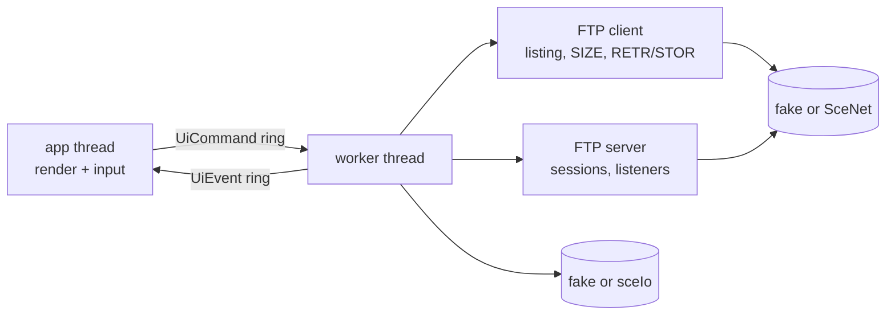
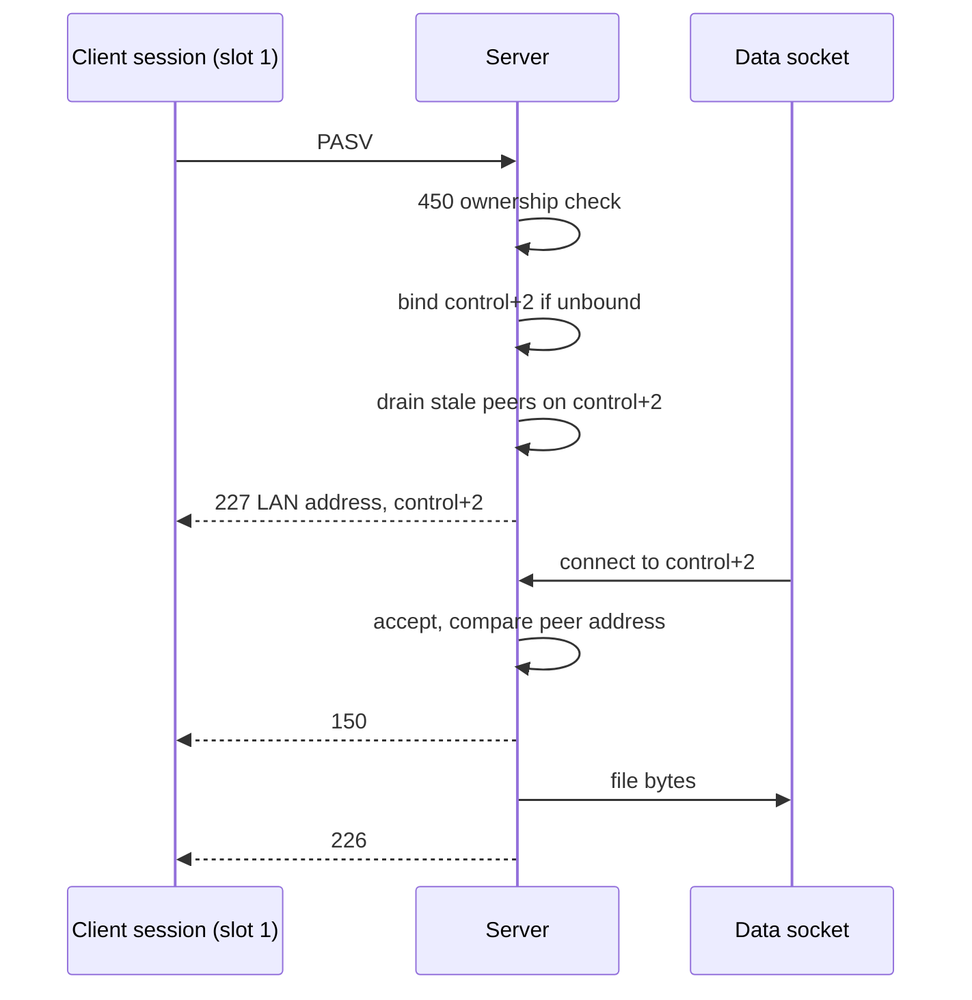
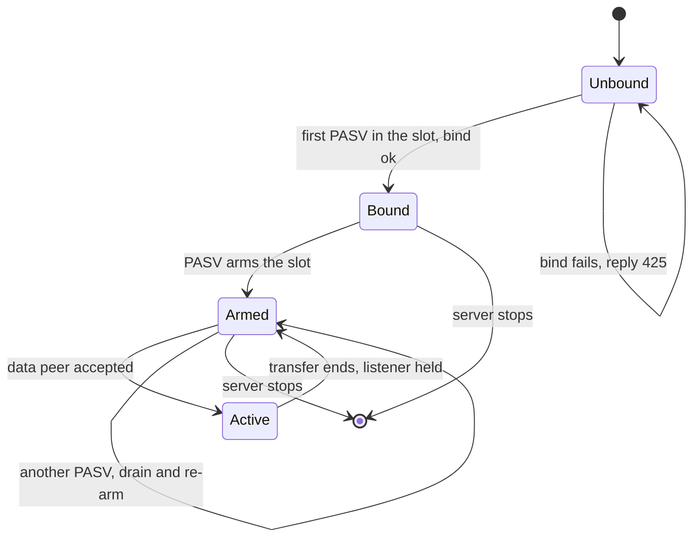

# vitaFTPShell Residual Network Closure - Plan

## Goal Capsule

- **Objective:** A user who opens two FTP sessions from one PC, and a user who uploads onto a server that answers SIZE but not MLST, each get a definite answer — the data connection reaches the session that asked for it, and a folder destination is refused before the transfer instead of after it. The threaded app carries host evidence through a transfer, a cancel, and a server session, not only through startup and quit.
- **Means:** One passive data port per server session slot, a single listing refresh in the SIZE preflight, and a second threaded app test under ThreadSanitizer.
- **Product authority:** `STRATEGY.md` (server mode as a compatibility surface, plain FTP only), `docs/DECISIONS.md` D85–D91, `docs/DESIGN.md` (no layout change; its port-bound sentence changes with R6).
- **Open blockers:** None. Planning can start from this document. Trailing-dot/space path folding stays out and is recorded below.

## Product Contract

Product Contract preservation: changed: Summary, R9, R13, AE6 — wording aligned to R7, R14, and the cancel refusal (a cancel is refused while a preflight runs). No scope change.

### Summary

Each of the four server sessions gets its own passive data port, so a data connection is attributed by the port it arrives on. The upload preflight refreshes the remote listing once when SIZE reports the destination exists but a SIZE-only server's listing does not show it. A second threaded app test drives a download, that refresh, a cancel, and a server session under ThreadSanitizer. All three land in one build, which becomes the console matrix target.

### Problem Frame

The server holds one passive listener on `control+1` and identifies a data connection only by comparing the connecting peer's address with the armed session's control peer. Two sessions from one PC share that address, so the test cannot tell them apart; the app's documented server setup (FileZilla's browse and transfer connections from one machine) is exactly that shape.

The upload preflight has the same weakness in a different place. On a server that answers SIZE but not MLST, the probe reports whether the destination exists and its size, never its type. The worker types a destination from the remote listing it published, and when the name is not in that listing it falls through to the server's STOR refusal. A stale or truncated listing therefore turns a certain refusal into a failed transfer.

Both are recorded as accepted limits, and neither shows up as a routine failure. The data-port case needs an interleaving: one session armed while another session's data socket arrives on the shared port, which the recorded two-session console run never produced. The upload case is the one a user meets directly, as a refusal that arrives after the attempt instead of before it. The concurrency evidence has a gap of its own: the only host test that runs the real thread issues a quit command and nothing else, so the handoff is never checked while a transfer, a cancel, or a server session owns the worker.

### Key Decisions

- **One data port per session slot.** Session slot *n* uses `control+1+n`, and the PASV reply carries that session's port, so identity follows the port. (session-settled: user-directed — chosen over an ephemeral listener per PASV: identity holds by construction, no `NetPort` bound-port output is needed, and a fixed four-port range stays forwardable.) Governs R1, R2, R13.
- **A slot's listener binds lazily and stays bound.** The first PASV in a slot binds its port; the listener is held until the server stops, and a bind failure costs that one PASV. (session-settled: user-approved — chosen over binding all four at server start: the current data-port bind failure already stops the whole server, and four eager binds would multiply that by four.) Governs R3, R4, R6.
- **The SIZE path refreshes the listing instead of probing the server.** (session-settled: user-directed — chosen over a CWD-into-destination test and over keeping the refusal-only message: it reuses the listing the app already trusts and leaves the pane truthful.) Governs R7, R8, R9.
- **Concurrency evidence gets its own binary.** (session-settled: user-directed — chosen over extending the liveness test: the existing gate stays intact and a failure names the scenario that broke.) Governs R11, R12.
- **All three land in one build, and that build becomes the matrix target.** (session-settled: user-directed — chosen over running b72 first and landing a delta afterwards: one console pass, accepted with the consequence that b72 never gets a run of its own.) Governs R14.
- **Path folding stays out of this pass.** The boot-config denial remains an exact-byte comparison on an unverified assumption about the filesystem. (session-settled: user-directed — chosen over adding a defensive folded-name denial now: the fact needs the console, and a defense built without it can refuse names the filesystem accepts.) No governed requirements.

### Actors

- A1. The console user working the local pane.
- A2. A desktop FTP client on one PC, typically holding two control sessions from a single address.
- A3. The app's own FTP client in the remote pane.
- A4. The console's FTP server.

### Requirements

**Server data-connection identity**

- R1. The server advertises the data port belonging to the session that armed the transfer, so the port a connection arrives on identifies its owner.
- R2. Session slot *n* uses data port `control+1+n` for *n* = 0–3; slot 0 keeps `control+1`, so the single-client case is unchanged.
- R3. A slot's data listener binds the first time a session in that slot arms a PASV and stays bound until the server stops.
- R4. When no other session owns the transfer, a data-port bind failure answers that PASV with 425 and leaves the server ON and no session armed; that reply ends the client's attempt, and the slot serves the next PASV the session sends once the port is free.
- R5. The ownership rules in R54 and D86 stay in force; per-session ports change which port a session advertises, not who may use it.
- R6. A control port above 65531 is refused, so no slot's data port can exceed 65535; the SERVER port editor, its validation message, the saved-settings clamp, and the DESIGN port sentence carry the same ceiling.

**Upload preflight**

- R7. When a SIZE preflight reports the destination exists but the current remote listing shows no row for its name, the app refreshes the destination's own parent directory once, and only while the remote pane still shows that directory; a pane that has moved leaves the destination untyped.
- R8. A destination the refreshed listing types as a folder is refused with `DESTINATION IS A FOLDER`; one still absent, including one beyond the listing cap, is treated as a file and follows the existing overwrite decision.
- R9. The refresh runs at most once per item; a refresh that fails, times out, or cannot obtain a listing slot leaves the destination untyped and the item follows R8's file path, and an answer for an item that is no longer active cannot decide a later item.
- R10. The probe order stays as D91 records it: MLST first, SIZE second, and a server offering neither starts the STOR directly.

**Concurrency evidence**

- R11. A second threaded app test drives a download, an upload that triggers the listing refresh, a cancel, and a server session with a connected client, while the app thread renders; the fake network takes one lock around its socket and listener state so the scripted peer can run off the worker thread.
- R12. The ThreadSanitizer gate runs that binary after the existing threaded app test (`test_app_thread`) and fails on any sanitizer warning or a missing OK line.

**Records and matrix**

- R13. The v1 plan states the per-session port rule in place of the single-port text in KTD6, U7, R50, and the resolved-questions row, and splits the bind-failure rule in KTD6 and R49: a control-port bind at start names the port and leaves the server OFF, while a slot's data-port bind at PASV answers 425 and leaves the server ON. R54 stays as written, and D86's four-session and ownership rules stay in force.
- R14. `docs/DECISIONS.md` gains one new entry that supersedes D39's port rule and amends the single-port sentences in D59, D63, and D86, whose address, client-PASV, four-session, and ownership rules stay as written; `docs/FIXES.md` and `docs/VERIFICATION.md` record the evidence, and the new build becomes the matrix target with M5 and M7 naming per-session ports. The same run carries the trailing-dot/space probe, and its result is recorded in `docs/FIXES.md` and `docs/VERIFICATION.md`.

### Key Flows

- F1. Passive transfer on the owner's port
  - **Trigger:** A session sends `PASV` while no other session owns the transfer.
  - **Steps:** The server applies the 450 ownership rule; binds the slot's port if it has no listener; drains stale queued peers; arms the slot; replies 227 with this session's port; accepts one peer whose address matches the control peer; runs the transfer; closes the data socket and keeps the listener.
  - **Outcome:** Only the session that armed the transfer can receive its payload.
  - **Covers:** R1, R2, R3, R5.
- F2. Upload onto a destination the listing does not show
  - **Trigger:** A SIZE preflight reports the destination exists, and the current remote listing has no row for its name.
  - **Steps:** The worker refreshes the destination's parent directory once, while the pane still shows it; re-checks the refreshed rows; refuses a folder, or treats the name as a file and continues to the overwrite decision.
  - **Outcome:** A folder the refreshed listing types is refused before the STOR; a name still absent follows the file path and can still fail at STOR.
  - **Covers:** R7, R8, R9.

### Acceptance Examples

- AE1. Two sessions from one address
  - **Covers:** R1, R2, R5.
  - **Given:** Two control sessions from `192.168.1.42`, in slots 0 and 1.
  - **When:** Slot 0 arms a PASV and a data connection arrives on `control+1` from that address.
  - **Then:** It is accepted as slot 0's data connection, and a connection to `control+2` while slot 0 is armed is not accepted as slot 0's.
- AE2. Data-port conflict
  - **Covers:** R3, R4.
  - **Given:** Another process holds slot 1's data port, and no transfer is running.
  - **When:** Slot 1 sends `PASV`.
  - **Then:** It receives 425, the server stays ON, slot 0 still completes its own transfer on `control+1`, and slot 1's next PASV succeeds once the port is free.
- AE3. Control-port boundary
  - **Covers:** R6.
  - **Given:** A server start with a chosen control port.
  - **When:** The port is 65531 and then 65532.
  - **Then:** The first starts and the second is refused, with no data port beyond 65535.
- AE4. Folder destination outside the listing
  - **Covers:** R7, R8.
  - **Given:** A server without MLST, a remote listing missing `DEST`, and SIZE answering 213.
  - **When:** The upload preflight runs for `DEST`.
  - **Then:** One refresh occurs and `DEST` is refused as a folder, with no STOR sent.
- AE5. New file outside the listing
  - **Covers:** R7, R10.
  - **Given:** The same server, a listing missing `NEW.TXT`, and SIZE answering 550.
  - **When:** The preflight runs for `NEW.TXT`.
  - **Then:** No refresh occurs and the STOR proceeds.
- AE6. An answer that outlives its item
  - **Covers:** R9.
  - **Given:** A preflight refresh in flight for an item, while a cancel answers `REMOTE CHECK IN PROGRESS`.
  - **When:** The batch is reset or a new batch is queued before the refresh completes.
  - **Then:** The arriving refresh cannot decide the new batch's first item, and that batch starts with no inherited answer.
- AE7. Threaded transfer run
  - **Covers:** R11, R12.
  - **Given:** The new threaded binary under ThreadSanitizer.
  - **When:** It completes a download, an upload that refreshes the listing, a cancel, and a server session.
  - **Then:** It prints its OK line with no sanitizer warning, and the gate fails if either is missing.

### Success Criteria

- Two sessions sharing one address deliver payload only to the session that armed the transfer, proven on the host with the fake network.
- An occupied data port never keeps the server OFF; the cost is one 425 for that attempt, and the next PASV from that session binds once the port is free.
- A destination missing from the first listing that the refreshed listing types as a folder is refused with `DESTINATION IS A FOLDER` and no STOR is sent, on a server with SIZE but no MLST.
- The threaded app completes a transfer, a cancel, and a server session under ThreadSanitizer with no race report.
- The console matrix on the new build records M5 and M7 against per-session data ports, and no `app`-class failure is introduced.

### Scope Boundaries

- **Deferred for later:** Trailing-dot/space path folding, including the defensive denial variant; it needs a console fact first, and the console probe rides along with the matrix run.
- **Deferred for later:** An ephemeral listener per PASV; it needs a bound-port output on `NetPort` and a new platform claim.
- **Deferred for later:** A destination beyond the 2000-row listing cap; the refresh re-reads the same capped listing, so the server's STOR refusal is the only signal there.
- **Deferred for later:** A data-port readout in the SERVER panel; the existing status panel keeps its current fields.
- **Outside this product's identity:** Any per-host session limit, secure transport, or server behavior change beyond the port ownership rule.

### Dependencies / Assumptions

- The fake network already stores a port per queued peer and supports eight concurrent listeners, so five (control plus four data) fit; it needs the lock that lets a scripted peer run on a second thread, a recorded wait-set count, and the same over-cap rejection the adapter applies.
- The Vita network adapter binds `INADDR_ANY` and refuses a zero port, so the per-slot design needs no adapter or `NetPort` change.
- The server registers only the armed slot's data listener in its wait set: `NET_WAIT_MAX` is 8, and four control sockets, one data socket, one armed listener, and the control listener already reach seven.
- Passive clients connect to whatever port the 227 reply names; this is standard FTP and holds for FileZilla and for the app's own client.
- The console matrix remains the only promotion path to `verified`; host evidence here never becomes `HW`.

### Outstanding Questions

- **Deferred to Planning:** Whether the matrix needs a new row for two same-address sessions or whether M5 and M7 are amended in place.

### Sources / Research

- `docs/plans/2026-11-08-1103-feat-vitaftpshell-v1-plan.md` — R41 (probe order), R50 (four clients, one transfer), R54 (peer-address rule), KTD6 and U7 (the single-port text this plan replaces).
- `docs/DECISIONS.md` — D39 (the decision that set `control+1` and the 1024–65534 editor bound), D92 (the per-session rule that supersedes it and amends D59's and D63's port clause; the record landed in the documentation truth sweep), D86 (four sessions, one transfer), D91 (MLST then SIZE).
- `docs/FIXES.md` — the recorded U4 residual and the b72 SIZE-only folder note.
- `docs/plans/archive/2026-11-15-2311-fix-b67-open-issues-plan.md` — the earlier decision gate that kept the fixed port; this plan reverses its outcome with a different shape (a fixed port per session, not an ephemeral port per PASV).
- `src/core/ftp/server.c` — single `data_port`, the address-only accept test, and the 425/450 reply paths.
- `src/platform/net.h`, `src/platform/psp2_net.c` — the listen contract and the adapter's refusal of port 0.
- `tools/fake/fake_net.c` — per-peer ports and the listener index used to prove two same-address sessions.
- `tools/test/test_app_thread.c`, `tools/test/tsan.sh` — the current threaded run and its gate.

---

## Planning Contract

### Key Technical Decisions

- KTD1. The server keeps one armed transfer and gains one bound listener per session slot. The armed slot stays global in `data_state`/`data_session`, so the 450 ownership rule and the peer-address check are untouched; only the listener and port become per-slot. (session-settled: user-approved — chosen over binding all four ports at server start: the data-port bind failure already stops the whole server today, and eager binding would multiply that by four.) Instantiates the Product Contract decision governing R1, R2, R3.
- KTD2. The wait set registers only the armed slot's listener. `NET_WAIT_MAX` is 8 and the current set already reaches seven with four sessions, one data socket, one pending listener, and the control listener; registering four listeners would exceed it and stop the server with a wait failure.
- KTD3. A preflight answer is bound to its item by a token, not by a path alone. `batch_reset` and every new preflight increment the token; the SIZE answer, the refresh, and the folder decision all carry it, so an answer that arrives after its item is gone is discarded rather than applied to the next item.
- KTD4. The refresh reuses the normal listing collection path and publishes into the pane's usual slot. It does not set `refresh_remote`, which would reschedule the listing forever; completion re-enters `pump_queue` through the same step that already reads the preflight latch.
- KTD5. A refresh that cannot start is detected synchronously, not by timeout. `remote_listing_begin` returns void today and a missing collection slot makes `client_listing_end` a no-op, so the unit adds a way for the caller to learn that no slot was acquired and treats that answer as untyped.
- KTD6. The threaded test observes state instead of sleeping. The worker advances fake time faster than the protocol deadlines, so each scenario runs a bounded tick loop until a named state appears, and fails on exhaustion.

### High-Level Technical Design

The three surfaces meet in one worker thread: the server owns listeners, the client owns the listing and probes, and the app thread renders state handed over through the rings.

A passive transfer now arms a slot-specific listener, so the accept can only serve the session that armed it.

Each slot's listener lifecycle is the only state this pass adds.

### Assumptions

- FileZilla re-reads the port each `227` names rather than reusing the control port plus one. Standard FTP, but only the console run proves it for this client.
- The fake network can express two pending peers from one address on different ports; it already stores a port per queued peer.
- `NET_WAIT_MAX` stays 8. The design fits by registering one listener, and a future change to the constant is not assumed.
- No new platform claim enters the adapters: every call the per-slot design needs already exists on `NetPort`.
- The port identifies the owner while a session holds its slot. A slot's listener outlives its session by design, so a data connection arriving from the previous session's PASV after that slot is reused would still match the new owner's control peer under R5; the concurrent two-session case is what this pass proves.

### Sequencing

U1 and U3 can proceed independently. U2 follows U1 because it shares the bind helper and the start path. U5 lands last and records the matrix rows for what U1-U4 prove.

---

## Implementation Units

### U1. Per-slot passive listeners

- Goal: Each session slot owns its data port, binds it on first use, and keeps it for the server's lifetime, while the server still allows one armed transfer at a time.
- Requirements: R1, R2, R3, R5; KTD1, KTD2.
- Dependencies: none.
- Files: `src/core/ftp/server.c`, `src/core/ftp/server.h`, `tools/fake/fake_net.c`, `tools/fake/fake_net.h`, `tools/test/test_server.c`.
- Approach:
  - Replace the single `data_port` and `data_listener` with per-slot arrays sized `SERVER_MAX_CLIENTS`; keep `data_state`, `data_session`, `pending_accept`, and `pending_deadline` global.
  - Compute each slot's port at start as `control_port + 1 + slot` (R2) and expose it through one accessor the tests and the 227 reply both read.
  - Add one helper that returns a slot's bound listener, binding `INADDR_ANY` on that slot's port the first time; a failure returns nothing and the caller answers 425 (R4 owns the reply, U2 owns the surrounding ceiling).
  - Route the accept, drain, disarm, wait-set, and stop paths through the armed slot's listener. `server_disarm` captures the owner slot before `server_close_transfer` clears `data_session`, because the drain it runs would otherwise have no slot to drain. `server_stop_internal` closes every bound listener.
  - Leave the 450 check and the peer-address comparison in place unchanged (R5).
- Patterns to follow: the existing `server_drain_listener`, `server_disarm`, and `server_stop_internal` teardown; the session array indexing already used for control sockets.
- Test scenarios:
  - Covers AE1. Two sessions connect from one address; slot 0 arms and receives on `control+1`, slot 1 arms and receives on `control+2`, and a peer queued on `control+1` is never accepted for slot 1.
  - A slot's first PASV binds once; a second PASV in the same session reuses the listener and adds no second bind.
  - A second session's PASV during slot 0's armed transfer still answers 450.
  - A data peer whose address differs from the control peer is closed and delivers no bytes.
  - Server stop closes every listener that was bound, verified through the fake's open-socket check rather than a remembered index.
  - The wait set records at most seven entries with four sessions and one armed listener, read from a new fake accessor for the last observed wait-set count.
  - A peer queued on a slot's listener before a disarm is closed by the next PASV rather than accepted.
- Verification: `test_server` passes, and the fake's listener log shows one bind per slot that armed.

### U2. Port ceiling and refusal surfaces

- Goal: A control port that cannot give four data ports is refused everywhere it can be entered, and a data-port bind failure is visible without stopping the server.
- Requirements: R4, R6.
- Dependencies: U1.
- Files: `src/core/ftp/server.c`, `src/app/worker.c`, `src/core/store.c`, `tools/fake/fake_net.c`, `tools/fake/fake_net.h`, `tools/test/test_server.c`, `tools/test/test_store.c`, `tools/test/test_integration.c`.
- Approach:
  - Server start validates the control port against 65531, binds only the control listener, and names only that port when the bind fails.
  - The worker gives `FTP_SERVER_INVALID` a user-visible error and leaves the server OFF; today the result falls through without a branch.
  - The settings loader normalizes a stored port to 1024–65531 instead of accepting 1–65535.
  - The fake gains a failure hook for one named port so a data-port bind can fail while the control port succeeds.
- Patterns to follow: the existing `FTP_SERVER_BIND_FAILED` branch in the worker and the `PORT MUST BE 1024-65534` validation path.
- Test scenarios:
  - Covers AE3. A start at 65531 succeeds and reaches `FTP_SERVER_ON`; a start at 65532 returns `FTP_SERVER_INVALID` with the server OFF.
  - Covers AE2. With the fake failing slot 1's port, that session's PASV answers 425, the server stays ON, slot 0 completes a transfer, and slot 1's next PASV binds and transfers once the failure hook clears.
  - A start-time control bind failure names the control port and does not mention a data port.
  - A stored `server_port` of 65534 loads as 65531, and a stored 80 loads as 1024.
  - A refused start emits exactly one error event and no success state.
- Verification: the fake can fail one port without affecting the other, and the tests above pass.

### U3. Preflight listing refresh

- Goal: On a server with SIZE but no MLST, a destination the current listing does not show triggers one refresh of its own parent before the folder decision, and a stale answer never decides the next item.
- Requirements: R7, R8, R9, R10; KTD3, KTD4, KTD5.
- Dependencies: none.
- Files: `src/app/worker.c`, `tools/test/test_integration.c`.
- Approach:
  - Give the preflight a token that `batch_reset` and every new preflight increment; carry it with the SIZE answer and the refresh. The token replaces the path comparison as the answer's identity test, and the path string stays only as the destination the answer describes.
  - Type a destination only from rows published for the destination's own parent, comparing against the worker's remote path before matching the bare name.
  - When SIZE reports the destination exists and the row is absent, request one listing of that directory, record that the item has used its refresh, and return; completion re-runs the same decision.
  - Treat a refresh that cannot acquire a collection slot as untyped and continue under R8's file path.
  - Keep the refusal of a cancel while the preflight is active, but key it on a latch that spans the probe and the refresh: `upload_stat_active` clears when the SIZE answer arrives, so a refresh needs its own in-progress flag cleared when the listing ends or fails. R9's guard is about item removal rather than cancel.
- Patterns to follow: the b72 upload-preflight latch and its path check, and the existing listing collection and publish path.
- Test scenarios:
  - Covers AE4. SIZE answers 213, the first listing lacks the name, one refresh shows it as a folder, and the item is refused with no STOR sent.
  - Covers AE5. SIZE answers 550, no listing is requested, and the STOR proceeds.
  - Covers AE6. A batch reset while the refresh is in flight, whose new batch starts with the same destination name, leaves the arriving answer unable to decide that item.
  - A pane moved to another directory mid-batch leaves the destination untyped and sends no refresh.
  - A refresh that fails mid-listing lets the item proceed under the file path, with one error and no hang.
  - A cancel during the refresh is refused with `REMOTE CHECK IN PROGRESS` and does not cancel the item.
  - Two consecutive items each get at most one refresh.
- Verification: `test_integration` passes, and the fake peer records one listing per item that needed it.

### U4. Threaded transfer test

- Goal: The real app thread completes a download, an upload that triggers the refresh, a cancel, and a server session under ThreadSanitizer, with the fake network safe across two threads.
- Requirements: R11, R12; KTD6.
- Dependencies: U1, U3.
- Files: `tools/test/test_app_thread_xfer.c`, `tools/fake/fake_net.c`, `tools/fake/fake_net.h`, `tools/test/run.sh`, `tools/test/tsan.sh`.
- Approach:
  - Guard the fake network's socket and listener state, and the accessors the peer thread uses, with one host mutex; the fakes are host-only, so a pthread mutex is acceptable there.
  - Drive the peer from the test thread and let the app thread render; wait on named states with a bounded tick loop, and drain the peer's scripted replies once per tick because fake sleep advances the clock faster than wall time.
  - Register the new binary in the app-linked branch of the test runner and as a second threaded run in the sanitizer gate.
- Patterns to follow: `tools/test/test_app_thread.c` for start and shutdown, and the integration suite for queueing a transfer and reading the dock.
- Test scenarios:
  - A download completes: the destination bytes match and the dock reaches its done word.
  - An upload on a SIZE-only peer triggers one listing and reaches the folder refusal for a folder destination.
  - A cancel on a stalled transfer reaches the cancelled terminal and leaves no partial file.
  - A fake client connects to the app's server, arms its own slot port, and retrieves a file.
  - Every scenario fails on tick exhaustion rather than hanging.
- Verification: the new binary prints its OK line under TSan with no sanitizer warning, and the gate fails if either is missing.

### U5. Records and matrix

- Goal: The console matrix carries the per-session port rows for the build that lands the change.
- Requirements: R14 (its evidence and matrix clauses; the decision and v1-plan clauses landed with D92 in the documentation truth sweep).
- Dependencies: U1, U2, U3, U4.
- Files: `docs/FIXES.md`, `docs/VERIFICATION.md`.
- Note: the port record landed as D92 in the documentation truth sweep (`docs/plans/archive/2026-11-16-0845-docs-documentation-truth-sweep-plan.md`); this unit keeps only the console-matrix rows.
- Approach:
  - Record M5 against per-session ports, and give it the same-address transfer that proves the slot port.
  - Rewrite M7's second-client expectation to an accepted session, with 450 reserved for a fifth session or a data command during the owner's transfer.
  - Add the trailing-dot/space probe to the matrix record.
- Test scenarios: `Test expectation: none -- matrix rows only; the console run produces them.`
- Verification: M5 and M7 name the per-session ports, and the trailing-dot/space probe has its result recorded.

---

## Verification Contract

| Gate | Command | Proves |
|---|---|---|
| Host suites | `./tools/test/run.sh` | Layering guard plus every host suite, including the new refresh and threaded cases |
| Sanitizers | `./tools/test/asan.sh` | Every suite under ASan and UBSan |
| Threads | `./tools/test/tsan.sh` | The negative handoff check, the existing threaded app, and the new threaded transfer |
| Preview | `./tools/preview/run.sh` | The 40 settled states still render |
| Assets | `./tools/check_assets.sh` | Launcher and LiveArea assets unchanged |
| Build | `./build.sh` | One uniquely named VPK, worker stack gate, one artifact kept |
| Docs | the repository link and code-fence check | No broken relative links, no odd fences |
| Console (not runnable here) | M5, M7, and the trailing-dot/space probe | FileZilla re-reads each `227`; two same-host sessions transfer; the filesystem folding fact |

## Definition of Done

- Every unit's tests pass under the host suites and ASan, and the threaded transfer passes the TSan gate.
- U1-U4 land with the behavior R1-R12 state, and U5 records its matrix rows; the document record landed as D92 in the documentation truth sweep.
- `./build.sh` emits one `vitaftpshell-v01.00-b<build>.vpk`, increments `BUILD_NUMBER`, leaves the unstripped ELF, and passes the worker stack check.
- `docs/FIXES.md` and `docs/VERIFICATION.md` reflect the evidence; D92 and the documentation truth sweep carry the decision, the v1 plan, `docs/DESIGN.md`, `docs/ARCHITECTURE.md`, and the summaries. The project stays `building` until the console matrix passes.
- No `[C]` claim escapes the adapters: the per-slot design adds none.
- Abandoned experiments and dead helpers from the implementation are removed, not left in the diff.
