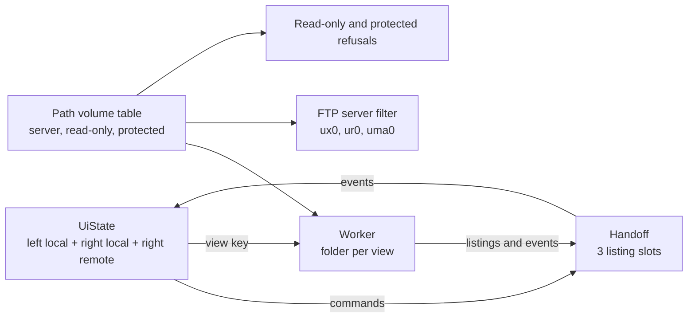
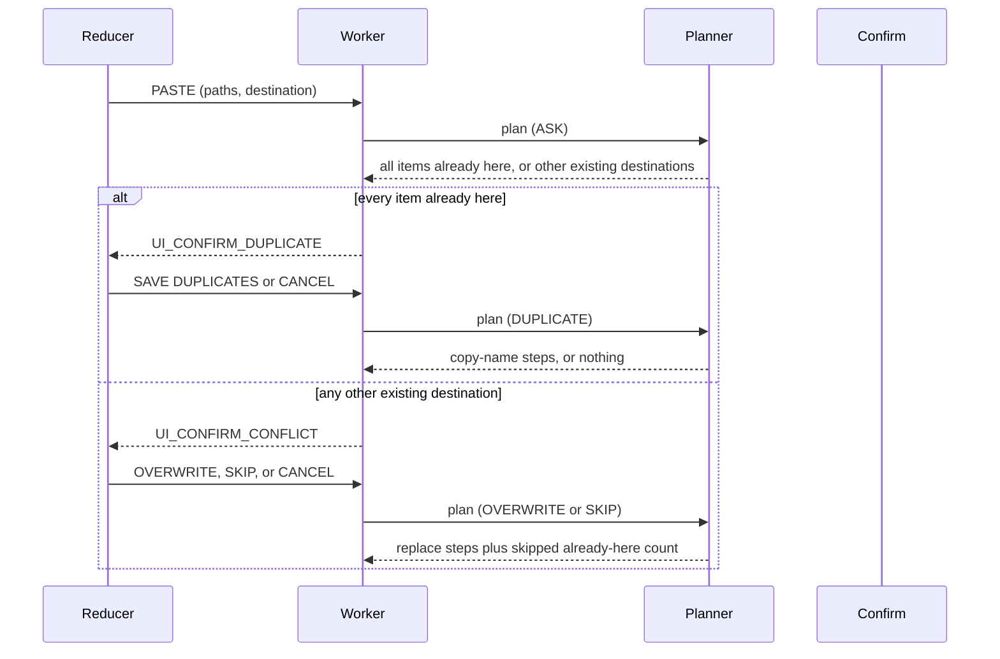
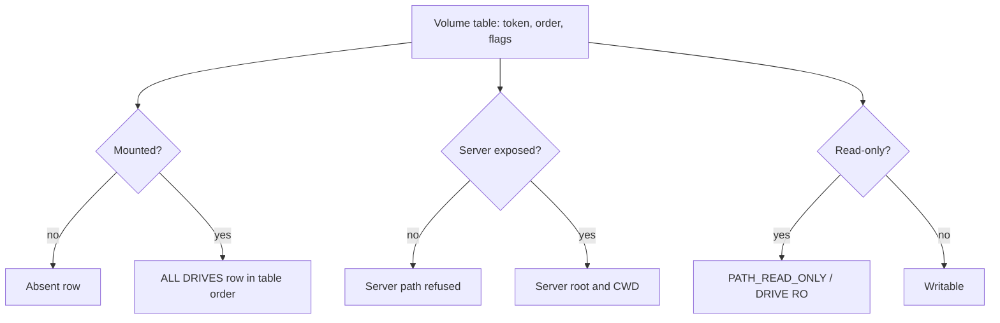

# Local Workspace: Second Pane, All Volumes, and List Navigation - Plan

## Goal Capsule

- **Objective:** A Vita user can do all local file work from the console: both panes browse local storage, every user-accessible storage mount is reachable (save data stays out), a successful connect lands in the workspace, and list navigation keeps the cursor with the view and wraps at the ends.
- **Means:** A three-view state model, a table-driven volume model with a filtered server exposure, reducer-only view switches, and deflection-scaled list navigation (KTD1, KTD2, KTD3, KTD5).
- **Product authority:** `STRATEGY.md` (the console is the workspace), `docs/DESIGN.md` (layout and input), and `docs/DECISIONS.md` D53, D60, D61, D69, D72, and D85.
- **Execution profile:** One feature branch, host suites and the docs gate on every unit, the hardware matrix at code freeze.
- **Stop conditions:** Stop if the server's three-mount exposure cannot be preserved, or if the third row arena exceeds the 6 MB listing-arena budget.
- **Not active scope:** Sleep and resume integrity and remote recursive folder transfer are separate plans; the FTP server's exposed volume set is unchanged.

**Product Contract preservation:** changed: the Problem Frame's same-folder sentence (the current build silently duplicates, per D60), the Objective and Summary save-data wording, and R1-R4, R6, R7, R9, R12, R13, R15-R17, R19, R21-R26 clarified from research; no product scope change. R5, R8, R10, R11, R14, R18, R20 preserved.

---

## Product Contract

### Summary

The workspace becomes complete for local work. ALL DRIVES lists every user-accessible storage mount the console has, save data stays out, the right pane can become a second local browser, a successful connect returns to the workspace, and list navigation follows the cursor and wraps.

### Problem Frame

The app is a console-first workspace, but its local side is narrower than the console. It sees three mounts and one local window, so a user with an internal card, a game card, or a reason to inspect the app folder has to reach for another tool. A user moving files between two folders must also walk the single window back and forth, losing the source selection and the place in the list.

Small frictions make every navigation cost more than it should. Connecting from SITES leaves the user on the site list after the connection already succeeded. The stick scrolls the view while the cursor stays behind, so the next D-pad press jumps the view back to the top. Lists stop dead at the first and last rows.

Copying a file into the folder it came from is the sharpest case: the destination already exists and is the source, and the current rule silently creates a copy name without telling the user it happened.

The result is that ordinary file organization feels like a transfer tool with a browser attached, and the console cannot yet be the only workspace for local files. That matters because "the console is the workspace" is the product's reason to exist, not a convenience.

### Key Decisions

- **The right pane is the only switchable pane.** One FTP session and one remote state are easier to reason about than two, and the left pane stays a stable local anchor. Governs R7, R8, and R15. (session-settled: user-directed — chosen over a switchable left pane or two independent panes: one FTP session and one remote state are easier to reason about.)
- **Switching is a view change, not a disconnect.** The session and both views keep their folder, cursor, scroll, and marks, and a running transfer continues. Governs R8, R9, and R13. (session-settled: user-directed — chosen over disconnecting on switch or refusing while a transfer runs: the user wanted the session and its work to survive.)
- **The second local view is a full peer of the left pane.** It carries the same actions, marks, free space, and protection, and it shares one clipboard with the left pane. Governs R10, R11, and R12. (session-settled: user-directed — chosen over clearing marks on switch: each view keeps its own selection.)
- **The switch is an ACTIONS row, so the right panel grows to seven rows.** The user asked for the switch in ACTIONS, and the sixth-row cap is a layout constraint rather than a product rule. Governs R14.
- **ALL DRIVES becomes volume-complete for user mounts while the server keeps its writable three.** A file manager should reach the console's storage; an anonymous server should not gain new writable surfaces by accident. Governs R1 through R6. (session-settled: user-directed — chosen over every mount including the protected system partitions, and over a writable-only list: the user wanted all drives without the system partitions.)
- **Same-folder paste asks duplicate or cancel; any other existing destination keeps the existing prompt.** Overwrite cannot change a file onto itself, and a batch with both kinds of collision should not stack two prompts. Governs R16 through R20. (session-settled: user-directed — chosen over a silent duplicate and over a no-op overwrite: the user wanted to be told the file exists and to choose a duplicate or cancel.)
- **Connect success returns to the workspace, but only from SITES.** The connect is the user's request to see the remote, and a failure should keep the list in front for an edit or retry. Governs R21 and R22. (session-settled: user-directed — chosen over connecting in the background: a connect is a request to see the remote.)
- **The stick moves the selection and the file and site lists wrap.** The stick is a second navigation control, not a detached scroll; a list that stops at the end forces a trip back through every row. Governs R23 through R25. (session-settled: user-directed — chosen over workspace-only wrap and a one-row stick: the user wanted the site book to wrap and the stick to scale with deflection.)
- **The local-local mode is session state.** Each launch starts local plus remote, because the remote is half the product; the mode is not persisted. Governs R15.
- **The v1 plan's stale input text is corrected, not the bindings.** The code and `DESIGN.md` already agree that Triangle opens ACTIONS and Select opens SITES; only the plan text is wrong. Governs R26.

```mermaid
stateDiagram-v2
    [*] --> Remote
    Remote --> Local: SWITCH TO LOCAL
    Local --> Remote: SWITCH TO REMOTE
    Local --> Remote: connect from SITES
    note right of Remote : kept: folder, cursor, scroll, marks, session, transfer
    note right of Local : kept: folder, cursor, scroll, marks
```

### Requirements

**Volumes**

- R1. ALL DRIVES lists `ux0:`, `ur0:`, `uma0:`, `imc0:`, `gro0:`, `grw0:`, and `app0:` in that order when mounted; an absent mount is absent, not an error row, and neither a protected system partition (`vs0:`, `os0:`) nor a save-data mount (`savedata0:`) appears. The list is built on entry, so a mount inserted or removed while it is open appears on the next entry.
- R2. `app0:` and `gro0:` are read-only: the row's value reads `DRIVE RO`, and a write, create, paste, rename, move, delete, or download destination there is refused with `READ-ONLY MOUNT` and changes nothing. The refusal follows the mount spelling, so the install tree under its `ux0:` spelling stays writable (R6).
- R3. Every listed volume root is protected from rename, move, and delete. `ux0:data`, `ur0:data`, and `imc0:data` are protected as system data roots; the existing `tai` rules are unchanged.
- R4. Free space is queried at the volume root and cached per volume per D59; a value the platform cannot report renders `--`.
- R5. The FTP server's exposure is a fixed three-mount allowlist independent of the local list: `ux0:`, `ur0:`, and `uma0:`. A server path on another mount is refused and creates nothing.
- R6. Path canonicalization accepts the new mount tokens in every role while keeping the same normalization and case rule, and the protected-path table grows per R3. The `app0:` alias is comparison-only: canonical paths keep the spelling the user typed, the install tree stays writable through its `ux0:` spelling, and a copy or move between the two spellings is treated as the same folder.

**Second local pane**

- R7. ACTIONS on the right pane offers `SWITCH TO LOCAL` on the remote view and `SWITCH TO REMOTE` on the local view; the left pane offers no switch. The switch row is available even when the remote view is lost or not connected.
- R8. A switch changes only which view the right pane shows. The FTP session, its folder, cursor, scroll, marks, and any running transfer are preserved, and switching back restores the view.
- R9. Each right-pane view keeps its own folder, cursor, scroll, and marks. The local view opens at ALL DRIVES the first time, then returns to its last folder for the session; a view whose folder no longer exists falls back to ALL DRIVES when the failure is discovered. When a local operation completes, any other local view showing the exact parent folder of a changed path reloads, keeps its cursor on the same name where it survives, and prunes marks for names that are gone; a view showing an unaffected folder stays as it is.
- R10. The right local view is a full local browser: the same actions, marks, free space, protection, and clipboard behavior as the left pane, subject to R12.
- R11. The clipboard is shared: COPY or MOVE in either pane, a pane switch, and PASTE in the other pane paste into the active pane's folder.
- R12. While both panes are local, UPLOAD is disabled on both with `NO REMOTE VIEW`, and that reason wins over `NO SELECTION`; Cross on a file or marked set performs no transfer and reports the same reason; the idle hint is row-aware (`X TO OPEN` on a folder or volume, `NO REMOTE VIEW` on a file); the switch row stays live.
- R13. A successful connection started from SITES switches the right view to remote. If SITES is still in front, it closes and the workspace returns with the remote view active (R21); if the user left SITES while connecting, the view switches but the screen and focus stay where they are. A connect attempt replaces the current session, even when it fails.
- R14. The ACTIONS panel on the right pane holds seven rows, with the switch row last, after DELETE on the local view and after DISCONNECT on the remote view; the left pane keeps six rows. Both panels grow to 360 px tall (bottom 436, 4 px above the dock), keeping the 44 px row pitch and the target panel aligned.
- R15. Each launch starts with the left pane local and the right pane remote and disconnected; the pane mode is not persisted. With both panes local and no session, the idle dock names the active pane by its path and marks and never prints `REMOTE`.

**Same-folder paste**

- R16. A paste whose items (files or folders) all already live in the destination folder asks SAVE DUPLICATES or CANCEL; CANCEL changes nothing.
- R17. SAVE DUPLICATES names each item with the existing copy rule (`A copy.TXT`, then `A copy 2.TXT`) and creates no overwrite; a folder duplicates recursively.
- R18. A same-folder MOVE stays refused with `ALREADY HERE`.
- R19. Any other paste with at least one existing destination asks the existing OVERWRITE ALL, SKIP EXISTING, and CANCEL prompt once; the prompt counts only the destinations that would be replaced, already-here items are named as staying and count as skipped, that batch offers no duplicate choice, and an already-here item in a mixed MOVE stays in place instead of failing the batch.
- R20. The same-folder question is decided by the destination path, so it fires in either pane, including when the paste is in the other local pane at the folder the items came from.

**Connect return**

- R21. On a successful connection started from SITES, SITES closes and the WORKSPACE returns with the remote view active and its listing requested.
- R22. On a failed connection, SITES stays in front with the reason for every failure class, including resolve, refused, port, and login. If the user already left SITES, the current screen keeps focus and the reason appears in the dock's message line and on the site card.

**List navigation**

- R23. The left stick moves the active pane's selection by its deflection, linearly from one row at the deadzone edge to five at full deflection, at the existing 100 ms cadence; the input layer computes the step and the reducer consumes it, and the view scrolls to keep the selection visible.
- R24. The workspace row list wraps: Up on the first row selects the last, and Down on the last selects the first, except that Down on the last row focuses the transfer dock when either lane has an active or queued transfer; otherwise it wraps. The SITES site book wraps and resets its window.
- R25. Wrap and stick-following apply to the workspace panes and the site book; the dock entry is R24, and ACTIONS, CONFIRM, and the editor keep clamping.

**Behavior source**

- R26. The implementation corrects the behavior documents and the decision record: the v1 plan's stick, Triangle/Select, and local-pane volume sentences; DESIGN's input table, six-row cap, ACTIONS geometry, ALL DRIVES paragraph, no-session dock, and both-local state; AGENTS.md's status, settled-scope, and Safety 4 lists; README.md, docs/PROJECT.md, and docs/ARCHITECTURE.md; the plans index; and the matrix. The server's volume sentences stay as they are.

### Key Flows

- F1. Switch the right pane to local.
  - **Trigger:** The right pane shows remote and the user opens ACTIONS.
  - **Steps:** Choose `SWITCH TO LOCAL`; the pane shows ALL DRIVES the first time, its last folder later; the FTP session stays connected.
  - **Outcome:** A second local view, the left pane unchanged, and ACTIONS now offering `SWITCH TO REMOTE`.
  - **Covers:** R7, R8, R9, R14.
- F2. Copy between two local folders.
  - **Trigger:** A file is copied or marked in the left pane and the right pane is local at another folder.
  - **Steps:** COPY; L or R to the right pane; navigate; PASTE.
  - **Outcome:** The item is copied into the active pane's folder, and both panes keep their own folders and selections.
  - **Covers:** R10, R11.
- F3. Paste into the folder the items came from.
  - **Trigger:** PASTE where every item already lives in that folder.
  - **Steps:** SAVE DUPLICATES or CANCEL.
  - **Outcome:** Duplicates with the copy rule (folders recursively), or nothing changed.
  - **Covers:** R16, R17, R20.
- F4. Connect from SITES.
  - **Trigger:** Select opens SITES; the user connects to a site.
  - **Steps:** The connection succeeds; if SITES is still in front, it closes and the workspace returns with the remote view active.
  - **Outcome:** The remote view requests its listing. A failure stays on SITES with the reason for every failure class.
  - **Covers:** R13, R21, R22.
- F5. Navigate with the stick and wrap.
  - **Trigger:** The stick is held in a workspace list or the site book.
  - **Steps:** The selection moves by the deflection, from one row to five, and the view follows; at the end of the list, the selection wraps.
  - **Outcome:** The cursor is always visible and never left behind by a scroll.
  - **Covers:** R23, R24, R25.

### Acceptance Examples

- AE1. Switch preserves remote state.
  - **Given:** The right pane is connected at `/pub` with two marks and a running download.
  - **When:** `SWITCH TO LOCAL`, browse, then `SWITCH TO REMOTE`.
  - **Then:** `/pub`, the cursor, the scroll, the marks, and the download are as they were; the dock still reports the transfer.
  - **Covers:** R8, R9.
- AE2. Read-only mount refuses a mutation.
  - **Given:** `app0:` is open and a file is under the cursor.
  - **When:** MOVE, RENAME, DELETE, PASTE, NEW FOLDER, or a download destination there is chosen.
  - **Then:** The action is refused with `READ-ONLY MOUNT`, and nothing changes; COPY remains enabled.
  - **Covers:** R2.
- AE3. Absent mount is absent.
  - **Given:** No USB storage and no game card.
  - **When:** ALL DRIVES opens.
  - **Then:** `uma0:`, `gro0:`, and `grw0:` are absent rows, not errors; the present mounts are listed in table order.
  - **Covers:** R1.
- AE4. Same-folder duplicate.
  - **Given:** `A.TXT` is copied and pasted into its own folder.
  - **When:** SAVE DUPLICATES is chosen.
  - **Then:** `A copy.TXT` is created and `A.TXT` is untouched; a second run creates `A copy 2.TXT`; a folder is duplicated recursively.
  - **Covers:** R16, R17, R20.
- AE5. Mixed paste.
  - **Given:** The clipboard holds `ux0:data/A.TXT` and `ux0:other/B.TXT`, and `ux0:data/B.TXT` already exists; the destination is `ux0:data`.
  - **When:** PASTE runs.
  - **Then:** One OVERWRITE ALL, SKIP EXISTING, and CANCEL prompt appears and counts only `B.TXT` as replaced; OVERWRITE leaves the already-here `A.TXT` unchanged, replaces `B.TXT`, and the terminal counts `A.TXT` as skipped; SKIP leaves both.
  - **Covers:** R19.
- AE6. Connect success and failure.
  - **Given:** SITES holds a good site, a site with a bad password, and a site with an unresolvable host.
  - **When:** The good site connects.
  - **Then:** SITES closes and the workspace returns with the remote view active; its listing appears.
  - **When:** The bad-password or bad-host site connects.
  - **Then:** SITES stays with the login or resolve reason.
  - **Covers:** R13, R21, R22.
- AE7. Stick and wrap.
  - **Given:** A 40-row folder with the cursor on the first row.
  - **When:** The stick is held down at the deadzone edge, then at full deflection.
  - **Then:** The edge moves one row and full deflection five, with the view following; after the last row the next step selects the first, and Up from the first selects the last.
  - **Covers:** R23, R24.
- AE8. Upload while both panes are local.
  - **Given:** Both panes show local folders.
  - **When:** ACTIONS opens on the left pane.
  - **Then:** The panel keeps six rows, UPLOAD is dim with `NO REMOTE VIEW` even with no selection, and no switch row appears.
  - **When:** ACTIONS opens on the right pane.
  - **Then:** UPLOAD is dim, and `SWITCH TO REMOTE` is the seventh row.
  - **Covers:** R7, R12, R14.
- AE9. Wrap with a transfer running.
  - **Given:** The network lane has an active transfer and the cursor is on the last row.
  - **When:** Down is pressed.
  - **Then:** The dock takes focus instead of wrapping; Up from the first row still selects the last.
  - **Covers:** R24, R25.
- AE10. Cross with both panes local.
  - **Given:** Both panes are local and a hidden remote session is connected.
  - **When:** Cross is pressed on a local file.
  - **Then:** No transfer starts, the dock's message line says `NO REMOTE VIEW`, and the switch row is the way back.
  - **Covers:** R12.
- AE11. Site book wrap.
  - **Given:** The site book has more rows than fit and the cursor is on the last site.
  - **When:** Down is pressed.
  - **Then:** The first site is selected and the six-row window resets to the top; Up from the first selects the last.
  - **Covers:** R24.
- AE12. Server keeps its three mounts.
  - **Given:** The server is ON.
  - **When:** A client sends `CWD /IMC0:` or `STOR /APP0:X`.
  - **Then:** The command is refused and nothing is created; the `/` listing still shows only `ux0`, `ur0`, and `uma0`.
  - **Covers:** R5.
- AE13. Cross-view reload.
  - **Given:** Both panes show `ux0:data` and the right local view is active on a file.
  - **When:** The left pane deletes a different file in that folder.
  - **Then:** The right view reloads, keeps its cursor on the same name, and prunes any mark for the deleted name.
  - **Covers:** R9.
- AE14. Vanished folder.
  - **Given:** A view is inside `uma0:games` and the USB storage is removed.
  - **When:** The view lists again.
  - **Then:** It falls back to ALL DRIVES with a reason, not a permanent `LISTING FAILED` on a dead path.
  - **Covers:** R9.
- AE15. Mount on entry.
  - **Given:** ALL DRIVES is open and no game card is inserted.
  - **When:** A game card is inserted, the user leaves and re-enters ALL DRIVES.
  - **Then:** `gro0:` appears read-only; removing it and re-entering removes the row.
  - **Covers:** R1.

### Success Criteria

- A user can copy or move a file between two local folders without changing the source pane's folder after the copy.
- Both panes list the same mounted volumes, and a write on a read-only mount changes nothing.
- A successful connect always lands in the remote view; a failed one stays on SITES with the reason for every failure class.
- The cursor is never left behind by a scroll, and a file list or the site book wraps at both ends except for the dock entry when a transfer can be cancelled.
- The existing host suites pass, new coverage proves these requirements, and matrix rows M24-M27 cover the volumes, the second view, the connect return, and navigation; the `imc0:` volume row is BLOCKED on the PCH-1000.

### How This Work Fits Together

<!-- ce-section: work-relationships -->

This plan covers the local workspace. The broader breakdown is the current understanding, not a committed roadmap.

- Order: this plan lands first, then remote recursive folder transfer, then the sleep and resume work.
- Power and resume integrity is a separate plan. It shares the activity signals this plan touches (server ON, transfers, local jobs) but can proceed independently.
- Remote recursive folder transfer is a separate requirement. It shares the remote pane and the transfer queue, and it is independent of this plan.
- The hardware matrix grows with rows for this plan; the code-freeze pass runs them with the rest.

### Scope Boundaries

**Deferred for later**

- Sleep prevention and resume integrity, including the server's behavior across a suspend.
- Remote recursive folder transfer.
- Persisting the pane mode or either pane's folder across launches.
- A third pane, two FTP sessions, or two remote views.
- Exposing the new mounts through the FTP server.
- Live mount polling; a mount change is picked up on entry.
- Write protection for the installed-app tree; only the alias comparison protects a self-copy.

**Outside this product's identity**

- A PC-first workflow or desktop-client port.
- SFTP, FTPS, HTTP, WebDAV, or SMB.

### Dependencies / Assumptions

- The mount set is runtime: `imc0:` exists on PCH-2000 only, `gro0:` and `grw0:` need a game card, and `uma0:` needs USB storage; `app0:` is always present.
- The test console is a PCH-1000, so `imc0:` cannot be mounted; its matrix row is BLOCKED, not PASS, and the host fakes are its only coverage.
- `app0:` and `gro0:` are read-only; `grw0:` is expected writable but unconfirmed, so a refused write there surfaces the platform reason rather than a read-only promise (`[C]`, hardware).
- `app0:` is the install tree `ux0:app/VFTPSHELL`; the alias equality is a `[C]` platform claim, and the install tree remains writable through its `ux0:` spelling.
- A connect attempt replaces the current session, even when it fails; the previous folder and marks are gone.
- The three views total about 5.04 MB of row arena against a 6 MB budget asserted by a host test; the console listing-footprint row is measured at code freeze.
- The ACTIONS panel can grow to seven rows, and the design update belongs to this work.
- The v1 plan's stick and binding text is stale; the code and `DESIGN.md` already describe the behavior this plan requires.
- The settings store keeps one `last_local`; the right local view's folder is session-only.
- No kernel plugin, daemon, or boot component is added.
- The implementation records four decisions: the volume scope, the view model, the same-folder prompt, and the alias; the volume and same-folder entries supersede the settled three-volume scope and D60's silent-copy and cross-pane clauses.

### Outstanding Questions

- Resolve before planning: none.
- Deferred to planning: whether `grw0:` writes succeed on this firmware; the free-space query policy for the new mounts (the adapter reports `--` where it cannot answer).

### Sources / Research

- `docs/DESIGN.md` — pane identity, the ACTIONS panel geometry, the six-row cap, the clipboard states, and the input legend.
- `docs/plans/2026-11-08-1103-feat-vitaftpshell-v1-plan.md` — the stick sentence, the Triangle/Select sentence, the three-volume local-pane sentence, and the server exposure sentence.
- `docs/DECISIONS.md` — D53 (ALL DRIVES startup), D60 (the clipboard), D61 (destructive confirms), D69 (copy/move source), D72 (two lanes), D85 (path-scoped server refusal).
- `src/core/uistate.c`, `src/core/uiact.h` — the pane pairing, the action sets, marks, the stick handler, and the session events.
- `src/core/fsop_plan.c`, `src/app/worker.c` — the copy-name rule, same-folder handling, the conflict preflight, and the hardcoded volume list.
- `src/core/path.c`, `src/core/ftp/server.c` — the volume enum, canonicalization, protection, and the server's name array.
- `src/core/input.c`, `src/ui/workspace.c`, `src/ui/actions.c`, `src/ui/confirm.c`, `src/ui/dock.c`, `src/ui/sites.c` — stick quantization, pane drawing, the row loop, the confirm renderer, the dock, and the site book.
- `src/gfx/layout.c` — the ACTIONS rectangle.
- `agent-wiki/11-reference.md` — the filesystem mount table.
- `AGENTS.md` — the settled three-volume scope and the safety list.

---

## Planning Contract

### Key Technical Decisions

- KTD1. **`UiPane` becomes the view key, with three views.** `UI_PANE_LOCAL` (left, always local) keeps index 0; `UI_PANE_REMOTE` and a new `UI_PANE_LOCAL_RIGHT` are the right slot's views, selected by `UiState.right_view`. Add `ui_pane_right_view()`, `ui_pane_is_local()`, and `ui_pane_remote_view()`; delete `other_pane()`. The worker gains a local path per view and parameterized listing functions; the handoff gains a third listing and the app a third mark buffer and row arena. Download destinations always resolve to the left local pane; an upload resolves to the remote view only while it is shown. Rejected: a nested right-local state or a whole-state swap, because a hidden view's live listing and marks would be overwritten. Governs R7-R11, R15.
- KTD2. **One volume table with flags drives every role.** Extend `Volume` in display order and add `VOLUME_EXPOSE_SERVER`, `VOLUME_READ_ONLY`, and `VOLUME_PROTECT_DATA`; table membership and order define the local list, and the path module owns the table. Add `PATH_READ_ONLY` to `PathResult` and return it from the shared path check, so write, delete, and rename refuse while read stays exempt. The server replaces its `NAMES[VOLUME_COUNT]` array with a filtered table scan and filters its root listing. The `app0:` alias is a comparison-only identity used by same-folder, ancestry, and reservation checks; canonical paths keep the typed spelling. Governs R1-R6.
- KTD3. **Two switch actions, handled in the reducer only.** Append `UI_ACTION_SWITCH_LOCAL` and `UI_ACTION_SWITCH_REMOTE` to the action enum. The left pane never shows one; the right remote view shows the first after DISCONNECT, the right local view the second after DELETE. The handler flips `right_view`, makes the new view active, leaves ACTIONS, and emits no worker command. Both panels become 360 px tall; the left keeps six rows, the right seven. Two actions rather than one dynamic label keeps the action label, description, and consequence helpers pure. Governs R7, R12, R14.
- KTD4. **A connect carries its origin and lands deliberately.** `begin_remote_connect` records that the attempt started in SITES. `UI_EVT_SESSION_OK` sets the right view to remote; it returns to the workspace and focuses the remote view only when SITES is the current screen. A connect attempt replaces the current session before dialing, so a failure leaves no session; every failure class sets the SITES reason. The session-lost interception moves after the screen keys so the switch row stays reachable. Governs R13, R21, R22.
- KTD5. **The input event carries a signed step, not a sign.** The input layer maps the raw stick magnitude to 1-5 with integer division (`1 + (|v| - deadzone) * 4 / (full - deadzone)`) and puts the signed step in `UI_EVT_STICK`. The reducer moves the selection by that step with modulo wrap; `scroll_rows` is deleted. Down on the last row keeps the dock entry, which becomes true for either lane and for queued items. SITES gets the same stick move and a window reset. Governs R23-R25.
- KTD6. **The duplicate question is its own confirm and its own planner outcome.** Add `UI_CHOICE_SAVE_DUPLICATE`, `UI_CONFIRM_DUPLICATE`, and `FSOP_CONFLICT_DUPLICATE`. The planner reports a duplicate need only when every item is already in the destination; a mixed batch uses the existing conflict prompt, and an already-here item becomes a skipped count rather than a step. The copy-name rule gets one exported owner so the prompt and the plan cannot disagree. The duplicate prompt renders its body and its item list together. Governs R16-R20.
- KTD7. **Cross-view refresh is keyed to exact parents.** The worker records the parent folders of every changed path for a local operation and the destination folder for a download; after the terminal it reloads each local view whose folder is one of those parents. A reload restores the cursor by name, then clamps. A listing that fails because the view's folder is gone resets that view to ALL DRIVES. Governs R9.
- KTD8. **Three views is the ceiling; the cost is accepted.** The three row arenas total about 5.04 MB against a named 6 MB listing-arena budget; a host test asserts the arithmetic and the code-freeze listing-footprint row measures the console. A fourth view is not planned. Governs R7-R15.
- KTD9. **The decision record and docs are part of the work.** Four decisions are added (volume scope, view model, same-folder prompt, alias), the AGENTS whole-set decision range is bumped, the matrix gains M24-M27, and a feature document is added. Governs R26.

### High-Level Technical Design

The view model separates the navigation slot from the view identity: L/R moves between the left slot and whatever view the right slot shows, while the worker publishes listings and the renderer draws by view.



A same-folder paste splits by batch composition before it reaches the planner's duplicate or skip branches.



The volume table is the single source for local presence, server exposure, and write permission.



### Assumptions

- The three row arenas total about 5.04 MB against a 6 MB budget asserted by a host test; the console listing-footprint row is measured at code freeze, and the worker-stack gate still passes.
- The server's three-mount exposure is a hard invariant, not a default.
- `app0:` is the install tree `ux0:app/VFTPSHELL` on 3.65 Enso, and the alias comparison is a `[C]` claim until the console confirms it.
- The install tree stays writable through its `ux0:` spelling; the alias only prevents a self-copy or self-move.
- A connect attempt replaces the live session; a failed attempt leaves none.
- A mount change is reflected on the next ALL DRIVES entry, not live.
- The PCH-1000 cannot test `imc0:`; the host fakes are its coverage.
- `grw0:` is an unconfirmed mount and write target.

### Sequencing

- U1 and U2 form the volume foundation and gate the local list; U6 and U7 are independent and can land in parallel.
- U3 is the central view-model change; U4, U5, and U8 depend on it.
- U9 lands last, after the code and tests settle, so the docs and the matrix describe the final behavior.
- Within U3, keep the left-local value at index 0 so the existing worker and test references keep their meaning, and let the compiler find the role tests that need a predicate.

### Alternatives Considered

- **A nested right-local state with a swap on switch.** Rejected: the hidden view's listing, loading flag, and marks would be overwritten by events that arrive while it is hidden, and a re-list on every switch loses the live generation.
- **Separate local and server volume enums.** Rejected: two tables drift, and the server's exposure would stop being a property of the one volume model.
- **One switch action with a state-dependent label.** Rejected: the action label, description, and consequence helpers are pure functions of the action, and a dynamic label would poison every render assertion.
- **Reusing `UI_CONFIRM_CONFLICT` for the duplicate question.** Rejected: the worker and confirm answer path would have to guess the question from the choice count.
- **Persisting the pane mode and folders.** Rejected by the user: each launch starts local plus remote.
- **Live mount polling.** Deferred: the local ledger has no refresh action, and re-entry is the existing recovery path.

### Documentation Plan

- `docs/DESIGN.md`: the seven-mount ALL DRIVES paragraph, the read-only value, the both-local state (U9), the input table and no-session dock (U6), the seven-row ACTIONS panel at 360 px (U4), and the duplicate confirm (U7).
- `docs/DECISIONS.md`: four entries for the volume scope, the view model, the same-folder prompt, and the alias; the volume entry supersedes the three-volume clauses and the same-folder entry supersedes D60's silent-copy and cross-pane clauses.
- `AGENTS.md`: the shared status block, the settled-scope sentence, the Safety 4 protected-path list, and the decision range.
- `README.md`, `docs/PROJECT.md`, `docs/ARCHITECTURE.md`: the same status block, the local-manager volume sentence, the pane/view wording, and the adapter's `--` free-space claim.
- `docs/plans/2026-11-08-1103-feat-vitaftpshell-v1-plan.md`: the stick sentence, the Triangle/Select sentence, and the local-pane volume sentence; the server sentences stay.
- `docs/plans/README.md`: this plan's status becomes implementation-ready.
- `docs/FIXES.md`: the stick cursor fix and any defect the units fix; the same-folder prompt is a superseding decision, not a defect.
- `docs/VERIFICATION.md`: M24-M27, with `imc0:` BLOCKED on the PCH-1000.
- `docs/features/`: one new `local-workspace` feature document (dated 2026-11-16) and its row in `docs/features/README.md`.
- `docs/design/`: one new state sheet (dated 2026-11-16) for the both-local workspace and the seven-row ACTIONS, and its row in `docs/design/README.md`.

---

## Implementation Units

### U1. Volume table, read-only results, and server exposure

- **Goal:** One table-driven volume model serves the local panes, the path rules, and the server without letting the server's three-mount exposure drift.
- **Requirements:** R1-R6.
- **Dependencies:** none.
- **Files:** `src/core/path.h`, `src/core/path.c`, `src/core/fsop_plan.c`, `src/core/ftp/server.c`, `src/core/ftp/client.c`, `src/app/worker.c`, `tools/test/test_path.c`, `tools/test/test_server.c`, `tools/test/test_fsop_plan.c`.
- **Approach:**
  - Extend `Volume` to the seven tokens in display order and replace the hand-written token matching and name switch with one table.
  - Add the three per-volume flags and the query functions; table membership and order define the local list, and the server filters on `VOLUME_EXPOSE_SERVER` in both the path mapping and the root listing.
  - Add `PATH_READ_ONLY` to the shared path check and map it to `READ-ONLY MOUNT`; copy and read paths stay allowed.
  - Protect every local root plus `ux0:data`, `ur0:data`, and `imc0:data`; keep the `tai` entries.
  - Add the comparison-only alias identity for `app0:` and the install tree; use it in same-folder, ancestry, and reservation checks.
  - Grow the free-space array and leave the adapter's `--` policy alone.
- **Patterns to follow:** the existing `PathResult` handling in `fsop_plan`, the server's `server_resolve`, and the table style in `path.c`.
- **Test scenarios:**
  - Every new token canonicalizes case-insensitively; `vs0:`, `os0:`, and `savedata0:` are invalid.
  - A write, create, rename, move, or delete on `app0:` or `gro0:` returns `PATH_READ_ONLY`; a copy from `app0:` is allowed.
  - A same-folder move between `app0:A.TXT` and `ux0:app/VFTPSHELL/A.TXT` is refused; a copy from `app0:` into `ux0:app/VFTPSHELL` duplicates, the reverse copy is refused as read-only, and a reservation on one spelling blocks the other.
  - Every listed root and the three data roots are protected; `uma0:data` is not.
  - The server root lists only three mounts, `CWD /IMC0:` and `STOR /APP0:X` are refused, and no name-array read runs past three entries.
  - The free-space array covers seven volumes and unknown values stay `--`.
- **Verification:** `test_path`, `test_server`, and `test_fsop_plan` pass; the server exposure test asserts nothing on the new mounts is created.

### U2. ALL DRIVES and the read-only surfaces

- **Goal:** The local root lists every mounted user volume in table order and every write surface honors the read-only flag.
- **Requirements:** R1-R4, R6.
- **Dependencies:** U1.
- **Files:** `src/app/worker.c`, `src/core/uistate.c`, `src/ui/workspace.c`, `src/ui/actions.c`, `tools/test/test_uistate.c`, `tools/test/test_integration.c`, `tools/test/test_render_workspace.c`, `tools/fake/fake_fs.c`.
- **Approach:**
  - Build the root from the table rows, probing each for presence; keep table order and no sorting.
  - Put the read-only state on the row and render it in the value column as `DRIVE RO`; no second glyph.
  - Disable MOVE, RENAME, DELETE, PASTE, and NEW FOLDER with `READ-ONLY MOUNT`; keep COPY and UPLOAD; refuse a download destination in the worker.
  - Extend the protection reason and the band text; keep the risk mark.
  - Rebuild the list on entry; do not add live polling.
- **Patterns to follow:** `worker_list_root`, `protection_reason`, and the existing row value column.
- **Test scenarios:**
  - The fake mounts produce the table order; an absent volume is absent; `savedata0` and the system partitions never appear.
  - A mount inserted between entries appears; a removed mount disappears on re-entry.
  - Read-only actions are dim with `READ-ONLY MOUNT`; COPY is enabled; a paste or download destination there changes nothing.
  - The value column reads `DRIVE RO`; the band names the reason.
  - Free space is `--` where the fake reports unknown.
- **Verification:** `test_uistate`, `test_integration`, and the workspace render suite pass; the render shows the read-only value.

### U3. Three-view state model

- **Goal:** The left local, right local, and right remote views each own their folder, cursor, scroll, marks, and listing, while one FTP session stays singular.
- **Requirements:** R7-R11, R15.
- **Dependencies:** none for the state shape; U1 for the volume list.
- **Files:** `src/core/uiact.h`, `src/core/uistate.h`, `src/core/uistate.c`, `src/core/handoff.h`, `src/core/handoff.c`, `src/app/app.c`, `src/app/worker.c`, `src/app/worker.h`, `src/ui/workspace.c`, `src/ui/dock.c`, `src/ui/actions.c`, `tools/test/test_uistate.c`, `tools/test/test_handoff.c`, `tools/test/test_integration.c`, `tools/test/test_app_thread.c`, `tools/test/test_app_thread_xfer.c`, `tools/test/test_render_workspace.c`, `tools/preview/preview.c`.
- **Approach:**
  - Add the third view value and the `right_view` selector; keep the left-local value at index 0.
  - Add the role predicates, the right-view resolver, the remote-view resolver, and the download target; delete `other_pane`.
  - Initialize the right local view at ALL DRIVES with its own marks; add the third mark buffer and the third row arena.
  - Parameterize the worker's local and remote listing entry points by view and keep one folder per view.
  - Route session events, the header, and the dock through the remote view; draw the right slot through the resolver.
  - Keep the upload target as the remote view only while it is shown.
  - List both local views' roots at worker start, so the first switch has rows without the reducer emitting a command.
  - Carry the issuing view through the local run and batch paths, so a refusal paints that pane's error line.
  - Title both local views `LOCAL`; position and the active outline distinguish them.
  - Expose the arena constants and assert the three-view total against the 6 MB budget.
- **Patterns to follow:** the existing `panes[]`, `listings[]`, and `rows_for` indexing; the session-event mapping in `app.c`.
- **Test scenarios:**
  - A switch preserves each view's folder, cursor, scroll, and marks; L/R moves between the left slot and the shown right view.
  - A listing in the right local view does not touch the left view's rows; a third listing generation is independent.
  - A download from the remote view targets the left local pane; an upload targets the remote view only while it is shown.
  - A session loss clears only the remote view's marks and leaves both local views intact.
  - The both-local workspace renders both panes with the right view's path and free space; both bands read `LOCAL`.
  - At start, the right local view's ALL DRIVES rows are ready; the first switch shows them.
  - A refused action in the right local view writes its error line on that view, not the left.
  - The three-view arena arithmetic is within the 6 MB budget constant.
- **Verification:** the state, handoff, integration, threaded, and render suites pass; the preview shows a both-local workspace.

### U4. ACTIONS switch and the seven-row panel

- **Goal:** The right pane switches views from ACTIONS, and the panel holds seven rows without crowding the dock.
- **Requirements:** R7, R12, R14, R15.
- **Dependencies:** U3.
- **Files:** `src/core/uiact.h`, `src/core/uistate.c`, `src/ui/actions.c`, `src/gfx/layout.c`, `docs/DESIGN.md`, `tools/test/test_uistate.c`, `tools/test/test_render_screens.c`, `tools/preview/preview.c`.
- **Approach:**
  - Append the two switch actions; select the visible set by slot and view, keeping the left at six and the right at seven.
  - Handle both switches in the reducer: flip `right_view`, activate it, leave ACTIONS, set a status, emit no command.
  - Give the switch rows their titles, target, and description; the target names the right pane.
  - Grow the action and target panels to 360 px and keep the 44 px pitch.
  - Make the local-local hint row-aware: a folder or volume says `X TO OPEN`, a file says `NO REMOTE VIEW`; the workspace legend draws `[X] OPEN` in that mode.
  - Keep the switch row live on a lost or disconnected remote view.
- **Patterns to follow:** the existing `action_for_pane`, `prepare_visible`, and the 44 px row loop.
- **Test scenarios:**
  - The left ledger has six rows and no switch; the right remote ledger has seven with `SWITCH TO LOCAL` last; the right local ledger has seven with `SWITCH TO REMOTE` last.
  - A switch emits no command, activates the new view, and leaves ACTIONS.
  - The left panel's `NO REMOTE VIEW` reason wins over `NO SELECTION`; the hint reads `X TO OPEN` on a folder and `NO REMOTE VIEW` on a file; the legend reads `[X] OPEN`.
  - The seven-row panel and the target panel are 360 px and the last row sits inside the frame.
  - The switch row is present on a lost remote view.
- **Verification:** the reducer and screen render suites pass; the preview shows the seven-row local-right ledger.

### U5. Connect return and failure reasons

- **Goal:** Connecting from SITES lands in the remote view, and every failure keeps SITES in front with its reason, without surprising a user who left the screen.
- **Requirements:** R13, R21, R22.
- **Dependencies:** U3, U4.
- **Files:** `src/core/uistate.c`, `src/core/uistate.h`, `src/app/app.c`, `src/app/worker.c`, `src/ui/sites.c`, `tools/test/test_uistate.c`, `tools/test/test_integration.c`, `tools/test/test_render_screens.c`.
- **Approach:**
  - Record the connect origin in SITES and clear it on the outcome.
  - On success, switch the right view to remote; return to the workspace and focus the remote view only when SITES is in front.
  - On any failure class, set the SITES reason and keep the screen; do not clear it from an unrelated error.
  - Keep the session replacement explicit: a new attempt drops the old session before dialing.
  - A failure that arrives while SITES is not in front keeps the current screen and writes the mapped reason to the dock's message line and the site card.
  - Move the session-lost interception after the screen keys so ACTIONS and the switch row stay reachable.
- **Patterns to follow:** the existing `begin_remote_connect`, `UI_EVT_SESSION_OK`, `UI_EVT_SITES`, and the SITES card error line.
- **Test scenarios:**
  - A successful connect from SITES returns to the workspace with the remote view active; the listing is requested.
  - A success after the user left SITES switches the right view but keeps the current screen and focus.
  - A bad password, a refused port, and an unresolvable host each leave SITES in front with a reason.
  - A new attempt replaces the old session; a failed attempt leaves none.
  - The switch row is reachable on a lost remote view.
  - A failure after the user left SITES leaves the current screen in place and shows the reason in the dock and on the site card.
- **Verification:** the reducer, integration, and screen suites pass; a failed connect shows a reason on the site card.

### U6. Stick movement, wrap, and the dock entry

- **Goal:** The stick moves the cursor like a list control, lists wrap at both ends, and the dock entry survives.
- **Requirements:** R23-R25.
- **Dependencies:** none for the input layer; U3 for the both-local dock.
- **Files:** `src/core/input.h`, `src/core/input.c`, `src/core/uistate.c`, `src/ui/sites.c`, `src/ui/dock.c`, `docs/DESIGN.md`, `tools/test/test_input.c`, `tools/test/test_uistate.c`, `tools/preview/preview.c`.
- **Approach:**
  - Map the raw magnitude to a signed step of 1-5 with integer division and put the step in the stick event.
  - Move the workspace selection by the step with modulo wrap; delete `scroll_rows`.
  - Keep Down-on-last focusing the dock when either lane has an active or queued transfer; otherwise wrap.
  - Add the SITES stick move and reset its window on wrap; use one visible-row constant.
  - Make the dock predicate true for the local lane and for queued items.
- **Patterns to follow:** the existing input repeat schedule and `move_selection`; the sites window math.
- **Test scenarios:**
  - Raw values at 32/33, 63, 95, and 127 produce 1, 1, 2, 3, and 5 steps with integer division as KTD5 writes it.
  - A full-deflection step from row 38 of 40 wraps to row 3; a single step at the end wraps to the first.
  - Down on the last row focuses the dock for a network transfer, a local job, and a queued item; with no transfer it wraps.
  - The SITES stick moves the selection, wraps at both ends, and resets the six-row window.
  - ACTIONS, CONFIRM, and the editor still clamp.
- **Verification:** the input and reducer suites pass; the preview shows the wrap and both-local dock.

### U7. Same-folder duplicate prompt and mixed batches

- **Goal:** A same-folder paste asks duplicate or cancel; a mixed batch asks once, skips already-here items, and never writes a file onto itself.
- **Requirements:** R16-R20.
- **Dependencies:** none for the left pane; U3 for the right local view.
- **Files:** `src/core/fsop_plan.h`, `src/core/fsop_plan.c`, `src/app/worker.c`, `src/core/uistate.h`, `src/core/uistate.c`, `src/ui/confirm.c`, `src/core/handoff.h`, `src/core/uiact.h`, `docs/DESIGN.md`, `tools/test/test_fsop_plan.c`, `tools/test/test_uistate.c`, `tools/test/test_integration.c`, `tools/test/test_render_screens.c`.
- **Approach:**
  - Add the duplicate conflict value and the planner's four-way rule: ask, duplicate, skip (already-here under overwrite or skip), or replace.
  - Add the duplicate confirm kind and the save-duplicate choice; map it through the worker's pending-answer path.
  - Export one copy-name owner and use it in both the planner and the worker.
  - Render the duplicate prompt with its title `ITEMS ALREADY HERE`, the destination folder in the context line, `SAVE DUPLICATES KEEPS THE ORIGINAL.` in the warning slot, and the five-row item list; focus CANCEL first and paint SAVE DUPLICATES as the yellow slab.
  - The mixed prompt counts only real replacements and names the already-here items as staying.
  - Count already-here items as skipped in the batch terminal; handle a folder by recursive duplicate under save-duplicates and skip under a mixed batch.
- **Patterns to follow:** the existing `UI_CONFIRM_CONFLICT` flow, the `FsOpConflict` ask path, and the batch vocabulary.
- **Test scenarios:**
  - All items already here: the duplicate prompt appears with CANCEL and SAVE DUPLICATES; save creates `A copy.TXT`, a second run `A copy 2.TXT`, and cancel changes nothing.
  - A folder already here duplicates recursively under save-duplicates and never copies onto itself.
  - A mixed batch with `ux0:data/A.TXT` and `ux0:other/B.TXT` into `ux0:data` asks overwrite/skip/cancel once, counts only `B.TXT`, leaves `A.TXT` unchanged, and reports `A.TXT` skipped.
  - A mixed move leaves an already-here source in place and moves the rest.
  - The duplicate prompt shows its title, context, warning, and list; a 64-item paste does not claim 64 in a 16-item prompt.
- **Verification:** the planner, reducer, integration, and render suites pass; the dock reports the skipped count.

### U8. Cross-view reload and vanished folders

- **Goal:** A change in one view refreshes the other view only when its folder was affected, and a folder that disappears returns the view to ALL DRIVES.
- **Requirements:** R9.
- **Dependencies:** U3.
- **Files:** `src/app/worker.c`, `src/core/uistate.c`, `src/core/handoff.c`, `src/core/handoff.h`, `tools/test/test_uistate.c`, `tools/test/test_integration.c`.
- **Approach:**
  - Record the exact parent folders of each changed path for a local operation and the destination folder for a download.
  - Reload each local view whose folder is one of those parents after the terminal; leave other views alone.
  - Capture the cursor's name on a reload and re-find it before clamping; prune marks for names that are gone.
  - On a listing failure caused by a missing folder, reset that view to ALL DRIVES with a reason.
- **Patterns to follow:** the existing listing begin/end events and `prune_marks`; the worker's post-batch reload.
- **Test scenarios:**
  - A delete in the left pane reloads the right local view showing that folder, keeps its cursor on a surviving name, and prunes a deleted name's mark.
  - A change in an unaffected folder leaves the other view untouched.
  - A rename or move reloads both parents.
  - A view inside a removed mount falls back to ALL DRIVES instead of staying failed.
  - A hidden view that loses its folder falls back when it is shown.
- **Verification:** the reducer and integration suites pass; the fallback is reported once, not per frame.

### U9. Documentation, decisions, and the matrix

- **Goal:** The behavior documents, the decision record, the feature document, and the hardware matrix match the shipped behavior.
- **Requirements:** R26.
- **Dependencies:** U1-U8.
- **Files:** `docs/DESIGN.md`, `docs/DECISIONS.md`, `AGENTS.md`, `README.md`, `docs/PROJECT.md`, `docs/ARCHITECTURE.md`, `docs/plans/2026-11-08-1103-feat-vitaftpshell-v1-plan.md`, `docs/plans/README.md`, `docs/VERIFICATION.md`, `docs/FIXES.md`, `docs/features/` (new `local-workspace` document), `docs/features/README.md`, `docs/design/` (new both-local and seven-row state sheet), `docs/design/README.md`.
- **Approach:**
  - Update DESIGN's ALL DRIVES paragraph, read-only value, and both-local state; U4 owns the ACTIONS geometry, U6 the input table and dock, and U7 the duplicate confirm.
  - Add the four decisions and bump the AGENTS decision range; record the volume and same-folder supersessions.
  - Update the status block once and replicate it identically in README, AGENTS, and PROJECT.
  - Update the v1 plan's stale stick, Triangle/Select, and local-volume sentences; leave its server sentences.
  - Add the feature document and its index row, the design sheet and its index row, and matrix rows M24-M27 with the `imc0:` row BLOCKED on the PCH-1000.
  - Mark the plans index row implementation-ready.
  - Add `docs/FIXES.md` rows for the stick cursor fix and any defect the units fix; the same-folder prompt is a superseding decision, not a defect.
- **Test scenarios:**
  - `python3 tools/check_docs.py` reports `docs guard: OK`.
  - The three status blocks are identical after link normalization.
  - The decision range ends at the new highest decision; every `D<n>` citation resolves.
  - Every new plan, design, and feature file has an index row.
  - The matrix names M24-M27 and marks `imc0:` BLOCKED.
- **Verification:** the docs gate, the link and fence check, and the asset guard pass.

---

## Verification Contract

| Gate | Command | Proves |
|---|---|---|
| Host suites | `./tools/test/run.sh` | Layering, worker stack, assets, docs gate, the listing-arena budget assertion, and every host suite, including the new volume, view, input, and prompt tests |
| Sanitizers | `./tools/test/asan.sh` | Every suite under ASan and UBSan |
| Threads | `./tools/test/tsan.sh` | The handoff, the threaded app, and the threaded transfer stay clean with a third view |
| Preview | `./tools/preview/run.sh` | The both-local workspace, the seven-row ACTIONS panel, and the new dock states render |
| Docs | `python3 tools/check_docs.py` and the workspace link/fence check | No broken link, odd fence, dead reference, or ownership drift |
| Build | `./build.sh` | One uniquely named VPK, the worker stack gate, and one artifact kept |
| Hardware | The code-freeze pass | M24-M27 plus the affected existing rows (M5, M7, M12, M18, M20) |

The host suites are the proof for every unit. The hardware rows are executed once at code freeze, as D95 states; `imc0:` is BLOCKED on the PCH-1000, not PASS.

## Definition of Done

- Every unit's scenarios exist and pass in `./tools/test/run.sh`; no feature-bearing unit has an empty test list.
- The server still exposes exactly `ux0:`, `ur0:`, and `uma0:`; a host test proves a new mount is refused and never listed.
- The three views keep independent folders, cursors, scrolls, and marks; a switch loses neither the session nor a running transfer.
- A same-folder paste asks duplicate or cancel; a mixed batch asks once, counts only real replacements, and never plans a copy onto itself.
- A vanished folder returns its view to ALL DRIVES; an unaffected view is not reloaded.
- Stick movement, wrap, the dock entry, and the site-book window are proven at the boundaries.
- The docs gate passes; the status blocks are identical; the decision range and every reference resolve; the plans, design, and features indexes are current.
- `./build.sh` produces one `vitaftpshell-v<version>-b<build>.vpk`, keeps the unstripped ELF, and passes the worker stack gate.
- The matrix gains M24-M27, with `imc0:` BLOCKED on the PCH-1000; no row is promoted without console evidence and the project stays `building`.
- Abandoned experiments, `scroll_rows`, `other_pane`, and any dead helper are removed, not left in the diff.
