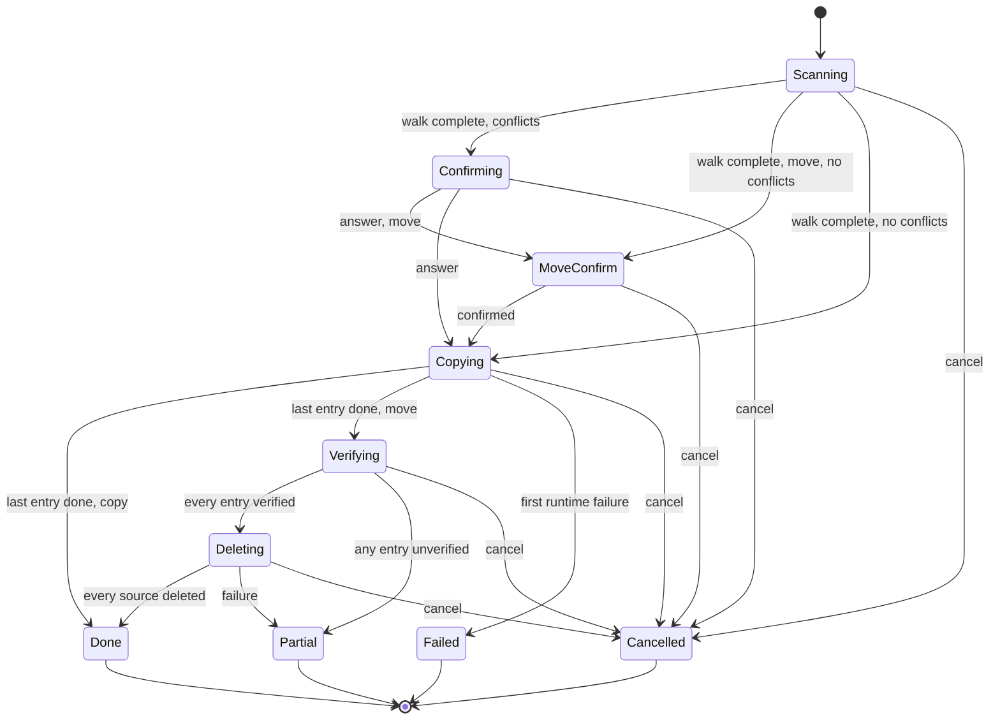
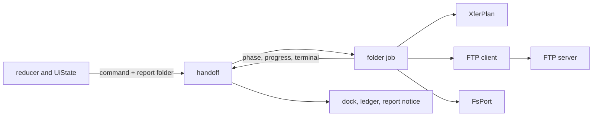
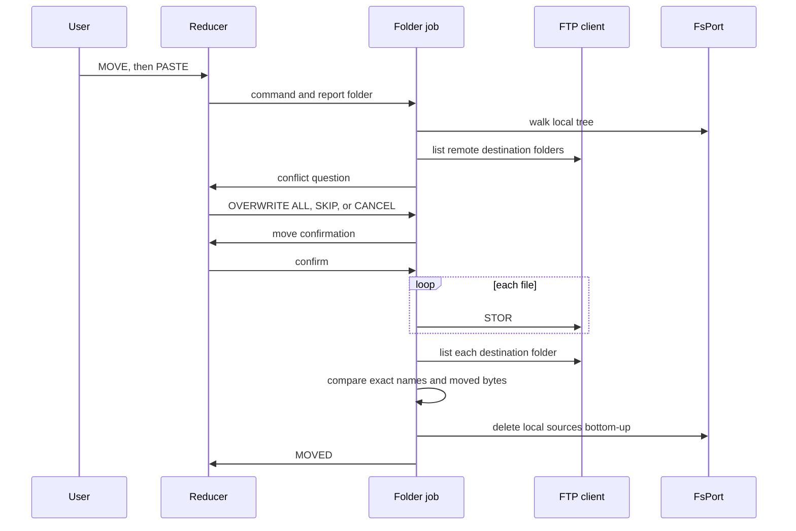

# Cross-Pane Folder Transfer - Plan

## Goal Capsule

- **Objective:** A folder, or a marked set that contains one, moves between the console and an FTP server as a single operation, and the copy and move model from the two local panes works across the network boundary in both directions.
- **Means:** A walk-first recursive plan, one conflict question, a move that re-lists the destination and deletes the source only after every entry verified, and a `skipped.txt` that names everything that did not transfer.
- **Product authority:** The v1 plan's R22 and R23 own remote recursion, and its R41 and R42 own the conflict and temporary-write rules. The R1-R24 and K1-K9 below are local to this plan. `docs/DESIGN.md` remains the layout authority and gains the eight-row remote ledger with its scroll, plus the scanning and verifying states.
- **Execution profile:** Deep and durable. Host suites prove the policy, the plan, and the worker; the new matrix rows are added as PENDING and promoted by the D95 code-freeze pass on the PCH-1000.
- **Stop conditions:** Stop if the build shows the eight-row scroll cannot fit the settled panel, or if a console-only behavior contradicts a requirement; record the finding and return to planning rather than working around it.
- **Who finishes:** `ce-work` implements the units and runs the host gates; the owner runs the console matrix on the build at code freeze.
- **Open blockers:** None.

## Product Contract

### Summary

A folder becomes one transfer in every direction: remote to local, local to remote, and as a move that verifies the copy before deleting the source. The remote pane keeps DOWNLOAD as its copy and gains MOVE, and a local clipboard pastes into the remote pane as an upload.

### Problem Frame

The two local panes copy and paste, but the boundary to FTP is still one file at a time. A folder has to be rebuilt folder by folder, a move cannot be expressed at all, and a failed copy leaves the user guessing what arrived. The v1 plan's R22 and R23 are the last unbuilt v1 requirements; today the UI dims a folder source with `FOLDER NOT SUPPORTED` and the worker refuses it as a backstop.

Once a folder can cross the boundary, the copy and move model has to reach it too: the clipboard, paste-into-a-destination, and verified-move ideas carry to the remote pane, with DOWNLOAD keeping its name as the remote copy (K5).

### Requirements

**Recursive transfer**

- R1. A remote folder is downloaded recursively with its whole subtree into the left local view's current folder, under a folder of the same name; a local folder is uploaded recursively into the current remote folder the same way. A marked set may mix files and folders, and it expands into one plan.
- R2. The plan is built by walking the whole tree before the first byte: every entry's source, destination, type, and size when known. An upload's walk also lists each remote destination folder once, so the conflict question names the real destinations. A destination folder that does not exist contributes no conflicts; a listing that is refused or stops at the 2000-row cap refuses the transfer before the first byte, because the question cannot be asked against a partial set. Before the transfer starts, the dock shows the entry count and the summed known bytes.
- R3. The walk is visible in the dock as `SCANNING`, occupying the network lane for its duration so the dock is focusable; it shows the folder name and the entries found so far. Its cancel opens a confirmation that says nothing has been transferred or deleted. A walk cancelled before the first byte moves nothing, deletes nothing, and writes no report. A folder job holds the network lane for its whole life; while it does, the pane's cursor, marks, and view switch stay live, a folder open and the remote write rows (NEW FOLDER, RENAME, DELETE, REFRESH) are dim with `TRANSFER IN PROGRESS`, MOVE and PASTE are dim with the same reason, a file DOWNLOAD queues, and a second folder transfer stays dim.
- R4. One conflict question is asked per transfer, after the walk, when the plan found existing destinations — OVERWRITE ALL, SKIP EXISTING, or CANCEL — naming up to 16 of them and counting the rest (`+N MORE`). An existing destination folder is merged, never replaced; a destination that is a file where the plan expects a folder is skipped with `DESTINATION IS A FILE`, its subtree with it, and the move never deletes that source. SKIP EXISTING applies per file, and a skipped source is not deleted by a move.
- R5. An entry the walk cannot transfer is skipped and the rest proceeds: a remote name that cannot become a local path, with its whole subtree; a local name that cannot be sent as a remote path — empty, `.`/`..`, a separator or colon, or a control character — with its whole subtree; a destination folder that R18's perm test marks read-only, with its whole subtree; a source folder whose listing stops at the 2000-row cap, where the listed rows transfer and the remainder is one missing entry; a source folder whose listing the server refuses; a destination that is a file where a folder is expected; a local entry that cannot be read. Each skip is recorded with its reason.
- R6. A tree too large for the plan is refused before the first byte with a named limit. The capacity exceeds one 2000-row listing, so the listing-cap rule in R5 stays reachable. No partial plan runs and no entry is silently dropped.
- R7. Empty folders are created as folders on both sides.
- R8. A recursive transfer that fails stops at the failed entry: the files that completed stay, the in-flight partial is removed (the v1 plan's R42), a failed upload's remote partial is deleted, and the report names the failure and what was never attempted. A cancel reaches the same terminal, with the remainder named. A data-channel failure leaves the session connected, except a failure of the session's first listing, which fails the session.
- R9. The views that changed refresh once at the terminal — the local view after a download, the remote view after an upload, and both views when a move deletes sources.

**Cross-pane copy and move**

- R10. The remote action ledger keeps DOWNLOAD as its copy and gains MOVE; it becomes seven action rows plus the switch, eight in all, superseding D65's six-row maximum. While a local clipboard is armed, PASTE replaces DOWNLOAD, and DOWNLOAD returns when the paste disarms the clipboard. The MOVE row reads `TO LOCAL PANE`, its destination is the left local view's path, and its consequence is `DELETES THE SOURCE AFTER THE COPY VERIFIES.` The panel keeps its 44 px row pitch and scrolls in whole rows when they exceed its height, starting at the top and following the selection; `docs/DESIGN.md` gains that row, the scroll, and its states, and the matrix row that reads `seven-row ACTIONS` is updated to match.
- R11. A local COPY or MOVE arms the clipboard with its items and its intent; CLEAR, a new COPY or MOVE, or a PASTE that emits its commands disarms it, as it does today. PASTE on the remote pane uploads the items into the current remote folder as one plan and disarms the clipboard when it emits its commands; a MOVE clipboard verifies the copy and then deletes the local sources.
- R12. Remote MOVE downloads the selected items, verifies the copy, and then deletes the remote sources. DOWNLOAD remains the copy and never deletes anything. MOVE is dim with `READ-ONLY MOUNT` when the left local view's current volume is read-only.
- R13. A cross-pane move deletes a source only after the copy verifies: each destination folder is re-listed, each listed row is matched to the planned names as it streams, and every planned entry must exist with its name matching exactly and its size confirmed. A file's size is confirmed when the destination size equals the bytes the transfer completed for that entry. A file whose size cannot be confirmed, or whose name differs only in case, is unverified: its source stays and the report names it. Unmatched destination rows are ignored and never counted as truncation; an empty folder verifies as an existing folder. A listing that genuinely cannot be read leaves the move unverified and keeps every source; when the destination folder holds more rows than the verification collector, the planned entries are verified with MLST or SIZE instead. Verification is cancellable on the walk's terms: its cancel keeps every copy and deletes no source.
- R14. Any skip, failure, or cancel during the copy or verification keeps every source, including sources whose copies completed. A skip makes the move incomplete, so no source is deleted; the report names the skipped entries for a manual retry. The copies stay and the dock reports `n OF m` partial. The delete phase runs bottom-up and stops at the first failure: that entry's verified copy stays, the sources not yet deleted are named in the report, and the move's single terminal is the network lane's, with its local steps running inside the job. A cancel during the delete phase stops between commands, keeps the remaining sources, and reports them; the deleted sources cannot be restored. A failed delete never removes a verified copy; the v1 plan's R42 cross-volume rollback clause does not apply to a cross-pane move.
- R15. A cross-pane move asks once before it starts, names the roots, carries the walk's entry count, says the source is deleted only after the verified copy, and warns `IF ANY ENTRY IS SKIPPED OR UNVERIFIED, NO SOURCE IS DELETED.` The walk and the conflict question run first, so the count is real.
- R16. Remote-to-remote copy is not offered: FTP has no copy command, and one clipboard carries one source side.
- R17. A local source on a read-only volume (`app0:`, `gro0:`) cannot be moved; MOVE is dim and COPY stays available.

The four actions map as follows (R10-R12):

| Action | Source | Destination | Deletes the source |
|---|---|---|---|
| DOWNLOAD | remote | left local view | never |
| MOVE on the remote pane | remote | left local view | after verification |
| COPY then PASTE on the remote pane | local | current remote folder | never |
| MOVE then PASTE on the remote pane | local | current remote folder | after verification |

**Read-only sessions**

- R18. Write capability belongs to the remote pane's current folder, read from its `perm` facts when the server reports them: the folder's own row in a listing's cdir or pdir, or an MLST of the folder after connect and after each navigation. A folder that grants no write, create, delete, or mkdir is read-only. A permission-class refusal fails only the entry it names and never marks the folder or the session, because a 550 is also the reply for a missing or protected path, including the app's own server's protected paths. A server that reports no `perm` facts stays enabled, and its refusal fails the action. Moving to another folder or refreshing recomputes the mark; a new session clears it.
- R19. While the current remote folder is read-only, UPLOAD, PASTE of a local clipboard, MOVE, NEW FOLDER, RENAME, and DELETE are dim with `READ ONLY`. DOWNLOAD and REFRESH stay live while the clipboard is empty; with a local clipboard armed, PASTE holds DOWNLOAD's row and reads `READ ONLY`, and CLEAR, reached from the local ledger, restores DOWNLOAD.

**Free space and the report**

- R20. Every download — a single file, a marked set, or a folder tree — sums its known bytes before the first item starts and refuses the whole request with `NOT ENOUGH SPACE` when the sum exceeds the destination volume's free space. A volume that reports no free space skips the check and the dock renders `--`; the cached value is invalidated when a transfer writes to that volume. Unknown sizes are not counted, so the check is a lower bound.
- R21. One `skipped.txt` is written per transfer, in the local pane's current folder at the start of the transfer — the folder that holds the transfer's root, not inside it; a set whose roots span folders uses that pane's folder. It carries a header naming the direction and both roots, a count, and one line per missing entry with its path relative to that folder and its reason; a path outside that folder is written as its full local path, a download skip with no local destination is written as its remote path marked `REMOTE`, and a control character in a name is escaped so one entry stays one line. With nothing missing it says the transfer was complete; a job that ends before the copy phase begins — a cancelled walk, conflict, or move confirm — writes no report and leaves any previous one in place; once the copy phase begins, a failed or cancelled transfer lists every entry it did not complete, with its cause, so a cancel never reads complete.
- R22. The report is replaced on every folder transfer that reaches its terminal, including one that skipped nothing, and a file already using that name is replaced unless the transfer wrote it or left it as a source; in that case the report takes the free name (`skipped 2.txt`) and the dock names it. A directory already using that name is not replaced, and the report is not saved. A move that deletes a source folder leaves the report, because it sits in the folder above. A report location that is read-only, or a report write that fails, leaves the transfer's outcome unchanged and the dock says the report was not saved.
- R23. The report is a record only: no action reads it back in v1.

**Feedback**

- R24. A recursive or cross-pane transfer's active dock state shows the direction, the current file, `n OF m`, transferred and total bytes, and the rate; an unknown total renders `--`. The walk, the verification, and the delete phase show `SCANNING`, `VERIFYING`, and `DELETING` with their folder or source counts and no byte bar. A copy ends `UPLOADED` or `DOWNLOADED`, a move ends `MOVED`, a cancel reads `CANCELLED n OF m` in white with its kept copies named, and a partial keeps the verb in yellow with the reason. When a report is not saved, the notice is appended to the terminal reason on the same line.

### Key Decisions

- K1. **Walk the tree before transferring it.** (session-settled: user-directed — chosen over streaming the tree as it is discovered: a true count, one conflict question, and a tree that cannot fit is refused before any byte.) Governs R2-R6.
- K2. **Skip the entry, keep the folder, and report it.** (session-settled: user-directed — chosen over refusing the whole folder for one bad entry: a single unsafe name should not block the rest, and the report makes the loss visible.) Governs R5, R21-R22.
- K3. **The report is replaced on every folder transfer.** (session-settled: user-directed — chosen over preserving a pre-existing file of that name: a stale list is read as the latest one.) Governs R21-R22.
- K4. **A move deletes only after a verified copy.** (session-settled: user-directed — chosen over deleting on the transfer's own success replies: the only remaining copy must not be deleted on an unverified write.) Governs R11-R15.
- K5. **The remote pane keeps DOWNLOAD and gains MOVE; PASTE replaces DOWNLOAD while armed.** (session-settled: user-directed — chosen over mirroring the local pane with COPY and MOVE: the one-press download is the common path and stays; it supersedes D65's six-row maximum.) Governs R10.
- K6. **Free space is checked for every download.** (session-settled: user-directed — chosen over folder-only: a marked set can fill the card just as easily.) Governs R20.
- K7. **Read-only is learned, never assumed.** (session-settled: user-approved — shown with the tradeoff that a server reporting nothing stays enabled, and the user confirmed.) Governs R18-R19.
- K8. **One clipboard carries one source side.** (session-settled: user-approved — shown with the remote-to-remote refusal, and the user confirmed.) Governs R11, R16.
- K9. **Verification re-lists the destination folders.** (session-settled: user-directed — chosen over probing every file with MLST or SIZE: one listing per folder keeps a large tree quick.) Governs R13.

### Key Flows

- F1. Recursive download
  - **Trigger:** DOWNLOAD on a remote folder, or a marked set containing one.
  - **Steps:** walk the subtree (`SCANNING`) → one conflict question if anything exists → transfer item by item → terminal → refresh the local view → write `skipped.txt` in the folder that holds the destination root.
  - **Outcome:** the tree lands merged with the destination; missing entries are in the report.
  - **Covers:** R1-R9, R21-R24.
- F2. Local move pasted into the remote pane
  - **Trigger:** MOVE on local items, then PASTE on the remote pane.
  - **Steps:** walk the local tree → conflict question → move confirm → upload → re-list each remote destination folder (`VERIFYING`) → delete the local sources bottom-up → `MOVED`.
  - **Failure:** any skip, failure, or cancel keeps every local source and reports partial.
  - **Covers:** R10-R15, R21-R22, R24.
- F3. Remote move
  - **Trigger:** MOVE on remote items.
  - **Steps:** walk the remote subtree → conflict question → move confirm → download → re-list each local destination folder (`VERIFYING`) → delete the remote sources bottom-up → `MOVED`.
  - **Failure:** as F2, with the remote sources kept.
  - **Covers:** R12-R15, R21-R22, R24.
- F4. Read-only folder
  - **Trigger:** the current remote folder's `perm` facts grant no write.
  - **Steps:** mark the folder read-only, dim the write rows with `READ ONLY`, keep DOWNLOAD and REFRESH live.
  - **Outcome:** a copy still works; a move and an upload do not start.
  - **Covers:** R18-R19.

### Acceptance Examples

- AE1. Unsafe name inside a downloaded folder
  - **Covers:** R5, R21.
  - **Given:** a remote folder holds `good.txt` and `bad:name.txt`.
  - **When:** the user downloads the folder.
  - **Then:** `good.txt` lands, `bad:name.txt` is skipped with its reason, and `skipped.txt` lists it. Nothing is refused whole.
- AE2. Move with one skipped file
  - **Covers:** R5, R14, R15.
  - **Given:** a local folder to move holds one file whose remote name is unsafe.
  - **When:** the user moves it to the remote pane.
  - **Then:** the safe files upload, the move confirm said the source is deleted only after the verified copy, the source folder stays because one entry is missing, and the report names it.
- AE3. Verification catches a short file
  - **Covers:** R13, R14.
  - **Given:** the server accepts a STOR but stores a shorter file.
  - **When:** the move's verification re-lists the folder.
  - **Then:** the size mismatch fails verification, nothing is deleted, and the dock reports partial with the reason.
- AE4. Read-only folder
  - **Covers:** R18, R19.
  - **Given:** a server whose folders advertise no write permission.
  - **When:** the user browses one.
  - **Then:** UPLOAD, PASTE, MOVE, NEW FOLDER, RENAME, and DELETE are dim with `READ ONLY`; DOWNLOAD and REFRESH stay live.
- AE5. Merge into an existing folder
  - **Covers:** R4.
  - **Given:** the destination already holds the folder with another file inside.
  - **When:** the user sends the folder and answers OVERWRITE ALL.
  - **Then:** same-named files are replaced, the other file stays, and no folder is deleted.
- AE6. Free space short
  - **Covers:** R20.
  - **Given:** a marked set whose summed known bytes exceed the destination volume's free space.
  - **When:** the user starts the download.
  - **Then:** nothing starts, and the dock says `NOT ENOUGH SPACE` with the shortfall.
- AE7. Session lost during a folder job
  - **Covers:** R8, R14, R21.
  - **Given:** a folder job in scan, copy, verify, or delete.
  - **When:** the control connection drops.
  - **Then:** the job ends with one terminal, the dock clears, completed copies stay, a move's undeleted sources stay, and the report is written when a byte had moved.
- AE8. Cancel in the copy phase
  - **Covers:** R3, R8, R21.
  - **Given:** a folder copy in progress.
  - **When:** the user cancels.
  - **Then:** completed files stay, the partial is removed, the dock reads `CANCELLED n OF m`, and the report names the remainder.
- AE9. Marked set from two folders
  - **Covers:** R1, R4, R21.
  - **Given:** marks collected in two local folders.
  - **When:** the user pastes them into the remote pane.
  - **Then:** one plan, one conflict question, one report in the pane's folder, and a path outside it is written as its full local path.
- AE10. New destination folder
  - **Covers:** R2, R4.
  - **Given:** the remote current folder does not hold a folder of the same name.
  - **When:** the user uploads a local folder.
  - **Then:** the destination contributes no conflicts, the folder is created, and no conflict question is asked.

### Scope Boundaries

- Remote-to-remote copy or move on one server. FTP has no copy command; this plan does not fall back to a download and upload through the console.
- Retrying from `skipped.txt`. The report is a record; selecting those entries again is manual.
- Background transfers and sleep or resume; they stay in their own later plan.
- FTPS, SFTP, and any non-FTP transport.
- A hidden-file toggle, a sync or compare mode, and a resume-from-offset transfer.
- Server-side changes. The Vita server already answers the commands a recursive client sends; the recursion lives in the client.
- A report for a pure file set. A transfer with no folder reports through the dock, not `skipped.txt`.
- A wall-clock timestamp in the report header; the app exposes monotonic time only today.
- A greyed-out write on a server that reports no `perm` facts; it stays enabled and its refusal reports on the action.

### Outstanding Questions

- **Resolved in the Planning Contract:** the plan capacity (4,096 entries, a 512 KiB arena, KTD2) and the reservation scope (the local tree root held as a tree reservation, KTD11).
- **Open at the code-freeze pass:** the measured heap fit for the plan and the verification collector beside the existing arenas, and whether `uma0:` and `ur0:` can report free space.
- **Resolve Before Planning:** none.

### Sources

- `docs/plans/2026-11-08-1103-feat-vitaftpshell-v1-plan.md` — R22, R23, R41, R42, KTD13, KTD20, KTD21.
- `docs/DECISIONS.md` — D65 (the folder refusal and the six-row ledger this plan supersedes), D66 (teardown), D67 (unsafe names), D96-D99 (volumes, the right view, the duplicate prompt, the alias).
- `docs/DESIGN.md` — the dock, the action ledgers, and the pane states.
- `docs/ARCHITECTURE.md` — the worker, the queue, the planner, and the reservations.
- `src/core/xfer.h`, `src/core/fsop_plan.h`, `src/core/ftp/client.h`, `src/app/worker.c`, `src/core/uistate.c` — the current shape this work extends.
- `docs/VERIFICATION.md` — M20 waits on this work, and M25's seven-row wording is updated by R10.

---

## Planning Contract

**Product Contract preservation:** changed: R2-R5, R8, R10-R15, R18-R22, R24; AE7-AE9 added. The changes close states the flow analysis and the implementation review found undefined: the job's lane and terminal, stop-on-failure, the destination listing outcomes, navigation and dim rules during a job, the source of the read-only fact, report existence, location, and collision, and the failure acceptance examples. The product intent is unchanged.

### Key Technical Decisions

- KTD1. **A folder transfer is one heap-owned job on the network lane.** A `FolderJob` holds the plan, the phase, the current entry, the report folder, and the cancel latch. It claims the lane's active fact and the server's external-busy fact for its whole life, `pump_queue` and `pump_remote_actions` return while it exists, and its pump waits on `ftp_server_busy`. Every teardown — terminal, cancel, connect, disconnect, session loss — runs through one `folder_job_end` that emits exactly one terminal and applies the report rule. Its local walk, verification, and delete steps run inside its pump rather than as a local-lane batch; the reservation table still guards overlap. (Chosen over one queue item carrying the plan: `XferItem` is a fixed-size value with no heap ownership and a per-item terminal, so it cannot own a tree or a single terminal.) Governs R1, R3, R9, R14, R24.
- KTD2. **The plan is an entry table plus a path arena, built iteratively.** `XferPlan` holds 4,096 entries, a 512 KiB path arena, and a directory worklist of entry indices; an overflow is refused before the first byte, never truncated. The code-freeze pass confirms the heap fit beside the existing arenas. (Chosen over a recursive builder: the worker stack gate and the 32-level scan cap do not fit a transfer tree.) Governs R2, R6.
- KTD3. **The walk uses a private, non-publishing listing collector.** A job token scopes listing events to the job's own pending request; the collector fills plan entries, never `UiRow`s, and lists absolute paths. A user listing can never enter the plan, and the pane's rows, path, and generation are untouched. Governs R2, R3, R5.
- KTD4. **Verification streams each destination listing and compares moved bytes.** Each listed row is matched to the planned names as it arrives, so extra rows are ignored rather than filling the collector. A planned entry verifies when its exact name exists and its size equals the bytes the transfer completed for it; an unknown or case-only match is unverified and the source stays. When the destination folder holds more rows than the collector, the planned entries are verified with MLST or SIZE. Governs R13.
- KTD5. **A phase field carries SCANNING, VERIFYING, and DELETING; a move flag carries MOVED.** The progress and terminal events gain the phase and move fields, the dock maps the phase word first, and the bar hides during a phase. No `XferDirection` value is inserted inside the local range. Governs R10, R24.
- KTD6. **The remote ledger scrolls in place, in whole rows.** `UiActions` gains a first-visible index; `actions.c` clips rows to the panel and draws a scroll indicator; the window starts at the top and follows the selection. The 44 px pitch and the local ledger stay unchanged. An explicit per-pane order table in `uistate.c` yields the remote order DOWNLOAD, MOVE, NEW FOLDER, RENAME, DELETE, REFRESH, DISCONNECT, SWITCH, with PASTE in DOWNLOAD's slot; `docs/DESIGN.md` and the render assertions update together. Governs R10, R19.
- KTD7. **Read-only is per folder from `perm` facts.** `ListingEntry` gains a write-capable mask and a known flag; the MLSD parser captures the cdir/pdir row's mask, and the MLST parser fills the same mask. The worker stamps the remote view's current-folder capability from an MLST after connect and after each navigation, and the walk stamps destination folders from their listings. A 550 never marks. Governs R5, R18-R19.
- KTD8. **The move's delete phase walks the plan bottom-up.** Local sources are removed through `FsPort`; remote sources through DELETE and RMDIR, one command at a time. It does not use `fsop_plan`'s 1,024-fact scan, but it calls `path_check_delete` on every source root before the first remove, so a protected, denied, or read-only source refuses the move and keeps the copy. A failed upload's remote partial is deleted. A cancel stops between commands. Governs R8, R14, R21.
- KTD9. **The report is a core module over `FsPort` with temp, sync, and rename.** `xfer_report_write` writes UTF-8 with LF, escapes control characters, replaces a file but never a directory, and takes the free name when the transfer itself wrote a `skipped.txt`. The command carries the report folder resolved at emission, so later navigation cannot move it. Governs R21-R22.
- KTD10. **Free space is a preflight over the cached per-volume value.** The sum covers known planned bytes; a known shortfall refuses the request; an unknown free space skips the check and renders `--`. The cache is invalidated after a write to that volume. Only `ux0:` reports a value today; the code-freeze pass measures whether `uma0:` and `ur0:` can. Governs R20.
- KTD11. **The job holds its local tree root as a tree reservation.** A download holds its destination root, an upload its source root, as `RESERVE_TREE` for the job's whole life; the job's own item start ignores its own root while checking the other lane, and the root is a dedicated reservation that survives the per-entry lane release. A local job touching a descendant asks WAIT, SKIP, or CANCEL, in either start order. Governs R3, R14.

### High-Level Technical Design

The job is a phase machine. Every phase is cancellable; every exit reaches exactly one terminal.

The job is the only writer of the client during its life. The plan, the client, and the filesystem meet only through the worker's pump.

An upload move is one walk, two prompts, one copy, one verification pass, and one delete pass.

### Sequencing

U1 defines the plan the rest consumes. U6 adds the `perm` fact that U2 and U5 read. U2 builds the walk on U1 and U6. U3 builds the job on U1 and U2. U4 adds verification and delete to U3. U5 is the UI surface for U3 and U6. U7 adds the preflight and report to U3. U8 closes the docs and the matrix after the code lands.

## Implementation Units

### U1. Transfer plan core

- **Goal:** A pure, heap-owned plan for a folder tree that the job can walk, verify, report, and delete from.
- **Requirements:** R2, R5, R6, R7, R13, R21.
- **Dependencies:** None.
- **Files:** `src/core/xfer_plan.h`, `src/core/xfer_plan.c`, `tools/test/test_xfer_plan.c`.
- **Approach:** Mirror `fsop_plan`'s separation, not its local-only types. `XferPlan` holds an entry table (source and destination offsets, parent index, type, size and known flag, moved bytes, status, skip reason), a 512 KiB path arena, and a directory worklist. Builders add a root, a child, or a skip; the finalizer computes totals and the conflict set. Verification compares a destination listing against the entries and marks verified or unverified. Report rows are generated in plan order. No port call lives here.
- **Patterns to follow:** `src/core/fsop_plan.h` for the bounded arena and refusal-on-overflow rule; `src/core/path.c` for name checks.
- **Test scenarios:**
  1. A three-level tree expands with the right entry count and parent links.
  2. The 4,096th entry fits and the 4,097th refuses with `PLAN TOO LARGE`, leaving no partial plan.
  3. An empty folder is one entry and transfers as a folder.
  4. A multi-root set adds each root in order and sums the known bytes.
  5. An unsafe remote name records its subtree as one missing entry.
  6. A read-only destination subtree is one skip with `READ ONLY`.
  7. Verification accepts an exact name with matching moved bytes.
  8. A short file, an unknown size, and a case-only name each leave the source unverified.
  9. Extra destination entries are ignored.
  10. A report row escapes a control character and writes a path outside the root as absolute.
- **Verification:** `test_xfer_plan` passes inside `./tools/test/run.sh`; the layering guard reports no platform include.

### U2. Remote walk and private collector

- **Goal:** Walk a remote subtree with sequential listings without disturbing the pane or the session.
- **Requirements:** R2, R5, R13.
- **Dependencies:** U1, U6.
- **Files:** `src/app/worker.c`, `src/app/worker.h`, `tools/fake/fake_peer.c`, `tools/fake/fake_peer.h`, `tools/test/test_client.c`, `tools/test/test_integration.c`.
- **Approach:** Add a walk mode checked in the listing handlers before `remote_listing_begin`, keyed by a job token. Each directory is one absolute `ftp_client_list` call; rows fill the plan, never the pane. A refused source listing becomes a skip; a 2000-row source listing becomes the listed set plus one missing remainder; a destination listing that is refused or capped refuses the whole upload before the first byte, and an absent destination contributes no conflicts. A data-channel failure is classified by the client state, so a first-listing failure ends the session and a later one skips the folder. The walk is cancellable.
- **Patterns to follow:** The upload preflight's token and latch (`src/app/worker.c`), the existing listing generation rules in `src/core/handoff.h`.
- **Test scenarios:**
  1. A nested tree is walked with absolute paths and the pane's rows and path are unchanged.
  2. Per-path fake listings return different rows for `/A` and `/A/B`.
  3. A refused subfolder is one skip and the rest of the walk continues.
  4. A 2,001-row folder transfers the first 2,000 and records one remainder.
  5. A rename between two listings produces a refusal, not a pane change.
  6. Cancel mid-walk moves nothing and writes no report.
  7. A first-listing data failure ends the session and the walk.
  8. A later data failure skips the folder and keeps the session.
  9. A destination folder that does not exist contributes no conflicts; a refused or capped destination listing refuses the whole upload.
  10. A read-only destination subtree is one skip during an upload walk.
- **Verification:** `test_client` and `test_integration` pass; the fake peer answers per path.

### U3. Folder job runner

- **Goal:** One heap job drives scan, prompts, copy, progress, cancel, and a single terminal.
- **Requirements:** R1-R9, R14, R24.
- **Dependencies:** U1, U2, U6.
- **Files:** `src/app/worker.c`, `src/app/worker.h`, `src/core/handoff.h`, `src/core/handoff.c`, `src/core/uistate.h`, `src/core/uistate.c`, `src/ui/dock.c`, `tools/test/test_integration.c`, `tools/test/test_app_thread_xfer.c`.
- **Approach:** `FolderJob` is heap-owned and ends only through `folder_job_end`, which emits one terminal and applies the report rule; `reset_remote_session`, a connect, a disconnect, and a session loss all route through it. `folder_job_pump` runs before `pump_remote_actions` and `pump_queue`; both pumps return while the job exists, and the job's pump waits on `ftp_server_busy`. The job claims the lane's active fact and the server's external-busy fact for its life. The phase machine follows the state diagram. One entry starts per step after the previous `OPERATION_DONE`; the conflict question and the move confirm are sequential prompts, and the job holds the lane between them. Progress and the terminal carry the phase and move fields.
- **Patterns to follow:** `local_run_pump` for the stepped heap run; `pump_remote_actions` for one-command sequencing; `cancel_local_lane` for teardown ownership.
- **Test scenarios:**
  1. A downloaded folder scans, copies, and ends `DOWNLOADED` with its entry count.
  2. An uploaded folder ends `UPLOADED`.
  3. SKIP at the conflict drops the existing file and the rest transfers.
  4. A second file DOWNLOAD queues behind the job; a second folder transfer is dim.
  5. A REFRESH queued before the job waits for its terminal and never runs between listings.
  6. Covers AE7. A session loss in scan and copy ends the job once and clears the dock.
  7. Covers AE8. Cancel in scan and copy follows the phase rule.
  8. No phase path emits two terminals.
- **Verification:** `test_integration` and `test_app_thread_xfer` pass; the linked stack gate passes with `folder_job_pump` added to its fixed chain.

### U4. Verification and delete

- **Goal:** A move deletes a source only when the copy verified, in both directions.
- **Requirements:** R12-R15, R21.
- **Dependencies:** U3.
- **Files:** `src/app/worker.c`, `src/core/xfer_plan.c`, `src/core/xfer_plan.h`, `tools/test/test_integration.c`, `tools/test/test_xfer_plan.c`.
- **Approach:** The verify phase streams each destination listing and matches rows to planned names, so extra rows are ignored; a planned entry compares exact name and moved bytes. When the destination holds more rows than the collector, the planned entries are verified with MLST or SIZE. The delete phase walks the plan bottom-up: `path_check_delete` on every source root first, then `FsPort` remove and rmdir locally, DELETE and RMDIR remotely, one command at a time, stopping at the first failure and reporting the undeleted remainder. A failed upload's remote partial is deleted. The terminal is `MOVED` on the network lane. A failed delete never removes a copy.
- **Patterns to follow:** `fsop_run`'s step discipline for the local removes; the client's one-op rule for the remote removes.
- **Test scenarios:**
  1. A verified move deletes every source and ends `MOVED`.
  2. A short file keeps every source.
  3. An unknown size keeps that source.
  4. A case-only destination name keeps that source.
  5. A destination folder with extra rows verifies and ignores the extras.
  6. A destination folder larger than the collector verifies its planned entries with MLST or SIZE.
  7. A delete failure keeps the failed entry's copy and names the rest.
  8. A cancel during delete stops between commands and reports the remainder.
  9. Both directions: local to remote and remote to local.
  10. A protected source refuses the delete and keeps the copy.
  11. A failed upload's remote partial is deleted.
  12. Covers AE7. A session loss in verify and delete ends the job once.
  13. Covers AE8. Cancel in verify and delete follows the phase rule.
- **Verification:** `test_integration` and `test_xfer_plan` pass.

### U5. Ledger, clipboard, read-only, and confirm

- **Goal:** The remote move row, the armed paste, the eight-row scroll, per-folder `READ ONLY`, and the move confirm.
- **Requirements:** R10, R11, R16-R19, R24.
- **Dependencies:** U3, U6.
- **Files:** `src/core/uiact.h`, `src/core/uiact.c`, `src/core/uistate.h`, `src/core/uistate.c`, `src/ui/actions.c`, `src/ui/dock.c`, `src/ui/workspace.c`, `docs/DESIGN.md`, `tools/test/test_uistate.c`, `tools/test/test_render_screens.c`, `tools/test/test_render_workspace.c`.
- **Approach:** Expose the existing `UI_ACTION_MOVE` on the remote pane, after DOWNLOAD, through an explicit per-pane order table rather than the enum order; PASTE takes DOWNLOAD's slot while a local clipboard is armed. `UiActions` gains a first-visible index; `actions.c` clips whole rows and draws the scroll indicator. `UI_CONFIRM_MOVE` names the roots, the entry count, and the warning that any skip or unverified entry keeps every source. The remote pane carries a read-only capability; MOVE also dims with `READ-ONLY MOUNT` when the left local view's volume is read-only. During a job, a folder open, the mutation and refresh rows, MOVE, and PASTE dim; cursor, marks, and the view switch stay live. The dock maps the phase word first, hides the bar during a phase, and shows `DELETING` with a source count.
- **Patterns to follow:** The local ledger's `prepare_visible`; the SITES window's scroll indicator; the existing confirm item rendering.
- **Test scenarios:**
  1. The remote ledger has eight rows and scrolls; the eighth is reachable; the local ledger is unchanged.
  2. The remote order is DOWNLOAD, MOVE, NEW FOLDER, RENAME, DELETE, REFRESH, DISCONNECT, SWITCH, and PASTE takes DOWNLOAD's slot while armed.
  3. MOVE is live for a file and a folder and dims with its reasons, including `READ-ONLY MOUNT` for a read-only local destination.
  4. The armed clipboard shows PASTE and disarms when the paste is emitted.
  5. A read-only folder dims the write rows; DOWNLOAD works while empty; PASTE holds its row while armed.
  6. The move confirm names the roots, the count, and the keep-every-source warning.
  7. The dock reads `SCANNING`, `VERIFYING`, `DELETING`, and `MOVED`.
  8. During a job, a folder open, NEW FOLDER, RENAME, DELETE, REFRESH, MOVE, and PASTE dim; cursor, marks, and the switch stay live.
  9. The ledger dims only the read-only folder; navigating away restores the rows.
  10. The render suites assert the eighth row and the scroll indicator.
- **Verification:** `test_uistate`, `test_render_screens`, and `test_render_workspace` pass; `./tools/preview/run.sh` renders the new states.

### U6. `perm` facts end to end

- **Goal:** The client learns a folder's write capability from the server.
- **Requirements:** R5, R18-R19.
- **Dependencies:** None.
- **Files:** `src/core/listing.h`, `src/core/listing.c`, `src/core/ftp/client.h`, `src/core/ftp/client.c`, `src/app/worker.c`, `src/core/uistate.h`, `src/core/uistate.c`, `tools/test/test_listing.c`, `tools/test/test_client.c`, `tools/test/test_integration.c`, `tools/test/test_uistate.c`.
- **Approach:** `ListingEntry` gains a permission mask (write, create, delete, mkdir) and a known flag. The MLSD parser captures the cdir/pdir row's mask, and the MLST result carries the same mask. The worker MLSTs the current folder after connect and after each navigation and stamps its capability; the walk stamps destination folders from their listings. A refusal never changes the fact.
- **Patterns to follow:** The existing `ListingEntry` known-flag pattern; the MLST result shape in `FtpClientEvent`.
- **Test scenarios:**
  1. `perm=el` parses with no write.
  2. `perm=adfw` parses with write.
  3. An absent `perm` leaves the fact unknown.
  4. MLST carries the same mask.
  5. A listing's cdir row supplies the current folder's mask.
  6. The app's own server, which reports no `perm`, leaves the folder enabled.
  7. An MLST after connect marks a read-only login folder before the first action.
  8. A 550 on a write fails the entry and never marks the folder.
- **Verification:** `test_listing`, `test_client`, `test_integration`, and `test_uistate` pass.

### U7. Free-space preflight and report

- **Goal:** Every download refuses a known shortfall before its first byte, and every folder transfer leaves a truthful report.
- **Requirements:** R20-R23.
- **Dependencies:** U3.
- **Files:** `src/app/worker.c`, `src/core/report.h`, `src/core/report.c`, `tools/test/test_report.c`, `tools/test/test_integration.c`.
- **Approach:** The preflight sums the known bytes at the job or batch start and reads the cached per-volume free space; a known shortfall refuses with `NOT ENOUGH SPACE` and the shortfall, an unknown value skips the check and renders `--`, and the cache is invalidated after a write to that volume. `xfer_report_write` writes the header and rows through a temporary file, syncs, closes, and renames with the aside fallback. A directory at the report path, a read-only location, or a write failure leaves the transfer's outcome unchanged and sets the dock notice; a file the transfer wrote under the report name takes the free name.
- **Patterns to follow:** `store.c`'s private temp, sync, and rename-with-aside sequence; the dock's `notice` and message line.
- **Test scenarios:**
  1. A single known-size download over free space refuses before the first byte.
  2. A marked set sums its known bytes and refuses.
  3. A folder download sums its plan and refuses.
  4. An unknown free space skips the check and renders `--`.
  5. An unknown size is a lower bound, not a guess.
  6. Covers AE9. A marked set from two folders writes one report, and an outside path is absolute.
  7. A failed or cancelled transfer lists every uncompleted entry with its cause.
  8. A complete transfer writes the complete line.
  9. A cancel before the copy phase writes no report.
  10. A move leaves the report in the folder above the deleted root.
  11. A directory named `skipped.txt` is not replaced.
  12. A file the transfer wrote named `skipped.txt` takes the free report name.
  13. A read-only location and a write failure leave the outcome unchanged.
  14. A control character in a name is escaped.
- **Verification:** `test_report` and `test_integration` pass.

### U8. Documentation, matrix, and hardware

- **Goal:** The settled documents, the matrix rows, and the console evidence match the code.
- **Requirements:** All.
- **Dependencies:** U1-U7.
- **Files:** `docs/DESIGN.md`, `docs/DECISIONS.md`, `docs/ARCHITECTURE.md`, `docs/VERIFICATION.md`, `docs/FIXES.md`, `docs/plans/2026-11-17-1111-feat-cross-pane-folder-transfer-plan.md`, `docs/plans/2026-11-08-1103-feat-vitaftpshell-v1-plan.md`, `PROJECTS.md`, `docs/plans/README.md`, `README.md`, `AGENTS.md`, `docs/PROJECT.md`.
- **Approach:** `docs/DESIGN.md` gains the eight-row ledger with its scroll, the `SCANNING`, `VERIFYING`, and `DELETING` dock states, the `MOVED` terminal, the MOVE row's destination and consequence, the per-phase cancel copy, and the report line. `docs/DECISIONS.md` gains the superseding entry for D65's six-row maximum, a superseding entry for R42's cross-volume rollback clause (a cross-pane move keeps the verified copy when the source delete fails), and the job, report, and read-only model. `docs/ARCHITECTURE.md` gains the job and the private collector. `docs/VERIFICATION.md` updates M20 and M25 and adds rows for recursion, the verified move, the report, read-only, and the eight-row ledger, all PENDING. The v1 plan's R22 and R23 move to the built state and D65's status is updated; `docs/FIXES.md` indexes the fixes; `PROJECTS.md` and the status blocks record the state.
- **Patterns to follow:** The local-workspace feature doc and its matrix rows.
- **Test scenarios:** `Test expectation: none -- documentation and matrix rows carry no runtime behavior.`
- **Verification:** `./tools/test/run.sh`, `python3 tools/check_docs.py`, and `./build.sh`; the new matrix rows stay PENDING until the D95 code-freeze pass on the PCH-1000.

## Verification Contract

| Gate | Command | Applies | Done signal |
|---|---|---|---|
| Host suites | `./tools/test/run.sh` | Every unit | Layering guard, worker-stack self-test, asset guard, docs guard, and all suites pass |
| Sanitizers | `./tools/test/asan.sh`, `./tools/test/tsan.sh` | U1-U7 | Clean runs on the new suites |
| Build | `./build.sh` | U1-U8 | The stack gate measures `folder_job_pump` and one uniquely named VPK lands |
| Preview | `./tools/preview/run.sh` | U5, U8 | The new dock and ledger states render |
| Docs | `python3 tools/check_docs.py` | U8 | No links, inventory, reference, status-block, or retired-phrase findings |
| Code-freeze matrix | `./send.sh <vita-ip>` on the PCH-1000 | U8 | The new rows are PENDING until the single D95 pass, which promotes them; `imc0:` stays BLOCKED |

## Definition of Done

- Every unit lands with its named tests; the host suites, ASan, UBSan, and TSan pass.
- A folder copies and moves in both directions; the move deletes only after verification; a failed or partial move keeps every source.
- `skipped.txt` lands in the folder above the root, lists every missing entry, never replaces a directory, and never overwrites a file the transfer itself wrote.
- A known free-space shortfall refuses before the first byte; an unknown value skips the check and renders `--`.
- The remote ledger has eight rows and scrolls; the dock reads `SCANNING`, `VERIFYING`, `DELETING`, and `MOVED`; a read-only folder dims its writes, and a read-only local destination dims MOVE.
- `docs/DESIGN.md`, `docs/DECISIONS.md`, `docs/ARCHITECTURE.md`, `docs/VERIFICATION.md`, and `docs/FIXES.md` are updated; the matrix rows for M20 and M25 are corrected, the new rows are recorded as PENDING, and the v1 plan's R22 and R23 move to the built state.
- `PROJECTS.md`, the status blocks, and `docs/plans/README.md` reflect the state; the build is uniquely named.
- No `[C]` claim escaped an adapter; no dead or experimental code remains.
- The project is not marked `verified` until the code-freeze matrix runs on hardware; `imc0:` stays BLOCKED on the PCH-1000.
