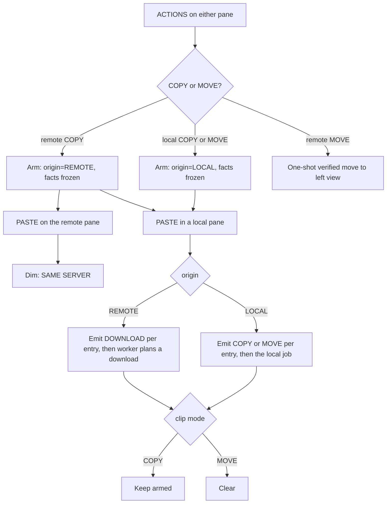

# Remote Clipboard for the FTP Pane - Plan

## Goal Capsule

- **Objective:** From the server listing, one COPY arms the selection and one PASTE puts it in whichever local folder the user is standing in, so a server folder moves like a memory-card folder and the destination can be chosen after the source.
- **Means:** one origin-tagged clipboard whose remote entries paste as downloads (KTD1, KTD2).
- **Product authority:** `STRATEGY.md` (the console is the workspace), `docs/DESIGN.md` (layout law), `docs/DECISIONS.md` D60, D97, D100, D101, and the v1 plan R10, R41, R42, R74.
- **Execution profile:** durable rules first, then the reducer with tests, then the worker direction fix, then the ledger and strings, then the truth pass. The host gate runs on every unit; the console matrix runs once at freeze.
- **Stop conditions:** a second clipboard; a second writer of clipboard state; a new platform header; a remote-to-remote transfer; a ledger row invented outside `docs/DESIGN.md`; a console claim without a hardware row.
- **Not active scope:** FXP, a relay, a unified namespace, server-side copy, remote-to-remote move, path editing.
- **ID scope:** R, KTD, and U numbers here are plan-local. The v1 plan keeps its numbering, amended once by U1.

---

## Product Contract

### Summary

The clipboard currently holds local paths only. A remote COPY arms the selection on the same clipboard, and a paste into either local view downloads it, with folders recursing and folders merging. The remote ledger gains COPY, and CLEAR while a set is armed. A remote clip dies with its session, and a remote destination refuses it with `SAME SERVER`.

### Problem Frame

Every remote action decides its destination before the user acts. DOWNLOAD and MOVE both land in the left local view, so a user who wants a server folder in the right local view must park the left pane there first, then go back to the server, then download. The clipboard already solves this for local files: COPY freezes the set, the user navigates, PASTE applies it. The remote pane is missing that verb, not that model, which is why the gap reads as an asymmetry rather than a missing feature.

The omission has a cost the two-pane layout makes visible. The product claim is that the console is one side of the transfer, not a remote endpoint. A pane whose every operation has a fixed destination is still a place you visit and issue commands from. The clipboard is what makes the server's namespace addressable from the same workspace.

### Requirements

**Clipboard model**

- R1. COPY on the remote pane arms the marked set, or the row under the cursor when nothing is marked, on the shared clipboard.
- R2. MOVE on the remote pane stays the one-shot verified move to the left local view and never arms the clipboard.
- R3. The clipboard records one origin for the set and, per entry, the row type, the size, and whether the size was known when the set was armed.
- R4. Arming a new set replaces the armed one silently, from either pane.

**Paste**

- R5. PASTE on a local pane with a remote-origin clipboard copies every frozen entry into the current folder, recursing a folder and merging an existing destination.
- R6. PASTE on the remote pane with a remote-origin clipboard is dim with `SAME SERVER`.
- R7. A paste of a COPY set keeps the clipboard armed; a paste of a MOVE set clears it.
- R8. A remote-origin paste runs as a download: the destination protection table, the read-only refusal, the free-space preflight, the conflict question, and the one-folder-job rule all apply unchanged.

**Lifecycle**

- R9. A disconnect, a session loss, or a reconnect clears a remote-origin clipboard. A user disconnect reads `DISCONNECTED - CLIPBOARD CLEARED` when a set was armed and `DISCONNECTED` when none was; a session loss adds no status of its own, so the pane's error and the band's return to idle are the record.

**Ledger**

- R10. While a set is armed the ledger order is PASTE, COPY, MOVE, CLEAR, then the pane's remaining rows, on both panes.
- R11. The remote pane offers COPY, dimmed with `NO SELECTION`, `READING`, `NOT CONNECTED`, `UNSAFE NAME`, or `REMOTE ROOT` in those states.

### Key Decisions

- **K1. One clipboard, tagged with an origin.** (session-settled: user-directed — chosen over a second remote clipboard: one set, one band, one CLEAR.) Governs R1, R4, R5.
- **K2. Remote COPY arms; remote MOVE does not.** (session-settled: user-directed — chosen over arming MOVE too: the remote move already has a destination and a verified-delete contract.) Governs R2.
- **K3. A remote source pasted on the remote pane is refused, never relayed.** (session-settled: user-directed — chosen over an FXP or a temp-file relay: one session, no temp space, no new lane rules.) Governs R6.
- **K4. COPY keeps the clip; MOVE clears it.** (session-settled: user-directed — chosen over a one-shot paste: repeated pastes into several folders are the point.) Governs R7.
- **K5. A remote clip dies with its session.** (session-settled: user-directed — chosen over keeping paths across a reconnect: a stale path can copy the wrong bytes, and a move would delete them.) Governs R9.
- **K6. PASTE takes the first row, and COPY and MOVE stay visible beside it.** (session-settled: user-directed — chosen over hiding COPY and MOVE while armed: re-arming must stay one press.) Governs R10.
- **K7. Arming replaces silently.** (session-settled: user-directed — chosen over a confirmation or a CLEAR-first refusal: the dock band already announces the armed set.) Governs R4.

### Acceptance Examples

- AE1. **Server folder into the right local view.** Given a connected site showing a folder with a nested file, when the user marks it, chooses COPY, switches to the right local view, opens `ux0:data/builds`, and chooses PASTE, the tree appears under that folder, the server copy remains, and the band still reads `COPY 1`.
- AE2. **One clip, two destinations.** Given a remote file armed with COPY, when the user pastes into `ux0:data/a`, navigates to `ux0:data/b`, and pastes again, both folders hold a copy.
- AE3. **Server onto itself.** Given a remote-origin clipboard, when the user opens ACTIONS on the remote pane, PASTE is dim with `SAME SERVER`.
- AE4. **The session drops.** Given an armed remote clip, when the connection drops, the clipboard clears and the band returns to the idle hint.

### Scope Boundaries

- **In scope:** the clipboard model, the paste dispatch, the worker's transfer direction, the two ledgers, the strings, and the durable documents.
- **Deferred to Follow-Up Work:** a remote-to-remote relay through local temp, which needs free-space accounting and lane rules this plan does not add.
- **Considered and not built:** a session-generation stamp on the clipboard, because a clip that dies with its session cannot outlive it; an origin tag in the target panel's band, because the pane-aware dock hint covers the one case where the user cannot tell where to paste; repeat-paste for MOVE, because a second paste would target deleted sources; a new design sheet for the armed ledger, because `docs/DESIGN.md` is the layout authority and the existing renders are historical.

### Success Criteria

- A remote folder pasted into a local view produces the same plan as a folder download: one job, one conflict question, one terminal state.
- The operator can copy from the server and paste into either local view without returning to the remote pane between the two presses.

---

## Planning Contract

### Key Technical Decisions

- KTD1. **Keep `clip_paths` and add parallel fact arrays.** The clipboard gains a single origin field and three per-entry arrays (type, size, size-known). Rejected: a struct array, which rewrites roughly thirty `clip_paths[i].text` call sites for no behavioural gain, and a second clipboard, which K1 forbids. `UiState` already carries the 64 KiB path array; the facts add under 1 KiB.
- KTD2. **A remote paste emits the existing download command shape.** One `UI_CMD_RUN_ACTION` per entry with `action = UI_ACTION_DOWNLOAD`, `move = 0`, batch stamps, the frozen path in `path`, and the active folder in `path2`. Rejected: a new command type or a new worker job, because `uistate.c` already routes a remote MOVE as "a DOWNLOAD with a flag" and `transfer_command_kind` already maps the action to the plan direction.
- KTD3. **Direction comes from the command, not the pane.** One predicate answers "does this command download?" — true when the action is DOWNLOAD, or when a `UI_CMD_TRANSFER` came from the remote pane (KTD2). Use it in `enqueue_transfer`, `enqueue_folder_transfer`, and the batch flush's pane normalization. Keep `command->pane` as the issuing view, so prompts and refreshes still name the pane the user is standing in. Rejected: rewriting the pane to remote, which would misattribute the conflict question and the report folder. Note that `UI_ACTION_COPY` is 0, so an untyped workspace transfer carries a COPY action; the predicate must key on the command type rather than treating a zero action as unset. A missed site would classify a remote-path upload as `app`, which counts against the D33 release gate.
- KTD4. **The armed order is computed, not tabulated.** The static `LOCAL_ORDER` and `REMOTE_ORDER` tables cannot express "PASTE first while COPY and MOVE stay visible", so the reducer builds the visible list from a small conditional. The pane's remaining order is unchanged.
- KTD5. **The frozen facts are the plan's input.** A remote folder has no local `stat`, so the arm step must record the row type and size; otherwise a pasted folder is planned as a file. The frozen sizes also bound a single-file paste's free-space preflight, so a file that grew after arming can pass the check and then fill the card mid-transfer; a folder paste is unaffected because the job re-sums during its scan. No remote clip can be a MOVE.
- KTD6. **Clear the clip in the two session funnels, and report it from the callers.** `clear_remote_session` and the `UI_EVT_SESSION_LOST` handler already clear marks; they clear a remote-origin clip silently in the same place. The DISCONNECT branch composes `DISCONNECTED - CLIPBOARD CLEARED` when a set was armed, because it sets its own status right after the call. A session loss adds no status of its own: the pane's error and the band's return to idle are the record. Rejected: clearing at each consumer, which would leave a path where a stale clip survives.
- KTD7. **Remote MOVE keeps its one-shot path untouched.** It already carries `path2` and the move flag, and changing it would turn a verified one-press move into a two-step one.

### High-Level Technical Design

| Source | Destination local | Destination remote |
|---|---|---|
| Remote | download job (new) | refused `SAME SERVER` |
| Local | local copy/move job (existing) | upload (existing) |

### Assumptions

- The armed ledger reaches eight rows in the left local view, nine in the right local view, and ten on the remote pane, so all three scroll. The approved shape said nine; the left view has no switch row, and the remote view must keep CLEAR where the clip was armed while DOWNLOAD's slot holds PASTE. Scrolling is the cost of a discardable, replaceable clip.
- A remote clip is always a COPY set, because remote MOVE does not arm (K2). Repeat-paste therefore never applies to a destructive set.

### Risks & Dependencies

- **Three direction sites, one predicate.** A missed site silently uploads a remote path (reported as `INVALID SOURCE`) or downloads a local one. The integration test must cover both the single-file queue path and the folder-batch path.
- **The local ledger scrolls for the first time.** Eight or nine rows against a seven-row viewport retires the "a local ledger never scrolls" invariant in `src/core/uistate.h` and `docs/DESIGN.md`. On the armed left pane DELETE falls below the fold; on the armed right pane DELETE and SWITCH do.
- **The remote ledger reaches ten rows.** This supersedes D100's eight-row figure. Armed, the rows below the fold are REFRESH, DISCONNECT, and SWITCH, so the scroll indicator and the L/R switch carry more of the navigation. At rest the pane is nine rows.
- **Unsafe names are load-bearing for the destination.** A remote name containing `:`, `/`, or `\` is refused at arm time by R11. Without that refusal, splitting the frozen path for the local destination would treat a server folder such as `/UX0:` as a volume prefix and canonicalize the paste onto a Vita root. The refusal is what keeps `last_segment` and `path_join` safe on a remote path.
- **PASTE displaces DOWNLOAD's row while a set is armed.** Cross still downloads a remote row, so the action is never lost; the row is hidden until CLEAR or a replacing arm. The band and the dock legend carry the Cross binding.
- **A kept local clip can outlive its source.** A COPY set now stays armed after a paste, so a later delete or rename of the source leaves a dead path on the clipboard. The paste fails per item with `SOURCE NOT FOUND`, which is the existing D60 behaviour; no prune is added, because a prune would need to watch a second writer's changes.
- **Stale frozen facts.** A server file that changes between arm and paste copies its current bytes. The frozen size also bounds a single-file paste's free-space preflight, so a file that grew can pass the check and then fill the card mid-transfer; a folder paste re-sums during its scan. Acceptable because the set can only be a copy and the failure is caught by the transfer itself.
- **Matrix growth at freeze.** The console pass gains one row and revises two more rather than running a second time, because the plan assumes M28-M32 have not passed yet. If a b85 console run lands first, this change adds rows to a second pass instead; the board's next action decides which shape applies.

### System-Wide Impact

The reducer owns the new state; the worker gains one predicate; the UI gains one row and a computed order; the docs gain decisions, a feature note, and matrix rows. No port, protocol, or platform surface changes, and no new file enters an allowed-platform-header list.

---

## Implementation Units

### U1. Durable rules: decisions, design, and the v1 plan amendment

- **Goal:** Record the seven product rules and the ledger change before the code depends on them.
- **Requirements:** K1-K7, R10.
- **Dependencies:** none.
- **Files:** `docs/DECISIONS.md`, `docs/DESIGN.md`, `docs/plans/2026-11-08-1103-feat-vitaftpshell-v1-plan.md`, `docs/plans/README.md`.
- **Approach:**
  1. Add seven numbered entries: the origin-tagged clipboard and the remote COPY row; remote COPY arms while remote MOVE stays the one-shot verified move; the remote paste as a download plus the `SAME SERVER` refusal; COPY keeps and MOVE clears; the clip dies with the session; the armed order; arming replaces silently.
  2. In the armed-order entry, supersede D100 item 2's eight-row figure and PASTE-slot clause, and D60's `PASTE first and CLEAR second instead of COPY/MOVE` sentence. State the counts there: nine remote rows at rest, ten armed. Do not rewrite either old entry.
  3. Update the action-panel section of `docs/DESIGN.md`: the remote row list, every per-state remote list (read-only folder, folder job, unsafe name, no selection, remote root), the armed order on both panes, the target-panel strings for a remote COPY and a remote paste, the pane-aware workspace hint, `SAME SERVER` added to the disabled-reason list, and the scroll note for the eight- to ten-row ledgers.
  4. Rewrite R74 in the v1 plan rather than appending beside it: a remote COPY arms, a remote MOVE stays the one-shot verified move, a local-pane PASTE downloads the set including a folder, and DOWNLOAD and UPLOAD accept folders. Point R74 at this plan.
  5. Index this plan in `docs/plans/README.md`.
- **Patterns to follow:** D100 and D101 for entry shape; the `docs/DESIGN.md` action-panel section for the ledger prose.
- **Test expectation:** none — documentation only, checked by the docs gate.
- **Verification:** `python3 tools/check_docs.py --root .` passes; every new D reference resolves; the plan index row exists.

### U2. Clipboard model: origin, frozen facts, arming, lifecycle

- **Goal:** The clipboard can hold a remote set and cannot outlive the session that produced it.
- **Requirements:** R1, R2, R3, R4, R9.
- **Dependencies:** U1.
- **Files:** `src/core/uistate.h`, `src/core/uistate.c`, `tools/test/test_uistate.c`.
- **Approach:**
  1. Add an origin field and the three per-entry fact arrays beside `clip_paths` (KTD1).
  2. Generalize the arm branch: COPY arms from either pane; MOVE arms only from a local pane; MOVE on the remote pane keeps its current one-shot path (K2). Record the type, size, and size-known from the marks, or from the selected row when nothing is marked.
  3. Clear a remote-origin clip in `clear_remote_session` and in the `UI_EVT_SESSION_LOST` handler (KTD6). Write the `CLIPBOARD CLEARED` suffix only on the user-disconnect branch, so a connect attempt clears silently.
  4. Re-prepare an open ledger when the clip dies. The session-loss handler already returns to WORKSPACE when ACTIONS is open on the remote view, because "the ledger's enabled flags describe the dead session"; extend that rule to a local pane holding a remote set, which would otherwise keep PASTE on screen against an empty clip.
  5. Update the `UI_ACTIONS_VISIBLE` comment in `src/core/uistate.h`: the armed local ledger now scrolls too.
- **Patterns to follow:** the existing arm block in `handle_actions_key`; `clear_marks` in the two session funnels.
- **Test scenarios:**
  - Remote COPY with one mark arms one entry with `origin = REMOTE`, the row type, and its size; the status returns to WORKSPACE.
  - Remote COPY with no mark and the cursor on a folder arms that folder with `UI_ROW_DIR`.
  - Remote MOVE still emits the one-shot download-with-move command and leaves the clipboard untouched.
  - A local COPY while a remote set is armed replaces the set and flips the origin.
  - `UI_EVT_SESSION_LOST` clears a remote set to `UI_CLIP_NONE` and leaves a local set armed; the pane's own session message is unchanged.
  - Arm a remote set, open ACTIONS on a local pane, deliver a session loss: PASTE is gone from the visible rows and the target panel no longer reads `CLIPBOARD`.
  - Disconnect clears a remote set and reads `DISCONNECTED - CLIPBOARD CLEARED`; with no set armed it reads `DISCONNECTED`; reconnect after a drop starts with an empty clipboard.
  - Copying a remote folder records its size as unknown when the listing had none.
- **Verification:** the reducer suite passes; a manual trace shows no path where a remote clip survives a session funnel.

### U3. Paste dispatch by origin

- **Goal:** A remote set pastes as a download into the active local folder, and a remote destination refuses it.
- **Requirements:** R5, R6, R7, R8, R10, R11.
- **Dependencies:** U2.
- **Files:** `src/core/uistate.c`, `tools/test/test_uistate.c`.
- **Approach:**
  1. Branch the paste emitter on the clip origin: remote emits DOWNLOAD commands with the destination in `path2`; local keeps COPY or MOVE (KTD2).
  2. Keep the destination checks that already run for a local paste: per-target `path_check_write`, the virtual-root refusal, and the read-only mount refusal.
  3. Skip the `ALREADY HERE` check for a remote origin, because it compares Vita parent paths.
  4. Keep a COPY set armed after the emit and clear a MOVE set (R7).
  5. Dim PASTE with `SAME SERVER` when the active pane is remote and the origin is remote. Apply it after the read-only and job-busy blocks, because `disable()` is last-write-wins and those blocks run later in the remote branch.
  6. Build the armed order as PASTE, COPY, MOVE, CLEAR, then the pane's remaining rows (KTD4).
  7. Dim the remote COPY row with its five reasons. `enabled[]` starts at 1 and the remote branch does not touch COPY, so each reason needs its own `disable()` call; also keep the unsafe-name check ahead of arming, as the local arm path does. Keep COPY live while a folder job runs, because arming freezes paths and touches nothing.
  8. Do not inherit MOVE's `READ-ONLY MOUNT` check against the left local view. A remote set has no destination until PASTE, and the right local view may be writable, so that check would block the flow this feature exists for.
- **Patterns to follow:** the existing paste block and its protection loop; the `SAME DESTINATION` and `NOTHING TO PASTE` refusals.
- **Test scenarios:**
  - A two-file remote set pasted on a local pane emits two batch-stamped DOWNLOAD commands with `move = 0`, the frozen types, and the current folder in `path2`.
  - A remote folder entry emits `source_type = UI_ROW_DIR`, so the worker plans a folder.
  - A remote set pasted on the remote pane dims PASTE with `SAME SERVER` and emits nothing.
  - A remote set pasted on `ALL DRIVES` dims PASTE with `ROOT`.
  - A remote set pasted into a read-only mount dims PASTE with `READ-ONLY MOUNT`.
  - A COPY paste leaves `clip_mode` and the count intact; a MOVE paste clears both. Update the two existing assertions that expect a copy paste to empty the clipboard (`tools/test/test_uistate.c` and `tools/test/test_integration.c`).
  - An armed left-local pane lists eight rows in the order PASTE, COPY, MOVE, CLEAR, then the rest; the armed right-local pane lists nine with the switch last; the armed remote pane lists ten.
  - Two remote entries with one basename still refuse with `SAME DESTINATION`.
  - COPY on the remote pane is dim with `NO SELECTION` on `..`, `UNSAFE NAME` for a name containing `:`, and `REMOTE ROOT` on `/`.
  - COPY and PASTE are dim with `READING` while the remote listing loads, and with `NOT CONNECTED` when the session is down.
  - In a read-only remote folder, and while a folder job runs, a remote set pasted on the remote pane still reads `SAME SERVER`, because that refusal is applied after the read-only and job-busy blocks.
  - COPY stays live in a read-only remote folder, while a folder job runs, and when the left local view sits on a read-only mount.
- **Verification:** the reducer suite passes; the emitted commands match the shape a marked remote download produces today.

### U4. Worker: direction from the command

- **Goal:** A download issued from a local pane is planned as a download, in both the single-file and folder paths.
- **Requirements:** R5, R8.
- **Dependencies:** U3.
- **Files:** `src/app/worker.c`, `tools/test/test_integration.c`.
- **Approach:**
  1. Add one predicate that answers whether a transfer command downloads (KTD3).
  2. Use it in `enqueue_transfer`'s local/remote branch, in `enqueue_folder_transfer`'s direction choice, and in the batch flush where the pane is normalized.
  3. Leave the connection guard in `handle_transfer` as it is: a local-pane download also needs a session, and `NOT CONNECTED` is the right refusal.
  4. Leave `request.origin` as the issuing pane so conflicts name the pane the user is in.
- **Patterns to follow:** the existing upload rewrite in `transfer_batch_flush`; `transfer_command_kind`.
- **Test scenarios:**
  - Connect, arm a remote file with COPY, paste on a local pane: the file lands with its content, the source remains, and the dock reaches its download terminal.
  - Arm a remote folder holding a nested file, paste into a local folder: the tree is created, one job owns the lane, and the conflict question is not asked when the destination is empty.
  - Paste the same remote file into a second local folder without re-arming: the second copy lands.
  - A remote set pasted where the destination file exists asks the conflict question once for the set.
  - A remote folder pasted into a read-only mount fails before the first byte with `READ-ONLY MOUNT`.
  - After the fake peer drops the session, the armed set is gone and PASTE is no longer in either ledger. A queued DOWNLOAD that outlived the session ends `NOT CONNECTED` and writes no local file.
- **Verification:** the integration suite passes; the log shows one `transfer_start` and one `transfer_done` per pasted file, and one folder job per pasted tree.

### U5. Ledger and strings

- **Goal:** The remote pane shows COPY, the armed order reads correctly on both panes, and the target panel says where a paste will land.
- **Requirements:** R10.
- **Dependencies:** U2, U3.
- **Files:** `src/ui/actions.c`, `src/ui/dock.c`, `tools/test/test_render_screens.c`, `tools/preview/preview.c`.
- **Approach:**
  1. Add the remote COPY label, description, and consequence; add the `SAME SERVER` reason where a dimmed row prints its reason.
  2. Make the workspace armed hint pane-aware: on the remote pane with a remote set it reads `COPY n - PASTE IN A LOCAL PANE`, and everywhere else it keeps `TRIANGLE TO PASTE`. Add a remote-paste description that names the server as the source.
  3. Add a preview state: the remote pane with a remote folder armed and ACTIONS open.
  4. Replace the geometry-derived `fit` in `ledger_draw` with `UI_ACTIONS_VISIBLE`, so the row cap has one home, and move the scrollbar-thumb assertion in `tools/test/test_render_screens.c` with the new row counts.
- **Patterns to follow:** the existing action label and consequence tables; `workspace-local-local` in the preview for a constructed state.
- **Test scenarios:**
  - The remote ledger with no clipboard lists DOWNLOAD, COPY, MOVE, NEW FOLDER, RENAME, DELETE, REFRESH, DISCONNECT, SWITCH.
  - With a remote set armed it lists exactly PASTE, COPY, MOVE, CLEAR, NEW FOLDER, RENAME, DELETE, REFRESH, DISCONNECT, SWITCH: PASTE holds DOWNLOAD's slot, so DOWNLOAD is absent and the total is ten.
  - A dimmed PASTE on the remote pane prints `SAME SERVER`.
  - The armed hint reads `COPY n - PASTE IN A LOCAL PANE` on the remote pane with a remote set, and `COPY n - TRIANGLE TO PASTE` on a local pane.
  - The armed left-local ledger lists eight rows and the right-local lists nine; both show the scroll indicator, and its thumb matches the new count.
- **Verification:** the render suite passes; the new preview PNG shows the remote COPY and CLEAR rows without clipping the label column.

### U6. Truth pass

- **Goal:** Every document that states the remote ledger or the clipboard matches the shipped behavior.
- **Requirements:** all.
- **Dependencies:** U1-U5.
- **Files:** `docs/features/2026-11-18-remote-clipboard.md`, `docs/VERIFICATION.md`, `docs/PROJECT.md`, `PROJECTS.md`, `AGENTS.md`, `README.md`.
- **Approach:**
  1. Finalize the feature note with the shipped build and its console status.
  2. Revise the existing M32 row for the ledger, revise M25's `eight-row ACTIONS` phrase and the M28-M32 summary line that also says eight rows, add one row for the remote clipboard flow, and update the counts. The unarmed remote ledger is nine rows; the armed one is ten.
  3. Update the status block in `AGENTS.md` and `docs/PROJECT.md` together, then the public `README.md` feature list and the board row. Update the existing FTP-client row of `docs/PROJECT.md`'s traceability table in place; the docs gate pins that table at three rows.
- **Execution note:** keep the status block byte-identical across its copies; the docs gate compares them. This is a feature, not a defect, so `docs/FIXES.md` stays untouched.
- **Test expectation:** none — documentation only, checked by the docs guard and the link check.
- **Verification:** `./tools/test/run.sh` passes; the matrix reads one row more than before; the public README names the remote clipboard.

---

## Verification Contract

| Gate | Command | Applies to |
|---|---|---|
| Layering, stack, assets, docs, all host suites | `./tools/test/run.sh` | every unit |
| Sanitizers | `./tools/test/asan.sh` | U2-U5 |
| One VPK, stack budget | `./build.sh` | U5 |
| Screen renders | `./tools/preview/run.sh` | U5 |
| Console matrix | `docs/VERIFICATION.md` rows for the clipboard and the ledger | at freeze |

The plan is proven when the reducer suite covers every origin and mode combination, the integration suite pastes a remote file and a remote folder into a local view through the real worker, and the console rows record the same flows on the PCH-1000.

---

## Definition of Done

- Every requirement R1-R11 is implemented or explicitly deferred with a reason.
- A remote COPY arms, a local PASTE lands, and the band survives the paste for a COPY set.
- A remote destination refuses with `SAME SERVER`; a disconnect clears the set.
- The worker plans a local-pane download as a download in both the single-file and folder paths.
- The armed order is PASTE, COPY, MOVE, CLEAR on both panes, and the panel scrolls without clipping.
- The decisions, the design section, the v1 plan amendment, the feature note, the matrix, the fix index, the board, and the public README agree with the code.
- `./tools/test/run.sh`, `./tools/test/asan.sh`, `./build.sh`, and `./tools/preview/run.sh` pass.
- Abandoned attempts are removed: no unused clipboard arrays, no dead branch, and no commented-out second clipboard.
- No console claim is made beyond the rows that actually ran.
